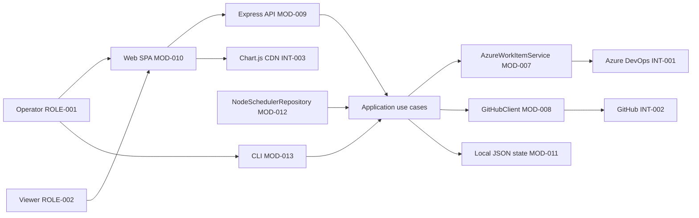
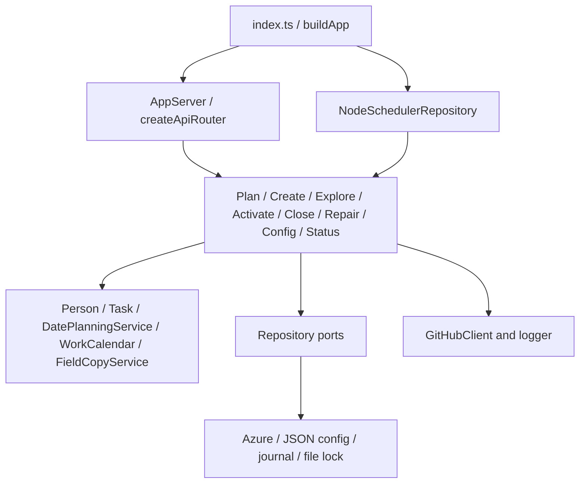
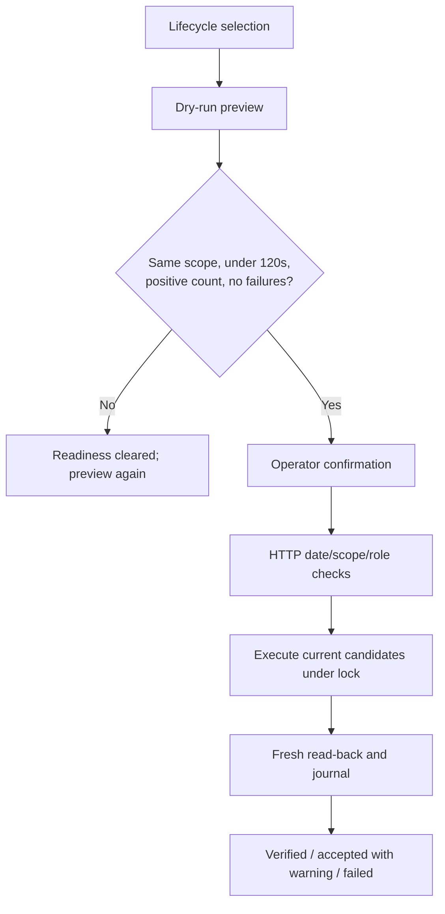
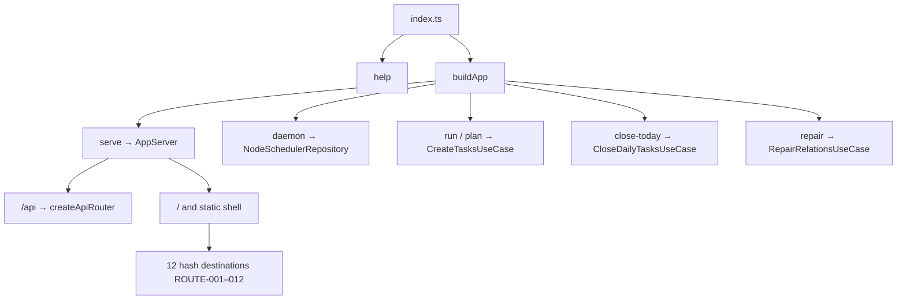
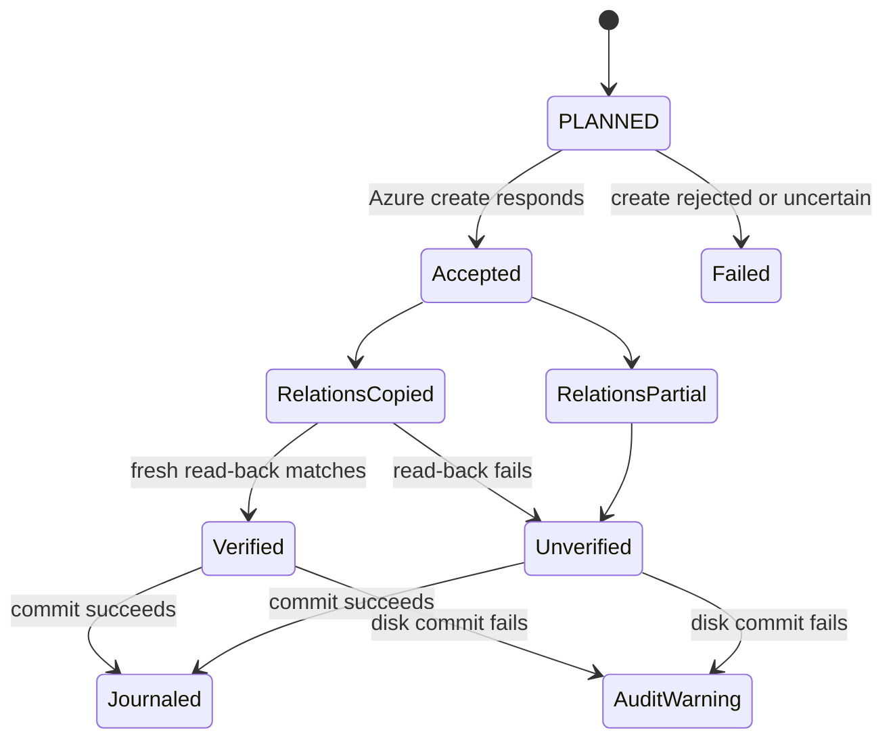

## 1. Document Control

# AzureTasks / 3in1 Task Studio — Single Source of Truth

| Field | Value |
|---|---|
| Repository | AzureTasks; repository-relative root `.` |
| Supported application | `new-app/`, package `azure-3in1-task-creator` 2.0.0 |
| Analysis date | 2026-11-04, Asia/Kolkata |
| Branch / base commit | `main` / `bb1fdeb4c4305874cf738738de04327895eaf506` |
| SSOT version | 1.0 — source-behavior baseline |
| Analyzed revision | Current working tree, including the nine changed files listed below; **not** the base commit alone |
| Method | Repository inventory; connected entry-point/use-case/adapter/UI analysis; test and configuration inspection; parallel specialist evidence review; offline checks; final path/ID/coverage/content audit |
| Audience | Product, engineering, architecture, QA, security, support, operations, and AI coding agents |
| Completion | Repository analysis and documentation complete within the stated offline scope. Runtime acceptance and complete reconstruction remain conditional on section 36/37 evidence. |

The pre-existing/concurrent working-tree changes are `new-app/SECURITY.md`, the three public UI files, `new-app/tests/integration/ui-plan-isolation.test.ts`, `new-app/tests/run-empirical-layout-challenge.mjs`, and the unit tests `empirical-challenger-m1-c2.test.ts` / `empirical-responsive-layout.test.ts`, plus `new-app/src/infrastructure/azure/work-item-service.ts` (initially unstaged, later staged externally; content stable against the recorded baseline). No production source, test, dependency, configuration, or generated repository asset was changed for this analysis. Temporary evidence and isolated compilation were written outside the repository.

`PROJECT_MASTER_PLAN.md` describes intended future behavior and historical evidence as well as current behavior. Its single-document maintenance rule conflicts with this explicit request for `SSOT.md`: this artifact follows the request and does not alter that plan. Here, executable source is evidence of current behavior; a target, old test count, comment, or mock is not proof of implementation or production readiness.

**Evidence convention.** Unless a row says otherwise, a source-backed implementation finding is **Confirmed / High confidence** about source behavior only. “Runtime-Dependent / High” means the dependency or branch is confirmed, while its deployed result is unverified. Inferred findings state their rationale and confirmation step. Partial, Dead or Unreachable, Test-Only, and Unknown are used explicitly. Recommendations are proposals, never implemented claims. Relative paths plus exact symbols are the stable evidence locator; bare source filenames in narrative tables resolve to their unique/contextual exact path in the Source Evidence Index; line numbers are used only when checked. IDs identify one conceptual item and are reused across catalogues.

**Limits.** No private roster values, journal records, credentials, or certificate contents were read into this document. No live tenant calls, remote writes, persisted scheduler startup, production restore, network vulnerability audit, new browser session, or formal accessibility review was performed. Existing `dist/` was not rebuilt or deeply analyzed. One multiprocess test consumes an existing compiled lock implementation, so that passing result is not by itself proof about newly compiled source. Scope and exclusions are explicit in sections 40–42.

## 2. Table of Contents

1. [Document Control](#1-document-control)
2. [Table of Contents](#2-table-of-contents)
3. [Executive Summary](#3-executive-summary)
4. [Product and Business Overview](#4-product-and-business-overview)
5. [Repository Overview](#5-repository-overview)
6. [System Context](#6-system-context)
7. [Architecture](#7-architecture)
8. [Domain and Module Catalogue](#8-domain-and-module-catalogue)
9. [User Roles and Permissions](#9-user-roles-and-permissions)
10. [Feature Catalogue](#10-feature-catalogue)
11. [Functional Requirements](#11-functional-requirements)
12. [Non-Functional Requirements](#12-non-functional-requirements)
13. [Business Rules and Validations](#13-business-rules-and-validations)
14. [User Journey Catalogue](#14-user-journey-catalogue)
15. [Screen and Navigation Catalogue](#15-screen-and-navigation-catalogue)
16. [Routing and Entry-Point Map](#16-routing-and-entry-point-map)
17. [API Catalogue](#17-api-catalogue)
18. [External Integration Catalogue](#18-external-integration-catalogue)
19. [Data Model and Data Flow](#19-data-model-and-data-flow)
20. [State Management](#20-state-management)
21. [Storage and Cache Strategy](#21-storage-and-cache-strategy)
22. [Authentication and Authorization](#22-authentication-and-authorization)
23. [Configuration and Feature Flags](#23-configuration-and-feature-flags)
24. [Error Handling and Recovery](#24-error-handling-and-recovery)
25. [Testing Strategy and Coverage](#25-testing-strategy-and-coverage)
26. [Build, CI/CD, and Deployment](#26-build-cicd-and-deployment)
27. [Logging, Analytics, Monitoring, and Observability](#27-logging-analytics-monitoring-and-observability)
28. [Security and Privacy](#28-security-and-privacy)
29. [Accessibility and Compatibility](#29-accessibility-and-compatibility)
30. [Dependency Inventory](#30-dependency-inventory)
31. [Technical Debt and Code Quality](#31-technical-debt-and-code-quality)
32. [Gap Analysis](#32-gap-analysis)
33. [Risk Register](#33-risk-register)
34. [Traceability Matrices](#34-traceability-matrices)
35. [Reconstruction Blueprint](#35-reconstruction-blueprint)
36. [Runtime Validation Checklist](#36-runtime-validation-checklist)
37. [Known Unknowns and Open Questions](#37-known-unknowns-and-open-questions)
38. [Conflicting Evidence](#38-conflicting-evidence)
39. [Recommendations](#39-recommendations)
40. [Analysis Coverage Report](#40-analysis-coverage-report)
41. [Unanalysed and Excluded Areas](#41-unanalysed-and-excluded-areas)
42. [Source Evidence Index](#42-source-evidence-index)
43. [Glossary](#43-glossary)
44. [Final Conclusions](#44-final-conclusions)

## 3. Executive Summary

3in1 Task Studio helps a configured engineering team inspect daily Azure DevOps task coverage, plan missing work items, create them from validated sources, inspect recorded effort, and operate activation, end-of-day closure, relation recovery, scheduling, audit exports, and GitHub activity evidence. It is a work-operations console; the master plan explicitly rejects treating task completion, recorded hours, or PR counts as attendance or productivity proof (`PROJECT_MASTER_PLAN.md`, §§3–5).

The application is one Node.js process with a vanilla browser SPA and CLI, an Express API, TypeScript use cases and domain rules, Azure/GitHub HTTP adapters, JSON file persistence, and host-local locks/timers. Azure owns the work items. The local journal owns recorded application outcomes. There is no implemented relational database, queue broker, distributed scheduler, SSO, or immutable stored plan/run protocol.

The checked source is materially safer than several historical master-plan findings: activation is wired, journal acknowledgements await persistence, remote verification bypasses the work-item observation cache, relation writes are not automatically replayed, and lifecycle writes preserve actual dates/descriptions/completed effort. These repairs do not close external release gates.

The most consequential current gaps are review/execution drift including failed preview scope (RISK-001), disconnected auto-closure policy enforcement (RISK-002), shared-credential attribution and incomplete auth throttling (RISK-003), host-local persistence/recovery limits (RISK-004), and tenant-dependent date/state/field compatibility (RISK-005). A clean rebuild requires private configuration, fresh credentials, tenant process contracts, operational decisions and design/runtime acceptance evidence, none recoverable solely from source.

## 4. Product and Business Overview

| ID | Domain | Purpose and confirmed implementation evidence |
|---|---|---|
| DOM-001 | Daily task coverage | A member + series + workday is the core coverage unit; discover sources, classify dates and fill gaps. `task.ts`, `date-window.ts`, `task-services.ts`, `plan-tasks.ts`, `create-tasks.ts` under `new-app/src/`. |
| DOM-002 | Team and availability | Configure member identity, source, task series, repository scope, working capacity, holidays and leave. `PersonConfig`, `ConfigUseCases`, `workdayEligibility`. |
| DOM-003 | Lifecycle and automation | Explicit activation/closure, schedule opt-ins and local checkpoints; separate dormant inclusion/exclusion policy subsystem. `ActivateDailyTasksUseCase`, `CloseDailyTasksUseCase`, `NodeSchedulerRepository`, `AutoClosureService`. |
| DOM-004 | Evidence and recovery | Recorded hours and GitHub events, creation/lifecycle journal, relation repair, logs and state backup. `ExploreTasksUseCase`, `GitHubClient`, `RepairRelationsUseCase`, file repositories and scripts. |
| DOM-005 | Access and operation | Shared operator/viewer authentication, local deployment, origin protection, CLI and preflights. `AppServer`, `src/index.ts`, scripts and CI. |

The business objective is documented in `PROJECT_MASTER_PLAN.md` §3: know which tasks should exist, which changes are safe, and what actually happened. Current success is observable as correct scoped rows, no duplicate creation for already represented dates, accepted item IDs, independent read-back evidence, and honest partial/failure results. Target metrics such as two-minute operations, maximum intended team size, future latency budgets and zero ambiguity are **documented targets**, not measured achievements or enforced universal limits.

Human stakeholders are an operations lead, engineers, an auditor/support investigator and a deployment administrator (documented product intent; actual app authorization is only ROLE-001/002). Roster `role`/`pod` fields are organizational metadata; they do not grant HTTP permissions. There is no application self-registration, employee login mapping, tenant provisioning, billing or account lifecycle.

A “series” is the canonical title prefix used to keep independent streams apart. A “source” is an existing Azure item whose permitted fields and relations seed another date. “Coverage” indicates task presence on eligible dates; “effort” is recorded Azure work data. A “verified” local outcome means the implementation's read-back checks passed, not that business work or hours were independently verified.

## 5. Repository Overview

| Path | Type and responsibility | Analysis disposition |
|---|---|---|
| `new-app/src/index.ts`, `container.ts` | CLI/server entry and dependency composition | Analyzed |
| `new-app/src/domain/` | Person/task entities, calendar/date rules, pure services and ports | Analyzed |
| `new-app/src/application/use-cases/` | Planning, execution, exploration, lifecycle, configuration, status, repair | Analyzed, including disconnected alternative |
| `new-app/src/infrastructure/` | Azure/GitHub transports, JSON repositories, lock, scheduler, logger, TLS | Analyzed; `.bak` copies classified separately |
| `new-app/src/presentation/api/` | 30 active HTTP operations, security, limits, read coordination and unmounted policy router | Analyzed |
| `new-app/src/presentation/web/public/` | `index.html`, `app.js`, `styles.css`; 12 hash views | Analyzed |
| `new-app/tests/` | 58 Vitest files, browser suite, restart probe, empirical harness | Analyzed and mapped in §25/42 |
| `new-app/scripts/` | Preflight tools/tests, backups, diagnostic/preview/benchmark utilities, precommit helper | Analyzed |
| `.github/workflows/ci.yml` | Linux checks/browser and macOS/Windows matrix | Analyzed |
| `PROJECT_MASTER_PLAN.md` | Current intent, historical evidence, open gates and roadmap | Analyzed as intent/history, not executable behavior |
| `routes_backup.ts` | Root historical route copy with obsolete relative imports | Dead or Unreachable; outside application tsconfig |
| `.agents/` | Markers plus proposed lock source/patch, old verification utility and test config | Classified historical/nonruntime; see §41 |
| `new-app/people.json` | Private operational roster/configuration | Shape analyzed from ports/loader; values excluded |
| `new-app/.task-journal.json` and archive directories | Local operational evidence | Mechanism analyzed; record contents excluded |
| `new-app/certs/`, `node_modules/`, `dist/`, lockfile | CA asset, third-party packages, generated build and resolution graph | Purpose/version-level inspection only; see §41 |

Stack: TypeScript strict ESM (`NodeNext`, target ES2022), Node 22 CI, Express 5, vanilla JS/HTML/CSS, npm lockfile, Vitest node tests, V8 coverage, ESLint and Prettier. No workspace package manager/monorepo build framework is configured; `new-app/` is the single supported package. Root backup/proposal files are not another application.

Local prerequisites: Node 22-compatible runtime, npm, writable private state directory, trusted network CA where needed, private `people.json` and authorized Azure configuration. GitHub is optional for activity evidence. Browser chart loading depends on the Chart.js CDN (§18). Detailed setup and safe verification boundaries are in §26.

## 6. System Context



The runtime boundary contains one configured organization/project, process memory and local files. Ingress TLS termination is external (INT-004); the server itself creates an HTTP server. CLI/file permissions and shared HTTP credentials are different trust boundaries. External work-item permissions come from the configured Azure PAT, not an authenticated employee identity. GitHub reads use configured token and repository scopes; no GitHub webhook or outbound mutation exists. No mobile application, external CMS, billing integration, or database is found in the supported runtime.

## 7. Architecture

The backend follows ports/adapters in broad structure: presentation invokes use cases, domain services encapsulate identity/date/copy rules, and `WorkItemRepository`/configuration/journal/lock/scheduler ports expose infrastructure. `buildApp` constructs one shared live `AppConfig` and injects repositories. Lifecycle use cases import the concrete GitHub client and logging infrastructure; layering is therefore not fully infrastructure-independent. The browser is a single controller with shared mutable state, not a component framework/store library.



Creation uses `TaskPlanBuilder`, `TaskExecutor` and `TaskResultAggregator`; preview independently uses `PlanTasksUseCase`. Both share date/discovery primitives but do not share a persisted reviewed plan. Read coordination exists separately in browser `api.get`, server `ReadCoordinator`, and Azure work-item observations; these are three different consistency scopes (§21). Writes acquire the shared local execution lock, perform remote work, verify and record outcomes. The journal is an outcome log, not a transaction spanning Azure and disk.

Cross-cutting concerns are origin guards, shared Basic auth, role checks, rate limits, TLS bypass rejection, redaction, atomic file writes, local execution ownership and explicit mutation confirmation. There is no remote revision-bound execution token, distributed transaction or durable background job queue.

## 8. Domain and Module Catalogue

All modules below are **Confirmed / High** as source responsibilities except the explicitly partial/dormant subsystem. Paths are relative to `new-app/src/` unless specified. Test IDs are defined in §25.

| ID / domain | Purpose, public entry and consumers | Dependencies, data/storage, features, tests, risks and evidence |
|---|---|---|
| MOD-001 / DOM-001 | Shared task/date/identity rules used by use cases and Azure adapter | `domain/entities/{task,person}.ts`, `domain/services/task-services.ts`, `domain/value-objects/date-window.ts`, barrel `domain/index.ts`; DATA-001/002/004; FEAT-004–007/010/011; TEST-001/002; RISK-005 |
| MOD-002 / DOM-002 | Roster/settings/calendar load/save for HTTP and CLI composition | `application/use-cases/config.ts::ConfigUseCases`, `domain/services/work-calendar.ts`; DATA-003/005; STORE-001; FEAT-001–003; TEST-003; RISK-006 |
| MOD-003 / DOM-001 | Preview, batch and one-off creation | `plan-tasks.ts`, `task-plan-builder.ts`, `create-tasks.ts`, `task-executor.ts`, `task-result-aggregator.ts`; MOD-001/007/011; DATA-004/006; FEAT-004–006; TEST-004; RISK-001 |
| MOD-004 / DOM-004 | Coverage matrix, task detail and recorded effort | `explore-tasks.ts::ExploreTasksUseCase`; MOD-001/007; DATA-007; FEAT-007–009; TEST-005; RISK-005 |
| MOD-005 / DOM-003 | Activate eligible items and close eligible workday items | `activate-daily-tasks.ts`, active `close-daily-tasks.ts`; MOD-001/007/008/011; DATA-008; FEAT-010/011; TEST-006/007; RISK-002/005 |
| MOD-006 / DOM-004 | Retry missing relations and detect/repair supplied orphan candidates | `repair-relations.ts::RepairRelationsUseCase`; MOD-007/011; DATA-006/009; FEAT-012; TEST-008; RISK-007 |
| MOD-007 / DOM-001 | Azure REST, WIQL, discovery, completeness, remote writes/verification | `infrastructure/azure/{client,work-item-service}.ts`; INT-001, STORE-005; FEAT-001/004–012; TEST-009; RISK-005/007 |
| MOD-008 / DOM-004 | Read-only GitHub identity, PR and commit evidence | `infrastructure/github/github-client.ts`, `domain/services/github-service.ts`; INT-002; DATA-010; FEAT-014; TEST-010; RISK-008 |
| MOD-009 / DOM-005 | HTTP, origin/auth/role/limits/errors/coalescing | `presentation/api/{server,routes,request-origin,rate-limiter,async-handler,env-validation,read-coordinator}.ts`; all active API rows; FEAT-017; TEST-011/012; RISK-003 |
| MOD-010 / all | 12-view browser console, forms, charts, shared reads and dialogs | `presentation/web/public/{app.js,index.html,styles.css}`; HTTP APIs, INT-003; STORE-006/007; FEAT-001–018; TEST-013–018; RISK-001/009 |
| MOD-011 / DOM-004 | Atomic config/journal, audit archives, file lock, redacted logs | `infrastructure/{persistence,config,journal,lock,logging,security}/`; STORE-001–004/008/009; FEAT-015–017; TEST-019/020; RISK-004/010 |
| MOD-012 / DOM-003 | Weekday create/activate/close timers, manual triggers and checkpoint recovery | `infrastructure/scheduler/node-scheduler-repo.ts`; MOD-002/003/005/011; FEAT-013; TEST-021; RISK-011 |
| MOD-013 / DOM-005 | CLI and dependency composition | `index.ts::parseArgs/main`, `container.ts::buildApp`; all use cases, starts scheduler only for permitted modes; TEST-012/020/021; RISK-004 |
| MOD-014 / DOM-005 | Setup, build, quality gates, diagnostics and offline backup/preflights | `new-app/scripts/*`, package/config files, `.github/workflows/ci.yml`; FEAT-001/015; TEST-022/023; RISK-012 |
| MOD-015 / DOM-003 | Inclusion/exclusion policy, admin checks and dedicated closure audit | `domain/entities/auto-closure-config.ts`, `domain/services/auto-closure-service.ts`, `presentation/api/auto-closure-routes.ts`, alternative `close-daily-tasks-updated.ts`; DATA-011; STORE-008/009; FEAT-019; TEST-024. **Partial / Dead or Unreachable in production flow**; RISK-002 |

## 9. User Roles and Permissions

| ID | Actor | Implemented boundary | Permission and limitation evidence |
|---|---|---|---|
| ROLE-001 | Operator | Verified shared Basic credentials when configured; implicit operator when development auth is absent | Reads, config/token updates, task writes, scheduling, repair and exports; mutation-specific confirmation/scope still applies. `server.ts::basicAuth`, `routes.ts::createApiRouter`. Shared credential is not personal attribution. |
| ROLE-002 | Viewer | Optional different shared Basic credential, or explicit server read-only option | GET/HEAD/OPTIONS plus plan and `dryRun:true` activation/EOD previews. Server rejects other writes; lifecycle handlers check parsed dry-run again. UI disables selected static controls and its POST guard rejects writes; dynamic controls can remain visually actionable. `AppServer.configure`, `api.post`, `applyViewerMode`. |
| ROLE-003 | Local operator/administrator | OS process and filesystem access, outside HTTP Basic | CLI, daemon, private config/credentials, backup/restore and deployment. No per-person authorization in CLI. |
| ROLE-004 | Scheduled automation | Configured host process with same Azure authority | All enabled creation members; activation/closure additionally use member `autoCloseEnabled` eligibility. Not an independently authenticated human role. `container.ts` scheduler callbacks. |

| Capability | Operator | Viewer | Local admin | Scheduled process |
|---|---|---|---|---|
| Inspect coverage/config/journal/logs/GitHub | Yes | Yes | Through code/tools | As needed |
| Preview plan/lifecycle | Yes | Yes | Yes | Internal replanning |
| Create/activate/close | Confirmed request | No | CLI available for create/close | Only configured jobs |
| Edit roster/calendar/settings/credentials | Yes | No | Files/tools | Checkpoints/settings only |
| Repair / scheduling controls | Confirmed request where required | No | Yes | Triggers its callbacks |
| Backup/restore state | No HTTP endpoint | No | Script/OS access | No |

There is no supported administrator/auditor/engineer SSO role or “my tasks only” permission. My Work is a chosen member filter, accessible to any authenticated viewer. `AutoClosureService.checkConfigurationAuthorization` checks configured admin names only in the unmounted policy implementation; it is not an active server role. No logout endpoint, refresh token or app-owned session expiry exists (§22).

## 10. Feature Catalogue

Each row supplies the business purpose, actor, precondition, principal/alternate behavior, linked requirement/flow/API/test and implementation evidence. Shared errors/storage/flags are expanded in §§13–24; missing immutable review/policy/runtime links are explicit gaps. “Operator” below includes authorized local invocation only where an equivalent CLI exists.

| ID / purpose | Actors, trigger and behavior | Classification; dependencies and evidence | Trace |
|---|---|---|---|
| FEAT-001 Connection/setup | Operator configures organization/project/PAT; any reader checks status; health only checks HTTP, ready checks Azure project/type. Missing token is disconnected, not healthy. | Confirmed; MOD-002/007/009, `get-status.ts::execute`, settings UI; actual connectivity Runtime-Dependent | FR-001; FLOW-001; API-002–005/009/010; TEST-003/011 |
| FEAT-002 Team | Operator adds/edits/removes/enables members, source/prefix/GitHub scopes and closure toggle, saves roster. Dirty-state feedback; save failure retains draft. | Confirmed; `ConfigUseCases.savePeople`, `renderPeople`, `savePeople`, STORE-001 | FR-002; FLOW-002; API-008; TEST-003/015 |
| FEAT-003 Calendar | Operator changes planned capacity and holiday/leave exceptions; version conflict requires reload. Eligibility informs plan/Explorer/ad-hoc, not proof of actual effort. | Confirmed; `workdayEligibility`, `validateWorkCalendar`, `loadCalendar`/`saveCalendar`; STORE-001 | FR-003; FLOW-003; API-006/007; TEST-003/015 |
| FEAT-004 Preview | Reader selects enabled members, reference date/mode; per-member progressive preview classifies source, duplicates, weekends/calendar and gaps. Empty scope cannot execute. Partial member loads can still enable execute: GAP-001. | Partial; `PlanTasksUseCase.execute`, `runPlanPreview`; transient DATA-004, no stored plan | FR-004; FLOW-004; API-011; TEST-004/014 |
| FEAT-005 Batch create | Operator confirms reviewed UI; server reselects/replans current scope, locks, creates eligible gaps, copies safe relations, fresh-verifies and journals. Per-item/source/audit failures are separate. | Confirmed creation, Partial review binding; `CreateTasksUseCase.execute`, `TaskExecutor`; STORE-002/003 | FR-005/020; FLOW-005; API-012/018; TEST-004 |
| FEAT-006 One-off/ad-hoc | Operator selects exact member/date, optional title/source/estimate/activity/description; confirms; no duplicate bypass allowed. Rejects disabled member, past date, ineligible calendar and invalid source. | Confirmed; `executeAdHocTask`, `openAdHocModal`, `createSingleCellTask`; STORE-002/003 | FR-006; FLOW-006; API-013; TEST-004/014 |
| FEAT-007 Explorer | Reader picks members/preset/date range and sees matrix/list, missing/duplicate/calendar states and item detail; exact cell creation uses ad-hoc. “Create missing” uses creation window, not arbitrary Explorer displayed bounds. | Confirmed; `ExploreTasksUseCase.execute`, `refreshExplorer`, `openDateInspectModal`; DATA-007 | FR-007; FLOW-007; API-017/018; TEST-005/014 |
| FEAT-008 My Work | Reader chooses member; same Explorer service returns scoped recent tasks. Late old-member results ignored. Does not establish personal access isolation. | Confirmed; `refreshMyWork`, `renderMyWorkContent` | FR-008; FLOW-008; API-017; TEST-005/014 |
| FEAT-009 Effort/coverage | Reader inspects monthly table of recorded effort and statuses; current-week charts are on Dashboard; absent work stays unknown. No historical snapshot series establishes true burndown. | Confirmed current aggregation; `loadBurndownMonth`, `renderBurndownTable`, Explorer summaries | FR-009; FLOW-009; API-017; TEST-005/014 |
| FEAT-010 Activation | Reader previews; operator confirms current workday/member scope; exact matching nonterminal items not already Active become Active. Descriptions, actual dates and work fields preserved. | Confirmed; `ActivateDailyTasksUseCase.execute`, `lifecycleSelection`, `triggerActivation`; tenant states Runtime-Dependent | FR-010; FLOW-010; API-016/025; TEST-006/016 |
| FEAT-011 EOD closure | Reader dry-runs; operator confirms today's eligible scope; final items skipped, remaining work zeroed, state Closed, preserved description/completed work/actual dates, fresh read-back and audit warnings. | Confirmed; active `CloseDailyTasksUseCase.execute`, `triggerEodClosure`; policy rules not enforced | FR-011; FLOW-011; API-015/026; TEST-007/016 |
| FEAT-012 Relation repair | Operator confirms; iterate journal entries with accepted target + unfinished relations, copy missing permitted links, read back, amend entry. Extended orphan repair requires supplied candidates/source. | Confirmed; `RepairRelationsUseCase.execute/repairOrphanTasks`; STORE-002/003 | FR-012; FLOW-012; API-014; TEST-008 |
| FEAT-013 Scheduling | Operator saves times and independent global opt-ins, enables scheduler or manually triggers. Local timers/checkpoints gate duplicate daily attempts; errors visible. | Confirmed / Runtime-Dependent firing; `NodeSchedulerRepository`, `container.ts`; STORE-001/003 | FR-013; FLOW-013; API-021–026; TEST-021 |
| FEAT-014 GitHub evidence | Readers inspect date-local PRs and explicit-repository/branch commit evidence; missing config/errors/partial search are distinct from no events. | Confirmed; `GitHubClient`, `formatPrTaskDescription`; STORE-010 | FR-014; FLOW-014; API-027/028; TEST-010 |
| FEAT-015 Activity/export/recovery | Reader inspects main journal and CSV/JSON; local admin backs up/verifies/restores selected state. Failed journal persistence cannot undo accepted Azure writes. | Confirmed; file journal, activity UI, `state-backup.mjs`; STORE-002 | FR-015/021; FLOW-015/019; API-019/020; TEST-019/022 |
| FEAT-016 Logs/console | Reader filters/searches recent/live redacted log stream, follows sticky tail, clears local buffer and opens drawer. Memory logs reset on restart. | Confirmed; `logger.ts`, SSE routes, `connectLogStream`/`renderLogStream`; STORE-004 | FR-016; FLOW-016; API-029/030; TEST-017/020 |
| FEAT-017 Access protection | Browser Basic challenge, viewer denial, origin validation, rate limits, production token requirement and TLS bypass rejection. No app logout/SSO. | Confirmed controls, Runtime-Dependent deployment; `AppServer`, `unsafeRequestOriginGuard` | FR-017; FLOW-017/020; API-001/002; TEST-011/012 |
| FEAT-018 Navigation/preferences | Reader changes 12 hash views, theme, responsive nav, keyboard dialogs; only theme persisted in localStorage. Unknown hash falls back to dashboard. | Confirmed; `switchView`, `wire/bootstrap theme handlers`, modal helpers; STORE-006/007 | FR-018; FLOW-018; ROUTE-001–012; TEST-013/018 |
| FEAT-019 Closure policy/audit | Standalone inclusion/exclusion rules/admin checks/versioned config and dedicated audit/export methods exist; no normal UI/API mounting or active closure enforcement. | Partial / Dead or Unreachable; MOD-015, `createAutoClosureRouter`, alternative closure file | FR-019; FLOW-021; API-031–036; TEST-024; GAP-002 |

## 11. Functional Requirements

These are testable descriptions of current behavior, not a new implementation specification. For each row, the acceptance criterion states the observable check. Preconditions, actors, trigger, alternate/failure paths and business purpose inherit the linked FEAT/FLOW entry; API and source links inherit the feature trace. Confirmed/High applies except the explicitly partial/dormant requirements. Automated coverage means fixture assertions, not production acceptance.

| ID | Requirement statement and acceptance criterion | Related items / classification |
|---|---|---|
| FR-001 | The system shall report HTTP liveness separately from Azure readiness when a reader requests health, resulting in dependency status without a false connectivity claim. AC: health says dependencies unchecked; unavailable Azure makes ready 503. | FEAT-001; FLOW-001; TEST-011 |
| FR-002 | The system shall validate and persist the roster when an operator saves team settings, resulting in unique keys/identities and updated live configuration. AC: duplicate identity fails; a valid save does not create Azure work. | FEAT-002; BR-001; VAL-001; TEST-003/015 |
| FR-003 | The system shall apply validated availability exceptions when planning/exploring a member workday, resulting in excluded zero-capacity dates and reported positive capacity. AC: holiday affects all scoped members; leave affects selected members; stale calendar version fails. | FEAT-003; BR-003; VAL-003; TEST-003 |
| FR-004 | The system shall preview eligible date decisions when a reader selects members/date/mode, resulting in source and planned/duplicate/excluded classifications without remote mutation. AC: empty explicit selection fails; missing source produces source failure. | FEAT-004; BR-002–005; VAL-002/004; TEST-004/014. Partial: reviewed result not immutable. |
| FR-005 | The system shall create planned missing tasks when an operator confirms an explicit HTTP scope, resulting in per-member/date accepted IDs and separate task/relation/audit outcomes. AC: duplicate dates are skipped; one failed date does not erase accepted creations. | FEAT-005; BR-004–007; FLOW-005; TEST-004 |
| FR-006 | The system shall create at most the requested single eligible workday task when an operator confirms an ad-hoc request, resulting in an accepted item or explicit rejection. AC: invalid source/date/disabled member/duplicate fails; custom title must identify the target series/date. | FEAT-006; BR-002/003/004/006; VAL-005; TEST-004/011 |
| FR-007 | The system shall classify selected members' workdays when a reader requests Explorer, resulting in matrix/list cells, scoped totals and creation eligibility. AC: 121-day range rejected; historical gaps shown but not eligible for creation; duplicates counted separately from single-task coverage. | FEAT-007; BR-008; VAL-006; TEST-005/014 |
| FR-008 | The system shall show the chosen member's current-month assignments when a reader opens My Work, resulting in member-filtered data and rejection of obsolete old-member responses. AC: changing member during a read cannot replace new results with old data. | FEAT-008; TEST-014 |
| FR-009 | The system shall preserve unknown work values when a reader inspects effort, resulting in unrecorded values distinct from recorded zero. AC: no synthetic completed hours and no historical burndown assertion. | FEAT-009; BR-009; TEST-005/014 |
| FR-010 | The system shall attempt activation when an operator confirms today's matching member scope, resulting in Active or a recorded failure while preserving user fields. AC: terminal/already Active records skipped; no replay or fabricated actual date on tenant rule error. | FEAT-010; BR-010; VAL-007; TEST-006 |
| FR-011 | The system shall attempt closure when an operator confirms today's matching member scope, resulting in Closed and RemainingWork=0 while preserving completed effort, description and actual dates. AC: terminal records skipped; live non-today HTTP/CLI request rejected; accepted unverified result remains distinguishable. | FEAT-011; BR-010/011; VAL-007; TEST-007 |
| FR-012 | The system shall repair missing permitted links when an operator confirms journal repair, resulting in independent verification and amended relation status. AC: no target ID is skipped; a failed entry does not prevent later entries; no new task is created by repair. | FEAT-012; BR-007; TEST-008 |
| FR-013 | The system shall schedule configured weekday jobs when automation is enabled, resulting in local execution and durable activation/closure attempt checkpoints before remote work. AC: checkpoint persistence failure prevents lifecycle callback; empty/failure EOD is not automatically retried that day. | FEAT-013; BR-012; TEST-021 |
| FR-014 | The system shall retrieve date-local GitHub activity when a reader requests evidence, resulting in scoped PR/commit evidence rather than proof of completed work. AC: incomplete direct PR search fails; daily summary's suppressed failures remain a documented limitation. | FEAT-014; BR-013; TEST-010; GAP-003 |
| FR-015 | The system shall preserve accepted-operation journal outcomes when a reader requests activity or export, resulting in active plus archived evidence and spreadsheet-safe CSV. AC: corrupt audit state fails rather than resetting; relation repair amends existing evidence. | FEAT-015; BR-014; TEST-019 |
| FR-016 | The system shall publish sanitized recent/live logs when a reader opens logs, resulting in bounded process-local history and SSE cleanup after disconnect. AC: initial 100 replay, then events and 15-second heartbeat; memory buffer capped at 500. | FEAT-016; OBS-001/002; TEST-017/020 |
| FR-017 | The system shall enforce server-derived viewer access when viewer credentials are used, resulting in read/preview access and denied mutations. AC: spoofed client role does not grant writes; production without operator token refuses startup. | FEAT-017; SEC-001/002; TEST-011/012 |
| FR-018 | The system shall navigate named hash destinations when a reader uses navigation/back/forward, resulting in one active view, accessible current-page indication and theme persistence where available. AC: unknown destination falls back; storage failure does not prevent theme application. | FEAT-018; TEST-013/018 |
| FR-019 | The standalone policy subsystem shall reject closure eligibility when disabled, ruleless, excluded or unmatched by an existing inclusion set, resulting in a service-level decision. AC: exclusions take precedence; exclusions-only permits a nonmatching user; empty admin list denies config authorization. | FEAT-019; BR-015; TEST-024; Partial / unreachable through supported runtime, not a real EOD guarantee. |
| FR-020 | The system shall distinguish accepted remote writes from verification/audit failures when execution returns, resulting in warnings instead of falsely claiming the Azure item was not created. AC: failed read-back or journal write after acceptance retains item identity. | FEAT-005/010/011; ERR-004; TEST-004/007 |
| FR-021 | The system shall validate offline state backups before local restore when an administrator confirms recovery, resulting in verified hashes and a new/empty target only. AC: tampering, symlinks, live lock or legacy secret fields block; credentials restored separately. | FEAT-015; FLOW-019; TEST-022 |

## 12. Non-Functional Requirements

No source evidence establishes a production SLA, RPO/RTO, formal accessibility certification, complete browser support matrix, or tested maximum team throughput. The master plan's target budgets are not current measured requirements. The following are confirmed implementation characteristics; their deployed effectiveness is Runtime-Dependent.

| ID | Characteristic and evidence | Limits / verification |
|---|---|---|
| NFR-001 | Performance: client max50 read cache/30s default freshness; server max100 pending coalesced scopes; Azure max1000 observations/30s. `api.get`, `ReadCoordinator`, `getWorkItem`. | TEST-009/014/023; browser and live provider latency unmeasured. Synthetic call reduction is not equivalent latency gain. |
| NFR-002 | Reliability: read/WIQL retries bounded; write non-replay; awaited journal; lifecycle checkpoints before callbacks. `AzureDevOpsClient.request`, file journal, scheduler. | No remote/local transaction or durable intent recovery. RISK-004/007. |
| NFR-003 | Security/privacy: shared auth roles, exact-origin guard, TLS safety, output escaping/redaction, private main files. `AppServer`, logger, AtomicFileWriter callers. | No SSO, complete content validation, security certification or comprehensive secret detection. SEC-001–008. |
| NFR-004 | Availability/scalability: single process, local timers and exclusive local lock; no replicas/failover configured. | Multi-host not supported by evidence. Persistent-volume/network topology external. |
| NFR-005 | Maintainability: strict source TS, separate test typecheck, interfaces/use-case layering and quality CI. | Large browser controller, concrete infrastructure imports, dormant copies; CLI/container excluded coverage. |
| NFR-006 | Accessibility/responsiveness: semantic nav/dialogs, keyboard buttons/focus, responsive layouts, chart motion preference. | Observed implementation, no conformance target verified; CSS animation and dynamic-dialog gaps (§29). |
| NFR-007 | Compatibility/localization: CI uses Node22 on Linux/macOS/Windows; browser suite Chromium synthetic data. English UI, Intl/IANA business timezones. | No locale switch, native mobile app, Safari/Firefox acceptance or DST guarantee. Shell start scripts need suitable shell on Windows. |
| NFR-008 | Recoverability/retention: hash-verified offline backup/restore for roster and journal; main journal rotation with no automatic pruning. | No measured recovery objectives or deployed restore rehearsal; policy stores excluded backup. |
| NFR-009 | Observability: structured local logs, SSE, status/liveness/readiness and selected Server-Timing headers. | No deployed external collector, alerting, uptime probes or trace correlation evidenced. |

## 13. Business Rules and Validations

Business rules explain domain decisions; validations explain the implemented input gates. Confirmed/High applies unless marked. The linked features/flows identify affected APIs. Precedence and inconsistencies are material to reconstruction.

| ID | Rule, input/condition → outcome and exceptions | Source / affected items |
|---|---|---|
| BR-001 | Enabled roster members participate; identity is trimmed/case-insensitive exact account match when Azure uniqueName exists; display-name equality only fallback without account. No substring or cross-domain match. | `person.ts::matchesPerson/identitiesMatch`; FEAT-002/004–011. String-only source ownership overload is weaker: CONFLICT-004. |
| BR-002 | Plan today/future through inclusive configured stop day. Request mode overrides config. CURRENT includes current stop day; FOLLOWING uses special Friday/current-stop +7 handling, otherwise next target. Future template does not hide earlier gaps. | `date-window.ts::getNextThursdayIso/planCreationDates`, `DatePlanningService`; FEAT-004/005. Naming “Thursday” persists for configurable stop day. |
| BR-003 | Weekend exclusion precedes availability. Capacity member override → calendar default → 8; relevant exceptions reduce to minimum; eligible only >0. Global empty-member holiday applies everyone; member leave explicit. Positive reduced capacity does not rewrite cloned estimate. | `work-calendar.ts::workdayEligibility`; FEAT-003–007; GAP-004. |
| BR-004 | Member/series/date with one item is a duplicate skip; >1 is multiple-existing warning/duplicate. Malformed/incomplete Azure batch responses fail closed; an individual item whose workday cannot be proved can be skipped from the duplicate map with a warning, so this does not prove zero duplicate risk for ambiguous historical data. A date with accepted existing work must not be recreated through bypass. | `DuplicateDetector`, Azure existing task query, create/ad-hoc; FEAT-004–007. No distributed idempotency key. |
| BR-005 | Explicit source/per-person/default source must belong to project/type/member/series and not a parent container. Preferred source selection uses workday ordering rather than only CreatedDate. Default source cannot silently seed another owner. | `validateSourceTaskOwnership`, `AzureWorkItemService.discoverLatestTasksForPeople`; FEAT-004–006. |
| BR-006 | New task overrides title, assignee, configured state, zoned StartDate and custom planned dates; copies eligible scalars/area/iteration. Excludes system-managed/lifecycle/WEF fields. Estimates copied only with flag; reset actual work adds zero CompletedWork and finite source estimate as RemainingWork. GenAI default supplied if absent. | `task-services.ts::FieldCopyService.buildFieldPatchOperations`; FEAT-005/006. Inferred end-time defaults have `parseInt(...)\|\|fallback` boundary risk (§33). |
| BR-007 | Only parent/Related/Dependency/Duplicate/Hyperlink/ArtifactLink whitelist may copy. No child links or binary attachment copying. Field creation and relation copy are separate nontransactional writes. Repair adds only missing permitted links and verifies. | `task.ts::COPYABLE_RELATION_TYPES`, `RelationCopyService`, `copyRelations`; FEAT-005/006/012. Normal adapter can retain duplicate allowed links: GAP-005. |
| BR-008 | Explorer status precedence: weekend → calendar exclusion → duplicate/created → missing → not applicable. Historical gaps displayed but cannot create; future gap only eligible inside creation window. Coverage = rounded exactly-one-item cells / eligible days, excluding duplicate cells from numerator. | `ExploreTasksUseCase.execute`; FEAT-007–009. Existing excluded-day tasks still contribute state/hour totals. |
| BR-009 | Missing/invalid/negative effort is unknown, not fabricated actual work. Task completion/PR presence is not proof of hours. Closure preserves completed work and actual fields. | Explorer and active lifecycle patch builders; FEAT-009/011. Invalid closure numeric reporting has less strict null normalization (§19). |
| BR-010 | Match correct member/series/workday and exclude story/container before lifecycle write. Already terminal Closed/Done/Resolved/Completed or ClosedDate skips; activation also skips already Active, but can attempt other nonterminal states. Explicit selection overrides member opt-out; implicit all uses autoCloseEnabled != false for activation and closure. | Active lifecycle `execute`; FEAT-010/011. This is not universal tenant state mapping. |
| BR-011 | Closure only adds RemainingWork=0, History and State=Closed; activation adds State=Active and History. No bypassRules, invented actual times, replacement descriptions or fallback mutation replay. Fresh read-back/audit failure does not undo accepted state change. | Active lifecycle patch arrays; FR-010/011/020. Lower-level adapter accepts bypass option but supported callers pass false. |
| BR-012 | Scheduler uses weekdays independently of skipWeekends; global create/activation/closure opt-ins separate. Activation/EOD attempt checkpoint persists before callback; EOD empty or failed attempt suppresses unattended same-day retry. Manual triggers can run while scheduler/automation is disabled. | `NodeSchedulerRepository`, `container.ts`; FEAT-013; FLAG-001–004. Creation has no durable daily attempt checkpoint. |
| BR-013 | Direct deliverables use PRs created local workday plus authored commits from explicit repo/branch scopes; daily summary also includes updated PRs. No configured commit repositories means no commit evidence. Derived username is a candidate, not verified identity. | `GitHubClient`, `github-service.ts`; FEAT-014. Daily summary suppresses per-member failure; repo filtering uses bare repo name: GAP-003/006. |
| BR-014 | Corrupt main audit/config must not be replaced with empty state. Journal acceptance waits for file commit; archives remain queryable. CSV values beginning spreadsheet formula characters are neutralized. | File repositories and exports; FEAT-015. Main journal fsync is not a remote transaction or parent-dir fsync guarantee. |
| BR-015 | Dormant policy denies when disabled or rules empty; exclusions override inclusion. If inclusions exist at least one must match; if rules are exclusions-only and none match, it permits closure. Match users/teams/roles case-insensitively; empty admin list denies config changes. | `AutoClosureService`; FEAT-019 only. Does not constrain FEAT-011. |

| ID | Implemented gate, failure/precedence and evidence | Related rule / API |
|---|---|---|
| VAL-001 | Roster array, nonempty name/assignee/key (save may derive key); unique trimmed case-sensitive keys and normalized assignees. GitHub repos ≤12 valid owner/repo; branches ≤12, ≤128 chars, allowed characters, no `..` or edge `/`. `validatePerson`, `savePeople`, config load. | BR-001; API-008. Case-folded key collisions still possible across consumers. |
| VAL-002 | HTTP personKeys nonempty string array, trim, no duplicates, cannot combine all=true; mutation scope required; preview omission may mean all. Explicit literal confirm is required for task execution/ad-hoc/repair/lifecycle and manual scheduler jobs, not generic settings/toggle saves. `resolvePersonScope`. | BR-001; API-011/012/015/016/018. CLI implicit-all differs. |
| VAL-003 | Calendar version safe integer≥0 and equal current; hours 0–24 max2 decimals; member refs known; ≤1000 exceptions; IDs unique `[A-Za-z0-9_-]{1,80}`; label1–120; real ordered dates; leave explicit members; holiday availability0; no duplicate member keys; selected member capacity ceiling. `validateWorkCalendar`, `saveSettings`. | BR-003; API-007/009; conflict409 only calendar route. |
| VAL-004 | Canonical real YYYY-MM-DD not past for create/plan; stop mode CURRENT/FOLLOWING enforced by CLI and normalized config but not comprehensive runtime request schema; valid IANA zones/time strings HH:mm on settings/scheduler. | BR-002; API-009/011/012/023. Window start≤end not checked for closure schedule. |
| VAL-005 | Ad-hoc member/date/confirm required; positive safe source ID; finite estimate≥0; bypass true rejected; enabled member, calendar/date and ownership/custom-title validation inside use case. | BR-003–006; API-013. JSON numeric strings normalized at HTTP boundary. |
| VAL-006 | Explorer start≤end, real dates, ≤120 inclusive days; explicit nonempty known enabled selection. Query users empty becomes omission at HTTP boundary; client avoids empty query. | BR-008; API-017. Selection accepts key/email/name case-insensitively. |
| VAL-007 | Literal dryRun for viewer previews; current-day-only live lifecycle at HTTP/CLI boundary; literal confirm true + explicit mutation scope. `routes.ts`, `index.ts`. | BR-010/011; API-015/016. Direct use-case callers have fewer boundary gates. |
| VAL-008 | Journal/log limit strict positive integer string, max1000 (defaults100/300). Scheduler enabled/persist/opt-ins literal booleans. | API-019/021–026/029; `parsePageLimit`, route controls. |
| VAL-009 | Production operator token; distinct viewer token; viewer cannot stand alone; exact public origins; numeric/localhost listen host; TLS bypass forbidden. | SEC-001–004; AppServer/TLS/origin guard. |
| VAL-010 | Nonempty PAT/GitHub saves; external secret mode refuses file persistence; template/placeholder scanning is advisory, not credential validity proof. | API-009/010; FileConfigRepository; CONFLICT-002. |

## 14. User Journey Catalogue

All flows are confirmed source paths unless marked dormant. Entry screens/routes and APIs are defined in §§15–17. Roles, requirements and tests follow the matching feature row. Common session behavior: native Basic credentials attach to same-origin requests; no app refresh/logout; HTTP failure becomes visible error or explicit per-view fallback. No durable browser resume of previews/runs is implemented. Common cancellation: confirm/dialog Cancel, Escape/backdrop/back navigation before submission performs no remote write; closing UI after submission does **not** cancel or roll back accepted server work. There is no API cancellation protocol or guaranteed request abort after navigation. No dedicated business-journey analytics exists.

| ID | Actor, objective, trigger/preconditions/start | Main steps, decisions, alternatives and exits | State/storage, error/retry and coverage |
|---|---|---|---|
| FLOW-001 | Operator/reader; connect and assess; Settings or Dashboard with private config | Save nonsecret config; supply credential using configured storage mode; check status/ready. Missing PAT disconnected; invalid project/type ready503. Exit on visible read status, not write authorization. | API-003–005/009/010; DATA-003, STORE-001; failed save retains inputs; TEST-003/011. |
| FLOW-002 | Operator; maintain team; Team | Load draft unless dirty; edit/remove; Save full roster. Add validates then immediately saves entire draft. Successful save prunes existing selections without widening; failure leaves dirty draft. | API-008; STORE-001, STATE-006; no Azure task synchronization. No general roster version conflict; TEST-003/015. |
| FLOW-003 | Operator; availability; Calendar | Fresh-load; add/remove zero-hour holiday/leave; save entire versioned calendar. Stale version409; refresh/re-entry can discard draft. UI does not edit all API capacity fields. | API-006/007; STORE-001, STATE-006; no undo history; validation preserves failed save draft; TEST-003/015. |
| FLOW-004 | Reader; preview gaps; Planner with selected enabled members | Select date/mode; clear old readiness; up to3 member reads; progressively merge. Empty selection exits with no request. Missing source/duplicate/calendar classifications shown. Some member failures leave partial result and may enable execute. | API-011; STATE-001/002, STORE-006; scope/version guards reject obsolete responses. Retry preview; TEST-004/014; GAP-001. |
| FLOW-005 | Operator; batch create; current preview/signature | Review planned titles; cancel or confirm; recheck signature/in-flight flag; submit selectors; server locks/replans/creates/links/verifies/journals; show accepted IDs and partial warnings; invalidate preview/read caches. | API-012/018; STATE-003, STORE-001/002/003/005/006. No stored reviewed plan; no all-or-nothing rollback. Inspect accepted IDs before retry. TEST-004/014. |
| FLOW-006 | Operator; exact workday task; Explorer cell/Planner ad-hoc | Choose member/date/options; confirm; validate duplicate/calendar/source; create one task; require returned ID for cell success; refresh work/plan; close only success. Per-cell in-flight guard; member-batch path lacks equivalent guard/warnings. | API-013; STORE-002/003; validation/failure keeps relevant dialog; audit failure warns; TEST-004/014. |
| FLOW-007 | Reader; inspect coverage; Explorer | Pick members/date preset/custom bounds; per-member concurrent reads≤3; matrix/list; inspect cell/member; optionally hand off to FLOW-006. Empty selection makes no request; empty result not “all current”; partial failures annotate loaded subset. | API-017; DATA-007, STATE-001; late reads rejected; local search filters returned data; retry Refresh; TEST-005/014. |
| FLOW-008 | Reader; inspect chosen work; My Work | Choose enabled member; query current month; render assignment table/details and valid Azure links. Different selected member invalidates old response; no member exits with empty state. | API-017; memory only; unknown hours explicit; errors shown; TEST-014. |
| FLOW-009 | Reader; recorded effort; Effort/Burndown | Choose month; load members≤3; progressively aggregate monthly table data (Dashboard charts use current-week data); inspect date; partial failures flagged; missing work remains unrecorded. Browser month default can differ from business zone at boundary. | API-017; DATA-007; chart CDN failure omits charts; table remains; TEST-005/014/018. |
| FLOW-010 | Reader preview/operator activate; Lifecycle selected keys or all shortcut | Require scope; preview dryrun; show candidates; readiness requires positive count, no failure, same scope and age<120s; fresh confirm; current-day server checks; attempt state; report accepted vs verified. | API-016, or queued API-025; STATE-004/007; scope change/failure clears readiness; no server-bound candidate set; TEST-006/016. |
| FLOW-011 | Reader preview/operator close; Lifecycle/EOD dialog | Same preview gate; inspect fields; confirm current workday; skip terminal; close eligible; show partial/audit/read-back warnings; no invented hours/times. GitHub failure can prevent task closure; no PR evidence alone does not. | API-015/026; STATE-005/007, STORE-002/003; failed preview never authorizes execute; TEST-007/016. |
| FLOW-012 | Operator; recover links; Activity/Settings | Confirm repair; lock; read unfinished entries; fetch source/target; add missing allowed links; fresh-read; amend; continue after individual failure; refresh journal. No target skips. | API-014; STORE-002/003; no recreate/rollback; extended orphan mode not exposed by normal HTTP handler; TEST-008. |
| FLOW-013 | Operator/automation; unattended routine; Automation/daemon | Save time/flags; confirm enable; timers on weekdays; lifecycle checkpoint before callback; queued manual run now has outcome in later status/logs. Configuration/lock/checkpoint errors refuse work. | API-021–026; STATE-008, STORE-001/003; failed/empty EOD waits next day unless manual retry; TEST-021. |
| FLOW-014 | Reader; inspect activity; Dashboard/Settings identity test | Resolve explicit/derived username; read date-local PRs and configured commits; display evidence. Derived candidate unverified. Direct error visible; daily summary may collapse API error to empty PRs. | API-027/028, INT-002; STORE-010; bounded pagination failure; TEST-010; GAP-003. |
| FLOW-015 | Reader/operator; audit and recover; Activity | Load latest250; distinguish loading/empty/error; inspect verified/relation badges; export entire current+archives CSV/JSON or confirm FLOW-012. Export authenticated but contains sensitive operational data. | API-019/020; STORE-002; corruption errors, not empty replacement; TEST-019/017. |
| FLOW-016 | Reader; troubleshoot; Logs/console | Connect SSE; initial replay; append redacted events; filter/search, sticky tail, clear local view; reconnect via EventSource. Open drawer and restore focus on close. | API-029/030; STORE-004/006; 500 cap; no durable log restore; TEST-017/020. |
| FLOW-017 | Operator/viewer; enter app; HTTP root | Basic challenge when enabled; compare credentials; assign role; public health bypass; session lookup drives client affordances. Session lookup failure chooses read-only UI. Production missing token refuses startup. | API-001/002; SEC-001; no app logout/session expiry journey; failed Basic401; TEST-011/012. |
| FLOW-018 | Reader; navigate/preferences; any view | Hash navigation/breadcrumb/current page + view focus; back/forward; mobile drawer/backdrop/Escape; theme updates chart palette without data fetch. Unknown route dashboard. Malformed percent hash can throw. | ROUTE-001–012; STORE-006/007; localStorage failure fallback; TEST-013/018. |
| FLOW-019 | Local admin; recover files; offline script | Stop service and verify no lock; offline-confirm backup; validate manifest; restore to new/empty target; provision secrets separately; start only after validation. Refuse tampering/symlink/embedded secret. | No HTTP route; STORE-001/002; TEST-022; excluded policy/secret/deployment state must be recovered separately. |
| FLOW-020 | Viewer/support; degraded operation; any protected action | Browse reads/previews; server and client deny mutation; origin mismatch403, auth401, rate429, unknown API404. Fix configuration/auth or wait as appropriate; no automatic write retry. | API errors; ERR-001–008; TEST-011/012/014. No app-owned expiry/refresh. |
| FLOW-021 | Dormant policy administrator; rules/audit intent | Standalone router validates admin/rules, saves versions or filters/exports/cleans audit. No mounted entry point; approved alternative executor is incomplete. | Dead or Unreachable / Partial; API-031–036; STORE-008/009; TEST-024 service/repo only. |

```mermaid
sequenceDiagram
  actor Operator
  participant UI as Planner app.js
  participant API as createApiRouter
  participant P as PlanTasksUseCase
  participant C as CreateTasksUseCase
  participant A as AzureWorkItemService
  participant J as FileJournalRepository
  UI->>API: POST tasks/plan (per member)
  API->>P: execute selectors
  P->>A: discover and read existing
  P-->>UI: transient preview
  Operator->>UI: review and confirm
  UI->>API: POST tasks/execute selectors + confirm
  API->>C: execute yes=true
  Note over C,A: local lock; recompute plan, no stored preview token
  C->>A: create fields, copy permitted relations
  C->>A: fresh read-back
  C->>J: await record outcome
  C-->>UI: accepted IDs, verification and partial warnings
```



## 15. Screen and Navigation Catalogue

Each SCR/ROUTE pair below is one real hash view in `index.html::view-*` and `app.js::VIEW_META/VIEW_GROUPS/switchView`. All share shell authentication; viewer restrictions apply to actions, not screen entry. No feature flag hides an entire route. Typical entry is nav/hash/deep link, exit is another view/back/forward; no nested route or resolver. Loading/empty/error conditions below are source behavior, not claimed rendered-browser results.

| Screen / route ID | Hash / name / controller | Features, flow and states |
|---|---|---|
| SCR-001 / ROUTE-001 | `#dashboard` Dashboard; `refreshDashboard` | FEAT-001/007/014/015; links to team/work/planning/audit; independent loads can succeed partially; unknown connection initially; no-data coverage distinct from healthy zero. FLOW-001/007/014/015. |
| SCR-002 / ROUTE-002 | `#mywork` My Work; `refreshMyWork`, `renderMyWorkContent` | FEAT-008; member required, loading/no tasks/error, obsolete response guard; FLOW-008. |
| SCR-003 / ROUTE-003 | `#explorer` Task Explorer; `refreshExplorer`, `renderExplorerMatrix/List` | FEAT-007/006; pills/search/date modes/matrix/list, partial and empty-scope states, detail and missing-cell actions; FLOW-006/007. |
| SCR-004 / ROUTE-004 | `#burndown` Daily Burndown; `loadBurndownMonth`, `renderBurndownTable` | FEAT-009; month/member progressive loading, partial totals, null hours, date detail; FLOW-009. Name does not prove historical burndown. |
| SCR-005 / ROUTE-005 | `#planner` Task Planner; `runPlanPreview`, `renderPlanMatrix`, `executeCreation` | FEAT-004–006; select/no scope, skeleton/progressive/partial/source missing/no work, readiness/confirmation/executing/results; FLOW-004–006. |
| SCR-006 / ROUTE-006 | `#lifecycle` Task Lifecycle; `renderLifecycleScope`, `lifecycleSelection` | FEAT-010/011; enabled-member buttons, selected count, empty error, preview actions; FLOW-010/011. |
| SCR-007 / ROUTE-007 | `#people` Team Management; `loadPeople`, `renderPeople`, `savePeople` | FEAT-002; draft/dirty/saving/failure feedback; add modal persists, remove draft; FLOW-002. |
| SCR-008 / ROUTE-008 | `#calendar` Work Calendar; `loadCalendar`, `renderCalendarView`, `saveCalendar` | FEAT-003; initial load, no exceptions, dirty/save, version conflict/error; dynamic exception modal; FLOW-003. |
| SCR-009 / ROUTE-009 | `#journal` Audit Log; `refreshJournal` | FEAT-015/012; load/empty/error, verification/relation badges, exports/repair; FLOW-012/015. |
| SCR-010 / ROUTE-010 | `#scheduler` Scheduler; `refreshScheduler`, save/toggle/run handlers | FEAT-013; disabled/enabled/queued/result state, three job policies and EOD member controls; FLOW-013. |
| SCR-011 / ROUTE-011 | `#logs` Live Logs; `connectLogStream`, `renderLogStream` | FEAT-016; connecting/live/reconnecting, filtering/search and clear; FLOW-016. |
| SCR-012 / ROUTE-012 | `#settings` Settings; `fillSettings`, `saveSettings`, `savePat`, `testConnection` | FEAT-001/017; config/token controls and disclosures; saving/testing/errors; identity candidate test and repair; FLOW-001/012/014. |

Seven static overlays are date detail, member detail, create confirmation, Add Member, Ad Hoc Task, EOD, and activation. Calendar exception editor is dynamically appended. Execution console is a drawer. Shared `showModal/hideModal/trapModalFocus` supports Tab trapping and origin-focus restore; dynamic calendar editor bypasses shared restore bookkeeping. Overlays have no independent URL or persisted state. They inherit the parent screen IDs rather than pretending to be additional routes.

## 16. Routing and Entry-Point Map

`new-app/src/index.ts::main` defaults to `serve`; parses `serve`, `run`, `plan`, `daemon`, `repair`, `close-today`, `help`. `--ui/--serve` and `--daemon/--scheduler` are aliases. Supported flags include `--person`, `--all`, `--dry-run`, `--yes/-y`, `--as-of/--today-override`, `--thursday-mode`, `--config`, `--port`, `--verbose`. Unknown flags/tokens are ignored; port parsing is not comprehensively validated. Help exits before container creation.

- `serve`: builds live dependencies, permits configured auto-start, wires activation and closure into `AppServer`, starts HTTP. Starting this command can start persisted automation; it is not a harmless documentation check.
- `daemon`: builds and starts weekday timers, installs SIGINT/SIGTERM scheduler stop handlers.
- `run`: creation; missing person selection means all enabled; interactive confirmation unless `--yes`; non-TTY declines.
- `plan`: calls **creation use case in dry-run mode**, not the HTTP preview class. `--dry-run` gives similar run behavior.
- `close-today`: live requires explicit `--all` or `--person` plus `--yes`; no live `--as-of`; dry-run may preview other dates.
- `repair`: requires `--yes`; repairs unfinished links globally.
- Common fatal errors exit2; task/source failure run exits1; relation/audit-only failures do not uniformly affect CLI exit codes. Closure task failure and repair failure yield exit1. See `printSummary/main` for exact command result policy.

HTTP mount order is detailed in §22. `/api` unknown routes return JSON404; non-API unknown paths may receive the SPA shell. Static HTML/JS/CSS are explicitly no-store. `#...` fragments stay in the browser and do not create server route hierarchies. No webhook, queue consumer, cron-service integration, mobile deep-link handler, lazy-loaded bundle, route resolver or redirect catalogue exists beyond SPA fallback/default view.



The six policy routes and alternative closure implementation have no active mount/import path. Root `routes_backup.ts`, three `.bak` files and `.agents/` proposals are not executable application entry points. Operational scripts are separate local entry points listed individually in §26/42.

## 17. API Catalogue

**Shared active HTTP contract.** All paths below are beneath `/api`, defined by `new-app/src/presentation/api/routes.ts::createApiRouter`; symbols are the method/path handlers. JSON usually wraps `{success:true,data}`. Readers require Basic credentials when configured except health; writes require operator. Viewer preview exceptions are API-011 and literal dry-run API-015/016. Basic Authorization is supplied by the browser or local caller; no bearer app session. JSON bodies use `Content-Type: application/json`, limit1MB. Normal route handlers have no explicit deadline, server automatic retry, idempotency key or durable response cache. Client GET behavior and server coalescing are §21. Plan failures400, readiness503; most thrown use-case failures500 through `asyncHandler`, even some input errors. Explicit guards use400/403/409/501 as listed. The `success` envelope alone is not proof every inner task succeeded.

| ID | Method / path | Request → response, consumer and purpose | Failure / special semantics; trace |
|---|---|---|---|
| API-001 | GET `/session` | → role viewer/operator; bootstrap | Defaults operator when auth absent; FR-017, FLOW-017, TEST-011 |
| API-002 | GET `/health` | → status alive, dependenciesChecked=false, timestamp; probes | Public, no upstream; FR-001, TEST-011 |
| API-003 | GET `/ready` | Live Azure status → ready/unavailable | 503 if project/type/connection unavailable, GitHub/writes unchecked; FR-001 |
| API-004 | GET `/status` | → connectivity, project/type status, org/project, timezone/config context and masked PAT; Dashboard/Settings | Role-scoped pending coalescing, Server-Timing status; FR-001 |
| API-005 | GET `/config` | → DATA-003 with masked GitHub token; all config consumers | Contains roster, not public anonymous-safe data; FR-002 |
| API-006 | GET `/calendar` | → calendar/default version0, defaultHours8, memberHours{}, exceptions[], timezone and key/name/enabled projections | FR-003, FLOW-003 |
| API-007 | POST `/calendar` | `{calendar:DATA-005}` → saved calendar | Missing400; version conflict409; other validation400. Save call precedes explicit missing check. FR-003, VAL-003 |
| API-008 | POST `/config/people` | `{people:DATA-001[]}` → message/people; Team/EOD controls | Validation errors typically500 wrapper; saves whole roster; FR-002 |
| API-009 | POST `/config/settings` | SaveSettingsInput → message/masked config; Settings/calendar | Settings persisted before live mutation; token registered after success; external secret mode can refuse; FR-001/003 |
| API-010 | POST `/config/pat` | `{pat}` → message/patMasked | Nonempty token; external storage can refuse; no validity/write-scope proof; FR-001 |
| API-011 | POST `/tasks/plan` | `{personKeys\|all,asOf?,thursdayMode?}` → DATA-004 preview; Planner | Omitted scope may all; explicit empty rejects400; read-only; FR-004 |
| API-012 | POST `/tasks/execute` | Same selectors + dryRun/confirm → DATA-006; batch/member creation | Live literal confirm and explicit scope; yes forced true; confirmation dryRun comparison literal but forwarding coerces boolean; FR-005/020 |
| API-013 | POST `/tasks/adhoc` | member/date, optional title/source/estimate/activity/description, confirm → inner success/task/source/relation/audit result | Required fields/numeric/bypass guards400; inner result can indicate failure under HTTP200; FR-006 |
| API-014 | POST `/tasks/repair` | `{confirm:true}` → repair report; Activity/Settings | Missing use case400; all unfinished journal entries, no member/candidate filter; FR-012 |
| API-015 | POST `/tasks/close-today` | scope/asOf?/dryRun/confirm → DATA-008 closure result; lifecycle/EOD | Missing implementation501; live current configured day; viewer dryrun only; FR-011 |
| API-016 | POST `/tasks/activate-today` | Equivalent → DATA-008 activation result | Same scope/date/viewer/confirm protections; wired by current serve composition; FR-010 |
| API-017 | GET `/explorer` | query preset/startDate/endDate/asOf/users comma-list → DATA-007 | Role+exact-scope pending coalescing; Server-Timing coverage, private/no-store. Used Dashboard/My Work/Explorer/effort; FR-007–009 |
| API-018 | POST `/explorer/create-missing` | explicit scope, asOf/mode, confirm → message/createdCount/skippedCount/full DATA-006 | Replans creation window, no supplied exact missing-cell set; FR-005/007 |
| API-019 | GET `/journal` | limit default100/max1000 → entries/count/incomplete count | Count of unfinished all-history vs bounded visible page; invalid limit400; Activity uses250, Dashboard6; FR-015 |
| API-020 | GET `/journal/export` | format=json → JSON; otherwise CSV download | Entire main+archives, sensitive identity/task data; no export pagination; FR-015 |
| API-021 | GET `/scheduler` | → in-memory SchedulerStatus | Accepted queued job not completed outcome; FR-013 |
| API-022 | POST `/scheduler/toggle` | enabled or legacy enable boolean, persist? defaulttrue → status | Truthy strings rejected; no confirm field required by handler; browser enable confirmation only; FR-013 |
| API-023 | POST `/scheduler/config` | times/timezone, boolean autoStart/autoClose/autoActive → status | Time/boolean validation; no close start<end rule; FR-013 |
| API-024 | POST `/scheduler/run-now` | literal confirm=true,all=true → queued acknowledgement | Refused job409; unsupported400; asynchronous actual outcome in status/logs; FR-013 |
| API-025 | POST `/scheduler/trigger-autoactive` | confirm=true,all=true → queued acknowledgement/status | Refusal can return HTTP200 with success=false; manual not gated by global enable; FR-010/013 |
| API-026 | POST `/scheduler/trigger-autoclose` | confirm=true,all=true → queued acknowledgement/status | Same acknowledgement/refusal distinction; FR-011/013 |
| API-027 | GET `/github/test-user` | username or email, date? → resolved candidate/deliverables | Missing client501, unresolved404; derived identity not independently verified; FR-014 |
| API-028 | GET `/github/daily-prs` | date? default configured today → DATA-010 member/team summary | Missing client501; per-member errors can become zero; FR-014, GAP-003 |
| API-029 | GET `/logs/recent` | limit default300/max1000 → recent log entries | Ring buffer only500; invalid400; FR-016 |
| API-030 | GET `/logs/stream` | SSE replay100 then live entries, 15s comment heartbeat | Listener/timer removed on disconnect; EventSource reconnect handled browser-side; FR-016 |

Selected active routes have HTTP delegation/security coverage in TEST-011/012; other features have use-case, source-contract or browser-mock tests. Path-specific HTTP tests were not found for `/calendar`, `/config/people`, `/config/settings`, `/config/pat`, `/tasks/activate-today`, `/scheduler/trigger-autoactive` or `/github/daily-prs`. Use-case/UI assertions do not close those route-contract gaps. No tests establish tenant backend rules from these frontend/API contracts.

**Dormant policy API (Dead or Unreachable / High).** `new-app/src/presentation/api/auto-closure-routes.ts::createAutoClosureRouter` defines the following relative operations, with intended `/api/auto-closure` prefix. There is no active mount; these are not supported reachable URLs. Router identity reads `req.user.email` or `req.authUser`, not Basic `authRole`; an identity bridge would be required before activation. No mounted HTTP integration test exists (TEST-024 covers service/repositories).

| ID | Method / relative path | Contract / limits |
|---|---|---|
| API-031 | GET `/config` | Load DATA-011 policy;503 unavailable repo |
| API-032 | PUT `/config` | Admin check, validate rules, conflict warnings, save metadata/version;400/403/503/500. Response version can differ from persisted increment. |
| API-033 | GET `/audit` | limit default100/clamp1–1000; taskId/userId/status/triggerSource/startDate/endDate filters; loose parseInt; limit precedes filtering in repo |
| API-034 | GET `/audit/export/csv` | Full dedicated audit CSV |
| API-035 | GET `/audit/export/json` | Full dedicated audit JSON |
| API-036 | DELETE `/audit` | Admin and nonempty beforeDate, lexical-date cleanup; no strong real-date gate |

**Azure operation contracts (INT-001; Confirmed caller behavior / Runtime-Dependent provider result).** `AzureDevOpsClient.request` prefixes configured baseURL/organization; Basic `:<PAT>`, JSON Accept; API version7.0 in active adapter. Read timeout30s to response headers, cleared before body read. Default maxRetries3 means up to4 attempts. GET/WIQL may retry429/5xx/network/abort with exponential1000ms base+jitter<1000, Retry-After seconds capped60s;401/403 fail immediately. Create/PATCH never automatically replay uncertain writes. `work-item-service.ts` enforces ≤5000 candidate IDs, batches100, exact/missing/duplicate response integrity; callers filter requested dates after candidate reads. No remote cache semantics can be inferred.

| ID | Method / endpoint pattern (after organization) | Consumer, request → response and handling |
|---|---|---|
| API-037 | GET `/_apis/projects/{project}` | `validateProject`; project presence or error; FEAT-001/005 |
| API-038 | GET `/{project}/_apis/wit/workitemtypes/{type}` | `validateWorkItemType`; type metadata/name or error; FEAT-001/005 |
| API-039 | POST `/{project}/_apis/wit/wiql` | Discovery/existing/candidates; `{query}` → IDs. Apostrophes escaped; filters project/type/not Removed/member/prefix as applicable. Completeness checked. Read-only POST. |
| API-040 | GET `/{project}/_apis/wit/workitems?ids={ids}&$expand=relations` | Batched details → value WorkItem[]; exact requested IDs required; failure not interpreted as empty coverage |
| API-041 | GET `/_apis/wit/workitems/{id}?$expand=relations` | Details/source/verification → DATA-002; ordinary observation cache or explicit fresh bypass |
| API-042 | POST `/{project}/_apis/wit/workitems/${type}` | JSON Patch field array, `application/json-patch+json` → accepted WorkItem/CreatedTask. Error-string duplicate reconciliation finds existing but throws refresh-required; no universal idempotency key. |
| API-043 | PATCH `/_apis/wit/workitems/{id}` | JSON Patch state/fields/relations → WorkItem. Optional low-level bypassRules query; active lifecycle false; cache invalidated before/finally. Relation batch failure reports failed links without replay. |

TEST-009 and feature tests cover these fake transports. Candidate source lookup may broaden after an empty identity query; partial nonempty identity results do not necessarily trigger broader discovery. Source ownership remains independently checked.

**GitHub operation contracts (INT-002).** `GitHubClient` uses configured API URL (fixed at construction), optional Bearer token, JSON Accept and application User-Agent. All operations are GET. Per-attempt30s timeout; maxRetries3; rate-limited403/429,5xx/network/abort retry, delay exponential capped30s+jitter<200 and Retry-After/reset capped60s; ordinary4xx fail. No PR/commit response cache; identity cache §21. Date-local evidence uses real canonical dates/timezone. TEST-010 covers fixture calls/errors/paging.

| ID | Endpoint | Request/response, ownership and bounds |
|---|---|---|
| API-044 | `/search/users` | q email in:email → login candidate; only needed without deterministic suffix/explicit username |
| API-045 | `/search/commits` | author-email, descending author date → first author login fallback; null can be cached |
| API-046 | `/search/issues` | type:pr author, optional org, created/updated windows; sort created descending, page/per_page → PR metadata. ≤10×100, incomplete_results or >1000 results fails direct call. Date-local deliverables expand UTC search ±1 day then filter created local day. |
| API-047 | `/repos/{owner}/{repo}/commits` | author/since/until/per_page100/page/optional sha → authored commits; explicit repo/branch config, combinations≤20, pages≤10 each, unresolved cap fails; local-day filter, dedupe repo+SHA. |

**Preflight-only operations.** API-048 GET `https://vssps.dev.azure.com/{organization}/_apis/identities`, exact email/descriptor parameters, dedicated identity-read token,15s timeout/manual redirect handling (`verify-azure-identities.mjs::identityLookupUrl`). API-049 GET Azure work-item-type `.../{type}/fields` plus the API-038 metadata shape using version7.1 (`verify-azure-schema.mjs`), dedicated read config,15s timeout. Work-item preflight reuses API-039/040 semantics with independent fixed HTTPS root/version and ≤20 members/200items each; these tools do not perform task writes. TEST-022 covers schema/identity/workitem fixture validation, not live access.

## 18. External Integration Catalogue

| ID | System / purpose | Trigger, protocol/auth, input→output and ownership | Failure/fallback, observability and unknowns |
|---|---|---|---|
| INT-001 | Azure DevOps work items and identities | API-037–043/048/049; task/status/preflight reads, authorized create/state/relation writes. Server PAT Basic; Azure owns remote fields/process/relations; local app owns config/outcome log. | Missing PAT/config error; read retry/completeness; no automatic write replay. Logger/readiness expose failures; actual scopes/fields/states/proxy unverified, UNK-001/002. |
| INT-002 | GitHub PR/commit/identity evidence | API-044–047; optional token Bearer, GET; person date/org/repo/branch→candidate/activity/HTML preview. Upstream owns events. | Optional absent evidence, retry bounded; direct incomplete fails, daily summary hides member failure. Derived username unverified; UNK-003; generated HTML does not prove completion. |
| INT-003 | jsDelivr Chart.js4.4.8 | `index.html` external script; browser loads chart library via HTTPS, no auth; canvas charts in `renderOverviewCharts`. | `typeof Chart==='undefined'` silently omits chart; table/data still available. No SRI in HTML. Runtime CSP/CDN/network behavior unverified; RISK-009. |
| INT-004 | HTTPS ingress / corporate trust infrastructure | External reverse proxy expected for authenticated nonlocal deployment; `PUBLIC_ORIGIN`, `CORS_ORIGIN`, `LISTEN_HOST`, `NODE_EXTRA_CA_CERTS`. HTTP process uses trusted CA, no TLS bypass. | No proxy/container/IaC deployment config in repository; operator must supply private ingress, HTTPS and correct origin/IP handling. UNK-004. |
| INT-005 | GitHub Actions / npm build ecosystem | CI installs resolved dependencies, audits registry graph, compiles/tests; transient Playwright and Chromium for browser suite. Build/release evidence only. | Registry/audit/download failure blocks workflow; retries full audit3 times. No deployment step; no observed live CI run in this analysis. UNK-005. |

No webhook subscription, queue consumer, external database, analytics collector, email/SMS notification provider, payments system, or CMS is wired. Proposed notifications/enterprise identity in the master plan are reconstruction/roadmap decisions, not omitted implemented integrations.

## 19. Data Model and Data Flow

Canonical contracts are `new-app/src/domain/ports/repositories.ts`, domain entities, `work-calendar.ts`, use-case interfaces and GitHub interfaces. JSON Patch arrays and dynamic Azure fields are not a strict provider schema. There are no SQL tables/migrations/ORM models.

| ID | Model / fields and invariants | Source and representation |
|---|---|---|
| DATA-001 | `PersonConfig` / `Person`: key,name,assignedTo; enabled defaulttrue; autoCloseEnabled defaulttrue; optional sourceTaskId,pod,role,titlePrefix,githubUsername,repositories,branches. | `domain/entities/person.ts`; JSON roster→entity→UI/member filters. Azure account uniqueName distinct from display name; organizational role not app permission. |
| DATA-002 | `WorkItem`: id,rev,fields,optional relations/url; dynamic WorkItemFields include System fields, scheduling and tenant customs; relation rel/url/optional attributes. `DiscoveredTask` adds parsedDate/person key; `CreatedTask` id/title/date/url. | `domain/entities/task.ts`; Azure DTO and working domain shape overlap. rev read but no general revision-bound plan contract. |
| DATA-003 | `AppConfig`: org/project/baseURL/type/series/prefix/start/timezone/weekend/stop/mode/state; copy/reset/retry; optional scheduler/activation/closure times/checkpoints/GitHub/calendar; people. | `repositories.ts::AppConfig`; live mutable config; public response masks token; filesystem strips secrets into separate mode. Unknown on-disk keys may be preserved. |
| DATA-004 | `PersonExecutionPlan`: person,sourceTask/null,status,statusMessage,effectiveStartDate,nextThursday,plannedDates; preview wraps todayIso,nextThursdayIso,personPlans. `PlannedDate` carries date/title/status/skip data. | `task-plan-builder.ts`, `plan-tasks.ts`, `date-window.ts`; transient DTO, no persisted plan identity/hash/expiry. |
| DATA-005 | `WorkCalendar`: version,defaultHours,memberHours map,exceptions; exception id,label,kind,start/end dates,member keys,availableHours. Eligibility eligible/plannedHours/reason. | `work-calendar.ts`; persisted inside config, version increment on accepted save. Capacity is planned, not actual hours. |
| DATA-006 | `CreateTasksOutput`: peopleProcessedCount, accepted/duplicate/weekend/source/task/relation counts, personResults. Per-person statuses SUCCESS/PARTIAL/SOURCE_FAILED/FAILED/SKIPPED plus accepted tasks, skips, failures, relation counts,auditWarnings. | `task-result-aggregator.ts`; result totals, not durable run entity. Ad-hoc response success/task/source/relation/auditWarning/error; no public verified field. |
| DATA-007 | `ExploreTasksOutput`: dateRange, dates/users, matrix, detailedTasks, summary; cell status/tasks/primaryTask/reason/eligibility; member stats coverage/state counts/work totals and recorded/unrecorded counts. | `explore-tasks.ts`; Azure DTO→member/date index→UI view model. Work values optional; total null if no trustworthy recorded value. |
| DATA-008 | Lifecycle input personKeys/asOf/dryRun; per-task prior/new state,status,PR/user/description/effort/date data,verification,audit warning; aggregate counts/target timezone. | `activate-daily-tasks.ts`, active `close-daily-tasks.ts`; generated description returned for evidence but not patched. Dryrun counters simulated, verified false. |
| DATA-009 | `JournalEntry`: runId,timestamp,personKey/name/assignedTo,target date/title,source ID,optional created ID,fieldCopyStatus,relationCopyStatus,verified,error. RepairReport rows show repaired/partial/failed/skipped and orphan unresolved. | `repositories.ts`, `repair-relations.ts`; generic creation-oriented fields reused for lifecycle; no durable intent queue. |
| DATA-010 | GitHub resolved candidate, PR/commit metadata/date-local evidence, htmlDescription/summaryText, daily member/team counts. | `github-client.ts`, `github-service.ts`; formatter HTML escapes text, local dates filter upstream UTC timestamps; no completion/hour inference. |
| DATA-011 | `AutoClosureConfig/Rule`: enabled,version,created/updated/by, rules inclusion/exclusion users/teams/roles, audit retention; audit task/user/closedAt/trigger/reason/details/version/validation/status/error. | `auto-closure-config.ts`; dedicated policy/audit JSON, dormant enforcement integration. |

```mermaid
flowchart LR
  P["PersonConfig + AppConfig + WorkCalendar"] --> Q["Source discovery / existing Azure items"]
  Q --> V["Identity, series, date, calendar validation"]
  V --> M["PersonExecutionPlan / Explorer matrix"]
  M --> U["UI review and display"]
  U --> C["Create selectors → recomputed plan"]
  C --> F["FieldCopyService → JSON Patch"]
  F --> A["Azure accepted item"]
  A --> R["Safe relation PATCH + fresh read-back"]
  R --> J["JournalEntry / warnings"]
  J --> X["Activity / CSV / JSON / repair"]
```



Relationships are logical, not database foreign keys: configured member key identifies plans/cells/journal rows; Azure source/created IDs link remote items; relation rel+URL identifies copied links; calendar memberKeys reference current roster. Removing a member has no implemented database cascade or remote deletion. Old journal records retain original identity text. Calendar membership can become inconsistent after roster edits without coordinated validation across both saves.

Transforms/defaults: exact case-insensitive Azure account normalization; canonicalized series prefix; planned start variants and recorded date extraction; title dates support current-year legacy/year-aware formats according to caller; zoned timestamps use Intl-based conversion. Source custom identity objects flatten to uniqueName/displayName; unsupported objects/null/empty values skipped. End time is explicit→END_TIME→inferred9-hour span or23:59; `parseInt(...)||fallback` may substitute for midnight/zero minutes (RISK-014). Default GenAI string comes from env or No. Calendar positive reduced hours do not replace cloned estimates (GAP-004).

Explorer prefers recorded planned dates even for contradictory matching title; lifecycle applies stronger title/day agreement plus fallbacks (CONFLICT-004). Missing source yields null and SOURCE_NOT_FOUND, not invented template. Missing actual effort is omitted/null in Explorer; closure preserves completed work but numeric conversion of invalid existing strings may produce NaN internally (JSON serializes nonfinite values as null); this is not a universal schema guarantee. Frontend `mergeExplorerSnapshots` sums scoped counts; effort total remains null if any member snapshot has null rather than inventing zero.

Ad-hoc verification is journaled but not directly exposed in its response. Accepted task count is not equivalent verified count. Existing future/excluded-day tasks can still be displayed and included in work totals. Explorer links default to public Azure root because composition omits its optional custom baseURL argument, even if transport uses a custom base (GAP-006).

## 20. State Management

| ID | State owner and transitions | Failure/reset and evidence |
|---|---|---|
| STATE-001 | Per-view read: unknown/loading→ready/empty/partial/error; browser request versions/abort scopes prevent selected stale replacements. | `state`, `refreshExplorer`, My Work/month loaders, api pending/latest/generation. No universal guard on every direct caller. Navigation does not persist data. |
| STATE-002 | Preview: no selection/no plan→loading→READY/SOURCE_NOT_FOUND/FUTURE_TASK_WARN/NO_TASKS_NEEDED; planned dates PLANNED, duplicate variants, WEEKEND_SKIP/CALENDAR_SKIP. | `runPlanPreview`, plan use cases; signature people/date/mode; config/source versions absent. Failure clears or leaves partial readiness, GAP-001. |
| STATE-003 | Creation: confirmed→lock acquired→discovery/replan→per-date accepted/failed→relation success/partial/failed→verified/unverified→journaled/audit warning→aggregate. | `CreateTasksUseCase`, TaskExecutor; lock finally release; accepted Azure work never rolled back on local failure. No durable pre-write intent. |
| STATE-004 | Activation: eligible nonterminal/nonactive→PATCH Active→accepted→fresh verified or warning. | Terminal/active skipped; tenant failure retains prior state in result. Description/work/actual dates preserved. |
| STATE-005 | Closure: eligible nonterminal→PATCH Closed + RemainingWork0→accepted→fresh verified or warning. | Terminal skipped; no fabricated completion/actual date. Provider may apply server-managed fields, unverified locally. |
| STATE-006 | Draft config: clean→dirty→saving→clean or dirty+error. | Team protects dirty draft; Calendar refresh/re-entry does not. Whole-roster EOD saves can overlap team draft. Config calendar version only optimistic boundary. |
| STATE-007 | Lifecycle UI: preview not ready→successful preview timestamp+scope→execution enabled (<120s/no failures/positive count)→confirm→submit→reset. | Scope change/failed/expired preview denies UI write; server does not bind candidate set or timestamp. |
| STATE-008 | Scheduler: stopped→persisted enabled→timers/heartbeat; per-job idle→queued/running→result; activation/EOD persist attempted timestamp before callback. | Checkpoint fail prevents remote action; empty/failure stops same-day automatic EOD retry. Results mostly memory; creation lacks durable daily checkpoint. |



“Failed or uncertain” is a transport outcome, not proof no remote write happened. The app does not persist an explicit unknown-outcome reconciliation queue. A reload loses UI plans, selection/drafts/results and log buffer; persisted config/journal/checkpoints survive only if local volume is retained. Shared `AppConfig` means settings affect multiple modules without reconstruction, but fixed constructor fields/caches can lag (§21/23).

## 21. Storage and Cache Strategy

| ID | Mechanism/key, content, reader/writer and scope | Lifetime/invalidation/cleanup, security/failure |
|---|---|---|
| STORE-001 | `people.json` or --config; AppConfig/roster/calendar/checkpoints. FileConfigRepository reads/writes; live config consumed by all modules. Adjacent `.env` for allowed local-file secrets. | Persistent, no expiry. Config/env atomic temp/fsync/rename mode0600. Existing unreadable file fails; three read attempts with two intervening50ms waits. Unknown config fields preserved. No full-config optimistic lock or multiprocess writer transaction. External production secret mode default. |
| STORE-002 | cwd `.task-journal.json` and `.journal-archives/task-journal-*.json`; DATA-009 outcomes. FileJournalRepository record/read/export/repair. | Record awaits committed batch; failure latches storageFailure. Rotation10MiB or impending entries≥10000, no auto archive retention. Files0600/archive dir0700; whole-file I/O. Corrupt main/archive fails. CSV formula protection; identities sensitive. |
| STORE-003 | cwd `.execution-lock.json`, reclaim/staging companions; PID/owner UUID/acquiredAt. Shared write/repair/lifecycle lock. | Exclusive creation; live PID never age-expired, EPERM treated alive; dead PID stale; zero-byte immediately stale; malformed<60s fails closed. Reclaim companion bounded recovery. Only owning token+PID releases. Host-local, not distributed. |
| STORE-004 | Logger process ring buffer500 + listeners; `{level,message,timestamp}`. Console additionally receives sanitized output. | Overwrite oldest, reset process; dynamic exact-secret registration retroactively redacts buffer. Raw logger output not buffered. No durable retention/collector. |
| STORE-005 | Azure process workItemCache ID→item/timestamp; `getWorkItem`. | 30s TTL/max1000; hits reorder, fresh bypass does not fill; PATCH/relation evict before/finally. Key excludes org/baseURL; live org change can temporarily return old-org same-ID observation. Read result not a verified write. |
| STORE-006 | Browser `state`/`calendarState`, API URL cache/pending reads/controllers, selected sets/drafts/plan signatures/log buffer/charts. | GET default30s, max50 LRU-ish; generation/latest owner; forceFresh bypass; mutation invalidation before/finally except preview. Pending shared only matching URL/gen/abort/freshness. `state.config` separately retained without TTL until explicit refresh/null. No offline persistence. |
| STORE-007 | Browser `localStorage['theme']`; only durable browser key found. | Reader bootstrap, writer theme toggle; light/dark, no expiry; exceptions caught and visual fallback. No app tokens/roster in localStorage, sessionStorage/IndexedDB/service worker found. |
| STORE-008 | cwd `.auto-closure-config.json`; DATA-011 rules. FileAutoClosureConfigRepository. | Default disabled/version1/rules[], retention90days;5s object cache; save increments supplied version, fixed tmp+rename; no fsync/private mode guarantee. Not active enforcement; bad policy does not gate active closure. |
| STORE-009 | cwd `.auto-closure-audit.json`, `.audit-archives/auto-closure-audit-*.json`; dedicated decisions. | Rotate before record at existing≥50000; fixed tmp+rename, no size bound/private mode/fsync evidence. Reads limit before filters; explicit lexical cleanup, retention not automatically scheduled. Not populated by active EOD executor. |
| STORE-010 | GitHub process identity cache by email+suffix; candidate/null. | No TTL/cap; reset process; settings/user mapping change may retain stale candidate. No PR/commit result cache. |

`ReadCoordinator` is a separate in-flight mechanism, not persistent storage: max100 pending promises, generation+role/scope key, completion/rejection removed, mutation invalidates (plan exempt). It never caches fulfilled results. The browser and Azure caches can still retain completed results according to their own rules. No cache-first offline mode, cross-process invalidation or data encryption at rest is evidenced. File permissions do not establish disk encryption.

`--config` relocates roster and adjacent secrets but **not** journal/lock/policy stores: they remain cwd-relative. Distinct config files in one cwd therefore share audit/coordination. Separate cwd instances can avoid each other's lock and still mutate one tenant, RISK-004. Backups cover STORE-001 roster plus STORE-002 only, not secrets/checkpoint files separate from config/policy stores/lock/deployment assets (§26).

## 22. Authentication and Authorization

SEC-001 — **Confirmed / High:** `server.ts::basicAuth` compares combined username:secret buffers with constant-time equality after length check. Operator and optional distinct viewer are shared credentials. Browser native Basic challenge/cache is the session mechanism. No app-created cookie, JWT, refresh token, MFA, SSO, registration, password reset, logout, expiry timer or employee identity binding exists. Secret changes are deployment/process configuration; browser credential-cache clearing is browser-dependent. Do not invent session-expiry/refresh journeys.

SEC-002 — **Confirmed / High:** server role comes from verified credentials, never a client role header. Viewer reads plus three read-only POST exceptions; lifecycle preview must have parsed `dryRun===true`. Read-only AppServer option assigns viewer role and blocks writes independently. Client `applyViewerMode` and `api.post` improve affordances but are not the security boundary. Some dynamic controls remain visually actionable; server tests establish actual denial, not universal UI disabling.

SEC-003 — **Confirmed / High:** unsafe `/api/` origin guard precedes authentication. Exact HTTP(S) origin configuration disallows wildcard/credentials/path/trailing slash. Reject opaque/unknown origins and cross-site/same-site metadata violations; truly headerless local CLI remains allowed. Forwarded headers are not implicitly trusted. No trust-proxy setup exists. Live ingress/origin/IP topology is UNK-004.

SEC-004 — **Confirmed / High:** production refuses startup without operator token; viewer-only or identical secret configuration refused. Listener defaults loopback, accepts localhost/numeric IP only. Server is HTTP: HTTPS termination/private backend ingress are external. Startup rejects TLS verification bypass via ALLOW_INSECURE_TLS=true or NODE_TLS_REJECT_UNAUTHORIZED=0; custom CA does not disable verification.

Middleware order: security headers → optional explicit CORS → unsafe-origin guard → optional auth limiter → Basic auth → general/strict/bulk limiters → JSON1MB → optional read-only gate → `/api` router → JSON404 API fallback → static files → SPA shell fallback. This order is important: failed Basic requests on ordinary paths never reach the general limiter. Auth limiter selects path strings auth/session/login, leaving ordinary protected paths unthrottled by these controls (RISK-003). No assertion of brute-force resistance follows from the existing definition tests.

Authorization is installation-wide; Azure/GitHub authority is the service credential's external scope. A viewer can read configured member identities, task data, audit and logs. Organizational roles/pods do not constrain those reads. Audit uses task/member metadata and shared-run evidence, not a reliably attributable individual operator.

## 23. Configuration and Feature Flags

FileConfigRepository precedence for existing config is defaults → JSON/legacy roster → selected adjacent `.env` overrides → process GitHub token handling; container also loads adjacent `.env` with override=false. A missing config returns defaults before loader's adjacent-env override step. Main entry first loads cwd dotenv. Therefore process injection, cwd, --config adjacency and specific consumer determine actual precedence; do not assume every environment variable overrides every JSON setting.

Confirmed safe defaults in loader/scheduler: timezone Asia/Kolkata, start09:30, weekend skip true, stop Thursday/CURRENT, state New, copy estimates/reset actual true, retries3/1000ms; scheduler/autostart/closure/activation off, activation17:30, closure18:15–18:45. Hardcoded tenant/project/series defaults exist but are intentionally not copied here; provision private authorized values. Production defaults are not proof of existing deployment values.

| ID | Flag/key and evaluator | Enabled / disabled/default; features |
|---|---|---|
| FLAG-001 | schedulerEnabled; buildApp/NodeSchedulerRepository | Persisted startup permission vs stopped; defaultfalse. FEAT-013. |
| FLAG-002 | schedulerAutoStart/autoStart | Startup behavior separate from enabled/running; defaultfalse. Manual trigger still possible. FEAT-013. |
| FLAG-003 | autoActive | Enable daily activation timer; defaultfalse, time17:30. FEAT-010/013. |
| FLAG-004 | autoClose | Enable daily closure timer; defaultfalse, window18:15–18:45. FEAT-011/013. |
| FLAG-005 | Person.enabled / autoCloseEnabled | enabled defaults true; disabled member excluded; member closure flag defaults true and also applies implicit activation. Explicit lifecycle member scope can override member opt-out. FEAT-002/004–013. |
| FLAG-006 | skipWeekends | Exclude weekends in planning/calendar/Explorer when true; scheduler always weekdays irrespective of this flag. |
| FLAG-007 | copyEstimates / resetActualWork | Copy source estimate / reset completed work on new tasks; independent defaults true; no inferred actual hours. FEAT-005/006. |
| FLAG-008 | thursdayMode | CURRENT/FOLLOWING date-window mode; request override; not an experiment. FEAT-004/005. |
| FLAG-009 | SECRET_STORAGE_MODE | external default in production refuses browser file saves; local-file default otherwise writes protected adjacent env. FEAT-001. |
| FLAG-010 | AppServer options.readOnly | Explicit server construction option denies mutations and reports viewer; no normal CLI flag; preview utility uses true. FEAT-017. |
| FLAG-011 | AutoClosureConfig.enabled | Defaultfalse; only dormant policy service; changing it does not gate active closure. FEAT-019. |

| Key(s), values omitted for secrets | Consumer/purpose; default/limit |
|---|---|
| AZURE_DEVOPS_PAT | Secret; Azure live getter unless explicit constructor PAT; no usable default |
| AZURE_DEVOPS_ORG / PROJECT / TIMEZONE | Loader default/environment mapping and adjacent-env overrides; private org/project, zone default above |
| GITHUB_TOKEN / GH_PAT | Optional secret; live token getter with config/env precedence; masked public response, not raw token |
| GITHUB_ORG / USER_SUFFIX / API_URL | Activity scoping, candidate convention, API root. Suffix fallback `_bflghec`; API URL fixed at client construction. |
| END_TIME / DEFAULT_GENAI_ENABLED | FieldCopyService planned end/default custom GenAI field; end inferred when absent, GenAI No |
| PORT / NODE_ENV / LISTEN_HOST | Default3000; prod auth/secret/static/port policies; bind127.0.0.1 |
| API_AUTH_TOKEN / USER, API_VIEWER_TOKEN / USER | Shared secrets/usernames, defaultadmin/viewer; viewer optional and distinct |
| PUBLIC_ORIGIN / CORS_ORIGIN | Exact ingress/browser origin configuration; no wildcard default advertised |
| SECRET_STORAGE_MODE | external/local-file only; invalid mode fails |
| NODE_EXTRA_CA_CERTS | Enterprise CA path; npm start/dev default bundled cert path. Certificate contents excluded. |
| ALLOW_INSECURE_TLS / NODE_TLS_REJECT_UNAUTHORIZED | Insecure true/0 rejected, not supported feature flags |
| ENABLE_RATE_LIMIT_IN_TEST | Literaltrue overrides default test-environment limiter bypass |
| AUTO_CLOSE / AUTO_CLOSE_START_TIME / AUTO_CLOSE_END_TIME | Selected adjacent-dotenv overrides for closure settings |
| RELEASE_BASE_URL / ALLOW_LOCAL_HTTP | Staging verifier; HTTPS required unless explicit allowed local HTTP |
| AZURE_DEVOPS_WORK_ITEM_TYPE | Schema verifier's type setting, not broad active app env alias |
| AZURE_DEVOPS_IDENTITY_PAT / WORK_READ_PAT | Dedicated secret read-only preflight credentials, never printed |
| RELEASE_PEOPLE_FILE / PERSON_KEYS / FROM_DATE | Preflight config path/member bounds/required real work-item date |

`.env.example` advertises WORK_ITEM_TYPE,TASK_SERIES,TITLE_PREFIX,START_TIME,THURSDAY_MODE,SKIP_WEEKENDS,DEFAULT_STATE,MAX_RETRIES,INITIAL_RETRY_DELAY_MS,LOG_LEVEL without corresponding active process/env reads for those aliases. Equivalent configuration fields exist in JSON, but setting the advertised aliases is not proven effective. The template's NEXT conflicts with executable FOLLOWING; viewer text overstates POST prohibition (CONFLICT-003). No remote config, A/B test SDK, CMS switch or feature-management service is wired.

## 24. Error Handling and Recovery

| ID | Taxonomy / trigger | Current handling and user/support recovery | Evidence and trace |
|---|---|---|---|
| ERR-001 | Invalid selection/date/settings/limits | Explicit guards400/409 where coded; many use-case throws500 via wrapper. Browser shows toast/inline state, retains relevant draft or asks refresh. No centralized typed error code system. | `asyncHandler`, `resolvePersonScope`, ConfigUseCases; VAL-001–008 |
| ERR-002 | Auth/origin/read-only/rate |401 Basic challenge;403 denied;429 limiter JSON. No session refresh; use valid credentials/origin or wait limit. Auth failures ordinary paths lack intended dedicated throttle. | AppServer/origin/limiter; SEC-001–004 |
| ERR-003 | Upstream read/network/timeout/incomplete data | Azure/GitHub bounded retry policy (§17); malformed/missing candidate data fails closed instead of “no duplicates.” UI partial member failures expose subset; daily GitHub summary exception noted separately. | Clients/explore loaders; TEST-009/010/014 |
| ERR-004 | Accepted write but failed read-back/audit | Preserve accepted ID/state, verified=false/audit warning; avoid telling caller item was never created. Inspect fresh remote record and journal before explicit retry. No atomic rollback. | TaskExecutor/create/lifecycle; FR-020 |
| ERR-005 | Ambiguous/rejected create/PATCH/relation batch | No automatic remote write replay. Error-string duplicate reconciliation demands refresh; relation outcome partial/failed and repair separately. No durable unknown queue or reconciliation endpoint. | Azure client/service, repair; RISK-007 |
| ERR-006 | Local lock/config/journal/checkpoint failure | Refuse competing execution, invalid config, unreadable audit or lifecycle callback when checkpoint fails; finally release owned lock. Storage failure can latch journal and require restart after repair. Do not manually erase evidence to get past error. | FileLock/FileConfig/FileJournal/scheduler; TEST-019/021 |
| ERR-007 | Missing optional integration/chart/source | Source failure per member; direct GitHub error; fallback evidence for activation; closure may fail on GitHub fetch error. Missing Chart silently no charts. No PRs is not no work; daily summary can suppress error, GAP-003. | GitHubClient/lifecycle/app.js; FEAT-014 |
| ERR-008 | SSE disconnect/unknown route/browser failure | EventSource reconnects, heartbeat15s, listener cleanup; memory log cap500. Unknown API JSON404; non-API SPA fallback; unknown hash dashboard, malformed decode can throw. Theme storage exception caught. | routes/server/app.js; FLOW-016/018/020 |

Client fetch has no explicit deadline or write retry loop; per-view request cancellation/version ownership is limited to implemented paths. Closing a modal or losing a connection does not prove server cancellation. Queued scheduler ACK is not execution success. Main batch UI summarizes partial task/source/relation/audit warnings; member-only create path can announce success without them. Data-empty, data-error and unknown are distinct where coded; no universal offline mode or degraded-state contract exists.

## 25. Testing Strategy and Coverage

Vitest5 node environment includes `tests/**/*.test.ts`, globals enabled. V8 coverage includes TypeScript `src/**/*.ts` but excludes `index.ts` and `container.ts`; the browser JS/CSS/HTML is outside that percentage scope. No fresh coverage percentage is claimed. Unit/integration labels are directory conventions: many UI/security suites inspect text/regex or a custom VM/DOM harness, not a browser/server contract. Most Azure/GitHub tests use fake repositories or mocked fetch; a passing test is not proof of real tenant rules.

| Test ID | Existing suite(s), beneath `new-app/tests/` unless indicated | Mapped intent / important limits |
|---|---|---|
| TEST-001 | `unit/person.test.ts`, `task-entities.test.ts`, `empirical-challenger-m2.test.ts` | FR-002/004–007/010/011; identity/source/series/date/container/relations; overload differences retained |
| TEST-002 | `unit/date-window.test.ts`, `task-services.test.ts` | FR-004–006; windows/fields/estimates/relations, also unused randomized closure helper; tests do not make helper active |
| TEST-003 | `unit/config-use-cases.test.ts`, `get-status.test.ts`, `work-calendar.test.ts` | FR-001–003; roster uniqueness, scopes, timezone, token masks, calendar bounds/eligibility |
| TEST-004 | `integration/create-tasks.test.ts` | FR-004–006/020; fake repo accepted creation, duplicates, dry-run, member/date isolation, missing sources, lock, readback/audit separation |
| TEST-005 | `unit/explore-tasks.test.ts` | FR-007–009; presets/scope/unknown hours/matrix/local-day rules |
| TEST-006 | `unit/activate-daily-tasks.test.ts` | FR-010; preservation, skips, rule failure, exact owner/date |
| TEST-007 | `unit/close-daily-tasks.test.ts`, `integration/close-daily-tasks.test.ts` | FR-011/020; final-state skip, no fabricated hours/date/description, locks, readback, audit warning, series/date filtering |
| TEST-008 | `unit/repair-relations.test.ts`, `integration/repair-relations.test.ts` | FR-012; missing links, orphan parent, locks, incomplete readback and per-entry failure |
| TEST-009 | `unit/azure-client.test.ts`, `work-item-service.test.ts`, `work-item-cache.test.ts`, `integration/discovery.test.ts` | FR-001/004–012; JSON Patch headers, read retries/nonreplayed writes, complete bounded queries, source safety, cache freshness |
| TEST-010 | `unit/github-client.test.ts`, `github-service.test.ts`, `daily-prs.test.ts`, GitHub portions `empirical-challenger-m2-c2.test.ts` | FR-014; candidate conventions, bounded/date-local PR/commit scope, errors/retries, escaped honest output, member totals |
| TEST-011 | `integration/api-routes.test.ts` | FR-001/005/006/010–017; delegation, scope/confirm/date, role/origin, limits, scheduler409/bools, ready vs health, SSE. Some endpoints only exercised by delegated stub. |
| TEST-012 | `integration/server-security.test.ts` | FR-017; production token, viewer, distinct secrets, port/CSP/origins/listen host/TLS buildApp safety |
| TEST-013 | `integration/ui-shell.test.ts`, `ui-navigation-runtime.test.ts` | FR-018; shell/nav/focus/mobile/action contract; text/VM tests, not full browser |
| TEST-014 | `integration/ui-data-loading.test.ts`, `ui-explorer-selection.test.ts`, `ui-work-views.test.ts`, `ui-plan-isolation.test.ts`, `ui-timezone-feedback.test.ts` | FR-004–009/018/020; coalescing, scope/late response isolation, progressive3, max50, unknown work, feedback. Does not test failed-member preview/execution mismatch. |
| TEST-015 | `integration/ui-team-save.test.ts`, `ui-calendar.test.ts` | FR-002/003; draft feedback/selection preservation/add save, calendar navigation/meta. Calendar test title implies adding exception but assertion only initial dirty=false. |
| TEST-016 | `integration/ui-lifecycle.test.ts` | FR-010/011; real controls, canonical scope, changed-scope mutation block; no tenant transition proof |
| TEST-017 | `integration/ui-operations-recovery.test.ts`, `ui-logs-feedback.test.ts` | FR-006/011/015/016; empty/error distinction, confirmation/id, partial EOD, live logs not per-line live region, filters/toasts/sticky tail |
| TEST-018 | `integration/ui-settings-accessibility.test.ts`, `ui-mission-control.test.ts`, `unit/empirical-responsive-layout.test.ts`, `empirical-challenger-m1-c2.test.ts`; `browser/ui-journeys.mjs`, `run-empirical-layout-challenge.mjs` | Labels/theme/layout/focus/source contracts and mocked geometry. Browser suite covers ten views, excluding Calendar/Lifecycle; synthetic data, no live tenant writes. Manual harness hardcoded macOS Chrome/CDP, not npm test/normal CI. |
| TEST-019 | `unit/repositories.test.ts`, `journal-durability.test.ts`, `empirical-challenger-m3-c1.test.ts` | FR-015/020; config/journal/lock/export/durability.8-process lock test imports existing `dist/...file-lock-repo.js`, so compiled-source equivalence unproven here. |
| TEST-020 | `unit/logger.test.ts`, `tls-safety.test.ts`, `empirical-challenger-m3-c2.test.ts` | FR-016/017; console/buffer/listeners redaction, rollover/late secret, TLS rejection. Explicit Bearer suffix regex limit retained. |
| TEST-021 | scheduler portions `unit/repositories.test.ts`, `automation-defaults.test.ts`, `integration/scheduler-cold-restart.test.ts`, `fixtures/scheduler-restart-probe.mjs` | FR-013; opt-ins, persistence before work, empty/failure no EOD replay, two isolated Node process restart. Late activation catch-up not proven. |
| TEST-022 | `integration/state-backup.test.ts`; `new-app/scripts/verify-azure-{schema,identities,workitems}.test.mjs` | FR-001/021; offline backup/tampering/secret/symlink protections;3 schema+8 identity+8 work-item preflight tests, no tenant calls |
| TEST-023 | `unit/read-coordinator.test.ts`, `performance-fixes.test.ts`; `new-app/scripts/benchmark-read-coordination.mjs` | NFR-001; role/generation/pending isolation, batch relation write/no replay, observation cache/journal batching, synthetic20→1 reads. Legacy speed/flush test names do not prove deployed budgets. |
| TEST-024 | `unit/auto-closure-service.test.ts`, `auto-closure-config-repo.test.ts`, `auto-closure-audit-repo.test.ts` | FR-019 dormant policy decisions/config/version/cache/audit/export/cleanup; no active closure enforcement proof |
| TEST-025 | `env-validation.test.ts`, `security-integration.test.ts`, `rate-limiting.test.ts` | Security file/regex/source presence; some limiter assertions accept200or429 or simply inspect definitions. Does not prove real auth/bulk route thresholds, installed hook, or secret rejection. |
| TEST-026 | EOD/orphan portions `unit/empirical-challenger-m2-c2.test.ts` | FR-011/012; stale casing-recovery test names now assert one patch/no custom-date writes/no description replacement; orphan fallback/finally release |

Fresh offline evidence, 2026-11-04 on the working tree identified in §1:

| Command from `new-app/` | Observed result | Scope |
|---|---|---|
| `npm test -- --reporter=dot` | Exit0;58 files,798 tests passed | All included Vitest tests, not browser/live services |
| `npm run typecheck` | Exit0 | Source no-emit compile |
| `npm run typecheck:tests` | Exit0 | Source+test fixture types |
| `npm run lint -- --max-warnings=0` | Exit0 | Configured TS rules, not frontend JS lint |
| `node --test scripts/verify-azure-schema.test.mjs scripts/verify-azure-identities.test.mjs scripts/verify-azure-workitems.test.mjs` | Exit0;19 passed | Mocked preflight contracts |
| `npx tsc --outDir <temporary-directory>/build` plus static asset copy there | Exit0; output and static files present | Build-equivalent compiler/copy check outside repository; normal `npm run build` not run to preserve generated repository assets |
| `node --check` on all repository JS/MJS runtime/test/script files | See final audit evidence in §40 | Syntax only, does not import/run them |

No fresh dependency vulnerability audit, coverage run/report, actual browser journey, screen-reader test, live provider test or production restore was performed. Historical counts in the master plan are snapshots, not failed current checks.

Proposed critical regression suite (REC-003): failed-member preview then execute-scope equality; settings/source changes after review; ad-hoc accepted-but-unverified feedback; auth-failure limiter on ordinary routes; all 12 viewer/browser flows; calendar dirty/version/roster overlap; callback checkpoint disk failure and late/DST timer behavior; remote-write timeout followed by independent reconciliation; corrupt archive and full restore; tenant field/state/source contract tests only in separately authorized staging scope. These are recommendations, not newly written tests.

## 26. Build, CI/CD, and Deployment

DEP-001 — Node22-compatible ESM runtime/npm, TypeScript ES2022/NodeNext, writable local private state and persistent volume. `package.json` has no engines constraint; CI uses22. Deployment filesystem/cwd is part of the data contract.

DEP-002 — Azure project/type/field/process/identity/read-write scopes and trusted TLS path. DEP-003 — optional GitHub scopes/API/network plus browser CDN. DEP-004 — external HTTPS/private ingress and externally injected production secrets. DEP-005 — CI registry/Actions/browser downloads. These are Runtime-Dependent dependencies, not provisioned infrastructure.

Local setup documented by the project: enter `new-app`, `npm ci`, copy `.env.example` to private `.env` only where local-file storage is intended, configure private roster/tenant and least-privilege authorized credentials. `npm run dev -- plan` previews; default `npm run dev` serves and may start opted-in persisted jobs. `npm run build` executes tsc then recursively copies static public assets to dist; `npm start` runs compiled entry. dev/start inject NODE_EXTRA_CA_CERTS default bundled corporate CA. Do not use `npm run format` during documentation work: it writes source. No database migration command exists.

| Operational entry | Confirmed behavior and limitations |
|---|---|
| `scripts/rebuild-preview.mjs` | Temporary empty-roster UTC config, clears integrations/auth, external secret mode, loopback3193 default, readOnly server and no auto scheduler. Requires Node/tsx capable of its TS imports; signals clean temp directory. Isolated fixture preview, not tenant verification. |
| `scripts/benchmark-read-coordination.mjs` |20 consumers/50ms synthetic delay; compares20 upstream calls vs1. Reported elapsed time is fixture-specific; not live tenant speedup. |
| `scripts/verify-azure-schema.mjs` | Read type/fields7.1; title/assignee/state/start/custom planned start/end/GenAI and New/Closed metadata checks; no Active check/actual rule execution/write scope proof. |
| `scripts/verify-azure-identities.mjs` | Dedicated identity-read secret; max50 enabled members; exact active unique non-group identity, ambiguity/incomplete blocked; no assignability proof. |
| `scripts/verify-azure-workitems.mjs` | Dedicated work-read secret; max20 members/200items each; real from date; exact project/type/account and bounded readback; prefix observation only, not historical task completeness or source/write safety. |
| `scripts/staging-readonly-verify.mjs` | RELEASE_BASE_URL, auth, HTTPS except explicit local exception;15s/manual redirects; health/ready/config/journal and hostile-origin403/same-origin404 nonexistent POST. Does not mutate tasks or certify write security. |
| `scripts/state-backup.mjs` | backup/restore require explicit offline confirmation and no lock; hashes/size manifest, private files/dirs, selected roster+main/archive journal allowlist; reject symlinks, embedded secret keys, nested target/existing backup, tampering. Restore new/empty directory only. `verify` does not require offline confirmation. No secret/policy/lock/deployment backup. |
| `scripts/debug-fetch.mjs` | Dated hardcoded tenant/member query utility, read-only network but raw work-item/title output and no robust timeout/retry; privacy-sensitive historical diagnostic. Do not execute as generic validation. |
| `scripts/pre-commit-env-check.sh` | Installable helper, not proof installed. Exact root `.env` match misses nested paths; suspected long secrets warning-only. |

CI `.github/workflows/ci.yml`: pushes main/master/feat/**/fix/** and PRs targeting main/master. Ubuntu job uses checkout/setup-node22, npmci, prod vulnerability audit and full lockfile audit high threshold (three attempts, every final failure blocks), source typecheck, strict lint, V8 coverage, JS/staging syntax checks, three preflight fixture suites, build, authenticated HTTP shell/liveness smoke, transient Playwright1.56.1 install/Chromium browser suite and screenshots retained7days. Matrix macOS/Windows runs source typecheck/lint/test/build/JS syntax. Test typecheck is a package script but is **not a CI step**. Browser suite ten views does not cover Calendar/Lifecycle.

There is no publish/deploy, environment promotion, image registry, container manifest, Terraform, Kubernetes, infrastructure secret injection, release tag policy, automated rollback or production migration mechanism. CI is validation only. Actual artifact build hash/release SHA/signoff and restart/restore drill remain UNK-005/006. Application task writes cannot be rolled back by redeploying an earlier binary. Serve lacks daemon-style graceful scheduler stop hooks in index; production shutdown management needs evidence.

## 27. Logging, Analytics, Monitoring, and Observability

| ID | Trigger, payload and consumer | Evidence, privacy and limits |
|---|---|---|
| OBS-001 | `Logger.info/warn/error/debug` → level,message,timestamp; sanitized console +500-entry ring+listeners. Debug only verbose; raw console output scrubbed but not buffered. | `infrastructure/logging/logger.ts`; FEAT-016. Exact registered secrets/Bearer/Basic/GitHub/Azure patterns; late registration re-scrubs buffer. No universal sensitive-payload filter. |
| OBS-002 | GET logs stream replays100 then events with15s ping; recent endpoint limit; browser500 buffer, level/search/sticky40px and drawer. | API-029/030, `connectLogStream`; listener cleanup; reconnect status. Not a durable audit trail. IP/path rate-limit messages and work item details may be sensitive. |
| OBS-003 | Health alive; ready live Azure project/type; status details; `Server-Timing: status/coverage` for shared reads; scheduler next/last job/result. | API-002–004/017/021; liveness no dependency health; last result may be memory-only/queued. |
| OBS-004 | Main journal created/failed/verified/relation outcome and lifecycle rows; runId/timestamp/member/date/item metadata, repair amendments. | STORE-002; sensitive export/retention; not immutable append-only forensic log or attributable SSO actor. |

No analytics SDK, funnel event taxonomy, distributed trace context, correlation middleware, external log sink, metrics exporter, configured alert/dashboard or actual uptime probe deployment is found. UI connection/coverage display is read-result presentation, not continuous monitoring. Logs and synthetic benchmarks do not establish user-ready latency/availability. Dead/dormant dedicated closure audit is not active decision observability.

## 28. Security and Privacy

SEC-005 — Input/output controls: strict member/date/calendar/limit guards; JSON body1MB; WIQL apostrophes escaped; display text built with DOM text nodes or HTML escaping; GitHub description formatter escapes content; safe relation types. This is not exhaustive schema validation or upstream URL-protocol validation. Some optional user descriptions/custom Azure fields are intentionally copied as authored content; existing Azure rendering policies are external.

SEC-006 — Response/browser controls: nosniff, SAMEORIGIN, strict-origin-when-cross-origin, permissions camera/microphone/geolocation disabled, CSP self with jsDelivr script allowance, inline styles allowed, self/GitHub connect, object none/base/form/frame self. No inline scripts allowed. CDN script lacks SRI. Production source fallback and external trust boundary must be reviewed at deployment.

SEC-007 — Secrets/files: Azure/GitHub credentials supplied outside public config; masked responses expose first/last4 (not an opaque boolean); external secret mode production default refuses browser local persistence. Main config/env/journal use private file permissions and atomic fsynced temp writes; dedicated policy/audit stores have weaker fixed-temp/mode/durability. Precommit helper and startup scanners do not establish prevented secret commits. Roster, work-item details, audit exports and logs are personal/operational data; retention, access approval and disk encryption are external decisions.

SEC-008 — Redaction/audit limits: exact registered secret scrubbing across console/buffer/listeners is tested. Generic unregistered Bearer regex can leave suffix fragments containing `+`/`/`, explicitly captured by empirical tests. HTTP async errors return raw error message strings, not a centralized redacted public error taxonomy. Service-owned Azure writes and shared Basic credentials do not identify a particular human operator. No formal compliance/security certification is claimed.

Prioritized visible concerns are RISK-001–010. Static inspection proves mechanisms and gaps; it cannot prove secret rotation, least-privilege production scopes, live reverse-proxy isolation, immutable forensic audit or absence of all vulnerabilities. No credential, certificate material or private person record is included here.

## 29. Accessibility and Compatibility

Confirmed source characteristics: semantic main/nav landmarks and skip link; headings focusable for navigation; hidden polite view announcer; aria-current/pressed on nav/member controls; named modal dialogs/aria-modal; initial focus, Tab trap, Escape/backdrop/cancel and common origin-focus restoration; labeled inputs/help/error association; password show/hide labels; keyboard matrix inspection buttons and scrollable focusable regions. Logs deliberately avoid announcing every line. Themes use semantic tokens and canvas text/grid colors; chart alternatives exist. Browser Chart animation respects prefers-reduced-motion.

Responsive CSS uses minimum1600 and maximum1200/1000/860/600/360 breakpoints; off-canvas sidebar≤860, two-column topbar actions≤600, responsive roster rows, local matrix scrolling/sticky first column constrained to220px with ellipsis/title. Body/main overflow-x hidden can conceal content; “no page overflow” is not proof all controls are visible/usable.

Known gaps (GAP-007; TEST-018): dynamic calendar modal skips shared focus restoration; CSS skeleton/spinner/drawer transitions lack reduced-motion override; some viewer-generated actions remain enabled visually; no fresh keyboard/screen-reader/contrast/zoom/touch audit. Calendar/Lifecycle absent from browser suite. English UI/en-US formatting, no locale selector; business workdate uses configured zone but month defaults and many log timestamps use browser timezone. Intl-based DST conversion and midnight boundaries need runtime validation. No WCAG level, Safari/Firefox/mobile platform support, assistive-technology compatibility or usability certification is established.

## 30. Dependency Inventory

Manifest constraints below are source facts (`new-app/package.json`); lockfile resolves actual installed versions. Only package-resolution inventory is needed; third-party source and lockfile lines are excluded from deep analysis. No fresh vulnerability/license-compliance audit was run.

| Dependency | Manifest range | Purpose |
|---|---|---|
| express | ^5.2.1 | HTTP/static/JSON and routing |
| cors | ^2.8.6 | Optional explicit allowed origin headers |
| dotenv | ^18.0.6 | Private env loading/parsing |
| express-rate-limit | ^7.1.5 | Process-local route-class throttles |
| typescript | ^5.7.3 | Strict ESM compile/declarations/maps |
| tsx | ^4.19.3 | Development TS/watch |
| vitest / @vitest/coverage-v8 |5.0.5 /5.0.5 | Node tests/V8 coverage |
| eslint |10.12.0 | Configured TS lint |
| @typescript-eslint/parser / eslint-plugin | ^8.0.0 / ^8.0.0 | TypeScript lint parsing/rules |
| prettier | ^3.0.0 | Source formatting script |
| @types/node / express / cors | ^22.13.5 / ^5.0.6 / ^2.8.19 | Compile-time declarations |
| Chart.js via CDN |4.4.8 | Browser charting, not npm runtime package |
| Playwright CI transient |1.56.1 | Browser journey automation; installed no-save/no-lock |

Node built-ins supply fetch/AbortController/Intl/crypto/fs/http/child_process/readline/timers; no ORM, UI framework, scheduler npm library or internal workspace package is configured. Package license field is ISC; separate license grant text/third-party license obligations were not independently audited. No current deprecated/vulnerable dependency is asserted without current advisory evidence. CI high-threshold audit is a configured control, not a present clean audit result.

Lockfile resolution spot-check: Express5.2.1, cors2.8.6, dotenv18.0.6, express-rate-limit7.5.1, TypeScript5.9.3, Vitest5.0.5, ESLint10.12.0, tsx4.23.15 (`packages["node_modules/<name>"].version`). These are committed graph values, not fresh registry recommendations.

## 31. Technical Debt and Code Quality

| ID | Confirmed current issue / evidence | Impact and proposed direction (not applied) |
|---|---|---|
| DEBT-001 | Independent preview and creation plan assembly; UI signature lacks config/source version; `PlanTasksUseCase` vs `TaskPlanBuilder`. | Review drift; REC-001. |
| DEBT-002 | ~4k-line browser controller/shared mutable state, duplicated direct/member/batch flows; tests frequently source-text based. | Inconsistent warnings/readiness/draft/freshness; REC-003/004. |
| DEBT-003 | Dormant policy router, incomplete updated closure, root route backup and three `.bak` sources. Unused exported randomized closure-time helper remains tested. | Maintenance ambiguity and misleading active behavior; REC-002/004. |
| DEBT-004 | Application imports concrete GitHub client/logger; dynamic fields/any arrays and reused creation-oriented journal model for lifecycle. | Weaker layer/schema contracts; REC-004. No unproven circular dependency claim. |
| DEBT-005 | Hardcoded tenant/title/source conventions, states, weekday scheduling, identity suffix and script paths; metadata-based auth/bulk limiter selection. | Portability/safety hazards; REC-002/005/007. |
| DEBT-006 | JSON whole-file persistence, fixed-temp weaker policy stores, local caches/locks, incomplete durable run protocol. | Cross-process/larger-data contention and recovery limits; REC-006. |
| DEBT-007 | Documentation/test names contradict current code; template ineffective env aliases and historical success counts. | Operator expectations diverge; REC-004. |

Additional current-source boundaries: end-of-day/activation do not consult work-calendar eligibility; calendar exclusion is not a lifecycle protection. Source-only failures are not explicitly included in the scheduled-creation callback failure condition. Normal per-member UI execution lacks the batch in-flight guard and comprehensive partial-warning handling.

No code or test remediation was performed. A method/component's existence has not been treated as reachable capability. Unused dependencies and circular imports are not asserted solely from filenames or this debt inventory.

## 32. Gap Analysis

| ID | Gap / classification, evidence | Affected behavior and required resolution |
|---|---|---|
| GAP-001 | Partial: reviewed plan not stored; failed member preview can remain in submitted all-selected scope. `runPlanPreview`, `executeCreation`, server replanning. | FEAT-004/005; fault-injected contract test and server-owned immutable review protocol decision. |
| GAP-002 | Partial/unreachable: policy router unmounted, active closure ignores injected rules/audit; replacement stops before actual closure logic. | FEAT-019 vs FEAT-011; distinguish global/member toggles from inclusion/exclusion policy. |
| GAP-003 | Partial: GitHub summary catches member errors→zero without member error marker; direct calls otherwise fail visibly. | FEAT-014; absence vs failure/completeness not reliably visible. |
| GAP-004 | Partial: calendar API supports positive capacity but UI creates only zero-hour exceptions and cannot edit all capacity fields; reduced availability does not affect cloned task estimate. | FEAT-003/005; business capacity/estimate policy and UI scope clarification. |
| GAP-005 | Partial: normal relation adapter filters allowed types but does not consume domain deduped relation payload; repair does. | FEAT-005/006/012; duplicate link and readback cases. |
| GAP-006 | Conflicting assumptions: custom Azure host omitted from Explorer link constructor; GitHub summary repo match loses owner; identity/date overloads differ. | FEAT-007/014; explicit external contract tests. |
| GAP-007 | Unknown runtime accessibility/compatibility; Calendar/Lifecycle lack browser suite, custom DOM/source checks incomplete. | All UI; REC-008 runtime review. |
| GAP-008 | Missing: per-person auth/audit actor, real auth/bulk throttling classification and installed hook proof. | FEAT-017; deployment/security owner decision. |
| GAP-009 | Missing: immutable run intent/reconciliation, distributed coordination, full-state backup/restore and deployment/rollback manifests. | FEAT-005/013/015; host-local limitation and external recovery evidence. |
| GAP-010 | Partial: Calendar dirty draft reload, whole-roster concurrent saves, indefinite config snapshot and org-unscoped item cache. | FEAT-002/003/004; versioning/invalidation verification. |
| GAP-011 | Unknown runtime scheduler late activation/DST/end-window behavior; creation lacks durable daily attempt checkpoint; source-only failures not included in container callback failure guard. | FEAT-013; targeted fake-clock/restart and live scheduling evidence. |
| GAP-012 | Missing current release evidence: exact artifact/SHA/live tenant/network/restore/credential-rotation/signoff unavailable. | Production acceptance; not completed by offline test pass. |

## 33. Risk Register

Severity below is a qualitative assessment of source-visible consequence, not a measured incident likelihood. Recommendations are proposed; owners are suggested functions, not confirmed named assignees.

| ID | Risk and evidence | Affected requirement/module | Business / technical impact; severity | Proposed action / owner |
|---|---|---|---|---|
| RISK-001 | Preview failures omitted from review yet all selected keys sent; plan recomputed (`runPlanPreview/executeCreation`, create use case) | FR-004/005; MOD-003/010 | Unreviewed tasks; scope drift; High | REC-001; backend+UI+product |
| RISK-002 | Dormant policy falsely assumed to gate active closure | FR-011/019; MOD-005/015 | Close outside expected inclusion/exclusion policy; High | REC-002; domain/security owner |
| RISK-003 | Shared creds/no actor identity; auth limiter misses ordinary Basic failures, bulk classifier misses real writes | FR-017; MOD-009 | Unattributed/insufficiently throttled access; High | REC-005; security/deployment |
| RISK-004 | Local JSON/lock/cwd, no distributed intent/transaction; --config not full isolation | FR-005/013/015/021; MOD-011–014 | Ambiguous outcomes, duplicate multi-instance writers, loss/recovery gaps; High | REC-006; architecture/operations |
| RISK-005 | Tenant fields/state/identity/date interpretation and mutable source compatibility | FR-004–011; MOD-001/005/007 | Wrong coverage/blocked or mis-scoped lifecycle actions; High | REC-002/007; Azure admin/domain QA |
| RISK-006 | Concurrent full-roster/settings saves and discarded Calendar draft | FR-002/003; MOD-002/010 | Lost configuration/availability intent; Medium | REC-003/004; UI/backend |
| RISK-007 | Remote field/relation writes nontransactional; no durable unknown-outcome reconciliation | FR-005/006/012/020; MOD-003/006/007 | Incomplete links, accepted task despite error, unsafe manual retry; High | REC-001/006; architecture/support |
| RISK-008 | GitHub errors become summary zero; derived unverified identity/repo-owner filtering | FR-014; MOD-008 | Misleading activity absence or wrong evidence scope; Medium | REC-003/007; integration owner |
| RISK-009 | CDN without SRI, incomplete a11y/browser coverage and clipping/motion gaps | FR-009/018; MOD-010 | Missing charts/unusable controls or exclusion; Medium | REC-008; frontend/accessibility |
| RISK-010 | Partial generic token redaction/raw error messages, sensitive exports, weaker policy stores | FR-015–017; MOD-009/011/015 | Information exposure, audit durability/retention gaps; High | REC-005/006; security/privacy/ops |
| RISK-011 | Timer catch-up/window boundary assumptions and in-memory job results | FR-013; MOD-012 | Missed/duplicated/unobservable daily operations; Medium | REC-003/007; SRE/backend |
| RISK-012 | Historical docs/test counters/CI mistaken for deployed acceptance; no deployment/rollback evidence | All; MOD-014 | Premature production signoff; High | REC-004/007; release owner |
| RISK-013 | Config/cache scope mismatch: item IDs cached across org changes; state.config no TTL | FR-001/004/007; MOD-007/010 | Stale/wrong-tenant observation during reconfiguration; Medium | REC-003/004; backend/frontend |
| RISK-014 | End-time zero component fallback; future-year ad-hoc title parser/current-year assumptions | FR-006; MOD-001/003 | Unexpected planned date/time or rejected valid request; Medium, inferred boundary consequence | REC-003/007; domain QA; reproduce first |

## 34. Traceability Matrices

The two tables compose the mandatory chain. All identifiers are defined in their catalogue; “none” means absent/not applicable, with the specific gap named. Component/controller below names actual vanilla functions or use cases, not invented framework components. Shared role/security/error/validation mechanisms are referenced without reassigning IDs.

| Feature → requirement | Rule / validation | Role → journey → screen/route | Feature flag |
|---|---|---|---|
| FEAT-001 → FR-001 | BR-001; VAL-009/010 | ROLE-001/002/003 → FLOW-001 → SCR-001/012, ROUTE-001/012 | FLAG-009 |
| FEAT-002 → FR-002 | BR-001; VAL-001 | ROLE-001 → FLOW-002 → SCR-007, ROUTE-007 | FLAG-005 |
| FEAT-003 → FR-003 | BR-003; VAL-003 | ROLE-001/002(read) → FLOW-003 → SCR-008, ROUTE-008 | FLAG-006 |
| FEAT-004 → FR-004 | BR-002–005; VAL-002/004 | ROLE-001/002 → FLOW-004 → SCR-005, ROUTE-005 | FLAG-005/006/008 |
| FEAT-005 → FR-005/020 | BR-004–007; VAL-002/004 | ROLE-001/003/004 → FLOW-005 → SCR-005/003, ROUTE-005/003 | FLAG-005–008 |
| FEAT-006 → FR-006 | BR-003–007; VAL-005 | ROLE-001 → FLOW-006 → SCR-003/005, ROUTE-003/005 | FLAG-005–007 |
| FEAT-007 → FR-007 | BR-008; VAL-006 | ROLE-001/002 → FLOW-007 → SCR-003, ROUTE-003 | FLAG-005/006 |
| FEAT-008 → FR-008 | BR-001/008; VAL-006 | ROLE-001/002 → FLOW-008 → SCR-002, ROUTE-002 | FLAG-005/006 |
| FEAT-009 → FR-009 | BR-008/009; VAL-006 | ROLE-001/002 → FLOW-009 → SCR-004, ROUTE-004 | FLAG-005/006 |
| FEAT-010 → FR-010/020 | BR-010/011; VAL-007 | ROLE-001/002(preview)/004 → FLOW-010 → SCR-006/010, ROUTE-006/010 | FLAG-003/005 |
| FEAT-011 → FR-011/020 | BR-009–011; VAL-007 | ROLE-001/002(preview)/003/004 → FLOW-011 → SCR-006/010, ROUTE-006/010 | FLAG-004/005 |
| FEAT-012 → FR-012 | BR-007/014; VAL-002 confirmation boundary | ROLE-001/003 → FLOW-012 → SCR-009/012, ROUTE-009/012 | None; explicit operator action |
| FEAT-013 → FR-013 | BR-012; VAL-004/008 | ROLE-001/003/004 → FLOW-013 → SCR-010, ROUTE-010 | FLAG-001–004 |
| FEAT-014 → FR-014 | BR-013; VAL-001 scope/date checks | ROLE-001/002 → FLOW-014 → SCR-001/012, ROUTE-001/012 | No global flag; config-dependent |
| FEAT-015 → FR-015/021 | BR-014; VAL-008 / offline backup gates | ROLE-001/002(read)/003 → FLOW-015/019 → SCR-009/CLI, ROUTE-009 / no restore route | None |
| FEAT-016 → FR-016 | No business eligibility rule; log bound/redaction NFR-009 | ROLE-001/002 → FLOW-016 → SCR-011/drawer, ROUTE-011 | Verbose log option, no product flag |
| FEAT-017 → FR-017 | No domain rule; SEC-001–004, VAL-009 | ROLE-001/002/003 → FLOW-017/020 → shell/all routes | FLAG-009/010 |
| FEAT-018 → FR-018 | No business rule; browser navigation/focus behavior | ROLE-001/002 → FLOW-018 → SCR-001–012, ROUTE-001–012 | None; local theme preference |
| FEAT-019 → FR-019 | BR-015; policy repo validation | Dormant admin identity → FLOW-021 → no screen/route (GAP-002) | FLAG-011 |

| Feature → component/controller → service | API/integration → model | State → storage → error → tests |
|---|---|---|
| FEAT-001 → refreshDashboard/testConnection → GetSystemStatusUseCase/ConfigUseCases | API-003–005/009/010 → API-037/038, INT-001 → DATA-003 | STATE-001 → STORE-001/005/006 → ERR-001/003 → TEST-003/011 |
| FEAT-002 → renderPeople/savePeople → ConfigUseCases | API-008 → DATA-001/003 | STATE-006 → STORE-001/006 → ERR-001/006 → TEST-003/015 |
| FEAT-003 → renderCalendarView/saveCalendar → validateWorkCalendar/workdayEligibility | API-006/007 → DATA-005 | STATE-006 → STORE-001/006 → ERR-001 → TEST-003/015 |
| FEAT-004 → runPlanPreview → PlanTasksUseCase/discovery/date services | API-011 → API-039–041/INT-001 → DATA-004/002 | STATE-001/002 → STORE-005/006; no stored plan GAP-001 → ERR-001/003 → TEST-001–004/014 |
| FEAT-005 → executeCreation/runForMember → CreateTasksUseCase/TaskExecutor | API-012/018 → API-037–043/INT-001 → DATA-001/002/004/006/009 | STATE-003 → STORE-002/003/005/006 → ERR-004/005/006 → TEST-004/009/014 |
| FEAT-006 → createSingleCellTask/submitAdHocTask → executeAdHocTask | API-013 → API-039–043/INT-001 → DATA-002/006/009 | STATE-003 → STORE-002/003/005/006 → ERR-001/004/005 → TEST-004/011/014 |
| FEAT-007/008/009 → Explorer/MyWork/Burndown renderers → ExploreTasksUseCase | API-017 → API-039/040/INT-001 → DATA-007/002 | STATE-001 → STORE-006 → ERR-001/003/007 → TEST-005/014/018 |
| FEAT-010 → lifecycleSelection/triggerActivation → ActivateDailyTasksUseCase | API-016/025 → API-039–047/INT-001/002 → DATA-008/009/010 | STATE-004/007 → STORE-001/002/003/005 → ERR-004–007 → TEST-006/016 |
| FEAT-011 → triggerEodClosure → active CloseDailyTasksUseCase | API-015/026 → API-039–047/INT-001/002 → DATA-008/009/010 | STATE-005/007 → STORE-001/002/003/005 → ERR-004–007 → TEST-007/016/026 |
| FEAT-012 → repair handler → RepairRelationsUseCase/RelationCopyService | API-014 → API-041/043/INT-001 → DATA-002/009 | STATE-003 relation recovery → STORE-002/003 → ERR-005/006 → TEST-008/026 |
| FEAT-013 → scheduler UI/container callbacks → NodeSchedulerRepository | API-021–026 → use-case APIs above → DATA-003/006/008 | STATE-008 → STORE-001/003 → ERR-006 → TEST-019/021 |
| FEAT-014 → renderDailyPrTracking/identity test → GitHubClient/formatter | API-027/028 → API-044–047/INT-002 → DATA-010 | STATE-001 → STORE-010/006 → ERR-003/007 → TEST-010 |
| FEAT-015 → refreshJournal/export/local script → FileJournalRepository/backup | API-019/020 or local script → DATA-009/003 | STATE-001 → STORE-001/002 → ERR-006 → TEST-019/022 |
| FEAT-016 → connectLogStream/console → Logger | API-029/030 → structured log entry, OBS-001 | STATE-001 → STORE-004/006 → ERR-008 → TEST-017/020 |
| FEAT-017 → bootstrap/applyViewerMode → basicAuth/origin/limiter/TLS | API-001/002 and all boundaries → role response | STATE-001 → browser native auth cache, no app session store → ERR-002 → TEST-011/012/025 |
| FEAT-018 → switchView/showModal/theme → browser DOM/Chart | No separate service/API; INT-003 → view/chart data | STATE-001 → STORE-006/007 → ERR-008 → TEST-013/018 |
| FEAT-019 → unmounted router/AutoClosureService | API-031–036 → DATA-011 | No active lifecycle transition → STORE-008/009 → dormant errors → TEST-024 |

Risk→requirement/module mapping is the explicit matrix in §33. Requirement→test is completed by §11 plus §25 (FR-020 spans acceptance/audit tests; FR-021 backup tests). Feature→storage and feature→flag have explicit entries above. The missing plan token, authenticated policy actor/mount, browser/session lifecycle and active policy enforcement are gaps, not fabricated links.

## 35. Reconstruction Blueprint

**Recoverable from repository:** one Node/Express/vanilla SPA application; dependency constraints/resolution; module/source boundaries; 12 view layouts and eight dialogs; CLI/actions; 30 active HTTP contracts; Azure/GitHub callers; domain identity/date/series/copy rules; JSON config/journal/checkpoint formats; local lock/cache/retry semantics; five integration boundaries; test fixtures and CI procedure. Required modules are MOD-001–014; retain MOD-015 only as a clearly dormant/incomplete subsystem unless a new policy implementation is explicitly chosen.

A behavior-preserving reconstruction would implement typed Person/WorkItem/Config/Calendar/Plan/Explorer/RunResult/Journal/GitHub contracts (DATA-001–010), the FR-001–018/020/021 flows, current BR/VAL precedence, server auth/origin boundaries and local persistent volume. It must preserve accepted-vs-verified outcomes, partial results, unknown hours, explicit scopes, no automatic write replay and host-local operation. Current UI assets are repo-native HTML/CSS/SVG/canvas; Chart.js is external. No missing proprietary design library was found, but production visual approval is not in source.

**Reconstruction dependencies not recoverable:** private authorized roster/tenant/series/source IDs and identity mappings; freshly provisioned least-privilege tokens and approved secret manager; actual custom field definitions/casing/transition process and relation permissions; network/proxy/CA trust and HTTPS ingress; persistent-volume backup/retention/ownership policy; actual production data and historical audit; GitHub enterprise username/repo/branch semantics; human/accessibility acceptance; release artifact hashes and named operational signoff. See UNK-001–012.

**Required stakeholder decisions:** whether exactly-one-task coverage is intended; activation opt-out reuse; calendar capacity vs estimate policy; lossless reviewed-plan/run protocol; inclusion/exclusion/admin policy reachability; operator identity model; production support/restore/SLO expectations. These decisions cannot be reverse-engineered into already implemented requirements. The master plan proposes SQLite WAL, `/api/v2`, Entra OIDC, immutable plans/durable runs, notifications/outbox, sprint mapping and CSV import; these are not current capabilities. It also proposes independent default-false per-member automation consents, unlike the current shared default-true member flag. Its target body/action/member/title/description/performance limits must not be assumed enforced. Building them would change current behavior and is outside this documentation task. A complete production product cannot be rebuilt from this SSOT alone without these external inputs.

## 36. Runtime Validation Checklist

All items are **pending** unless explicitly covered by offline evidence in §25. Use isolated synthetic fixtures/read-only deployment checks first. Task-mutating checks require their own authorized staging scope; none were executed for this analysis. For each row capture exact source/artifact SHA, environment/config versions, safe redacted request/result, timestamp and operator evidence. Do not capture raw tokens/private roster in this document.

| Pending check / related unknown | Required environment, actor and data | Steps and expected evidence / related items |
|---|---|---|
| UNK-001 Tenant schema/workflow | Authorized Azure read admin; target project/type and permitted source | Run schema preflight; inspect actual field semantics/New/Active/Closed rules; compare planned/actual field casing. Metadata pass does not prove transition. Separately authorized small staging create/activate/close, fresh verify preserved fields/relations. FR-001/005/010/011. |
| UNK-002 Member/source identity | Dedicated identity/work-read credentials, bounded approved member/source batch | Run exact identity and prefix preflights; independently confirm project assignability/source ownership/series/date evidence, duplicate ambiguity and display-only cases. Preserve reviewed sanitized matrix. FR-002/004–007. |
| UNK-003 GitHub evidence | Authorized read scopes, explicit verified usernames/repo/branch and known day events | Compare PR created vs updated semantics, local midnight, repo owner distinction, commits, pagination/incomplete/error summary. Confirm zero differs from failure and derived username ownership. FR-014. |
| UNK-004 Ingress/auth/TLS | Real staging HTTPS/proxy, operator and viewer, approved CA | Verify external TLS/private backend, PUBLIC/CORS origins, forwarded/IP behavior, unknown Origin/Fetch Metadata, public health, reader denial, rate failures on ordinary paths. Capture statuses/headers, no secrets. FR-017. |
| UNK-005 Release CI/artifact | Release owner, intended exact revision, registry access | Fresh npmci/audits/typecheck/tests/build/browser checks on release SHA; retain artifact hash/logs and branch/PR result. This analysis is not a live Actions result. |
| UNK-006 Restore/durability | Isolated host/volume, offline copy, approved recovery admin | Stop service/no lock; backup/verify/new-dir restore; recover secrets/policy/deployment separately; corrupt-write/checkpoint/crash drills. Compare file hashes and fresh status before enabling automation. FR-015/021. |
| UNK-007 Reviewed scope | Fault-injected local fixture/staging, operator, two selected members | Fail one preview, allow other; inspect review list/outgoing execution selectors and any remote mutation; change settings/source/candidates after preview. Expected review/execution equivalence is currently not guaranteed. FR-004/005; RISK-001. |
| UNK-008 Timer behavior | Fake-clock harness then isolated opt-in staging host; weekdays/DST/near-window inputs | Cold restart before/inside/after active/close window; checkpoint fail, empty scan, long live lock, creation source failure, manual trigger with timer disabled. Record one authorized attempt and honest result; verify late activation inference. FR-013. |
| UNK-009 Accessibility/UI | All12 views, operator/viewer, real Chromium/Safari/Firefox as target owner decides; long/partial/empty data | Keyboard/focus/Tab/Escape/restore, reader announcements,200–400%zoom, mobile touch/long strings, reduced motion, chart blocked, dynamic controls; add Calendar/Lifecycle. Record findings, no conformance assumption. FR-018. |
| UNK-010 Configuration/cache | Isolated config/roster/calendar and two clients/operators | Concurrent team/EOD/calendar save; stale version, dirty navigation, force refresh, org switch with same item ID; inspect persistence/current state and lost draft behavior. FR-002/003/004. |
| UNK-011 Metrics/business intent | Product/domain owner and known sample task/calendar/activity data | Reconcile exactly-one coverage vs duplicates, excluded-day hours, positive capacity vs copied estimates, shared activation/closure member flag, absence-vs-error. Decide semantics explicitly before changing code. FR-003/007/009/014. |
| UNK-012 Privacy/operations | Security/privacy/operations owners, data classification and retention policy | Decide shared vs individual identity, authorized export audience, retention/deletion/rotation, vault/CA replacement and logs. Verify secret masks/redaction with synthetic tokens, hook install/nested paths, backup coverage. FR-015–017. |
| Boundary regression | Synthetic fixtures/date cases, QA | Check midnight/:00 inferred end time, DST transitions, future-year ad-hoc title, malformed percent hash, custom Azure host links and allowed duplicate relation input. Record direct repro before treating inferred consequences as observed incidents. RISK-014/GAP-005/006. |

## 37. Known Unknowns and Open Questions

| ID | Question / why it matters | Current evidence and affected scope | Required source/owner and verification |
|---|---|---|---|
| UNK-001 | What are the target tenant's real writable fields/process transitions? | Source assumes states/custom fields; metadata preflight insufficient; FEAT-001/005/010/011 | Azure process administrator; schema/read and separately authorized staging writes (§36) |
| UNK-002 | Are configured member/source/series identities exact, assignable and date-consistent? | Private roster/source data excluded; code supports display-only fallbacks; FEAT-002/004–011 | Tenant/domain owner; bounded exact identity/source evidence |
| UNK-003 | Are candidate usernames and PR/commit scopes authoritative and complete? | Deterministic suffix/summary filtering/failure collapse; FEAT-014 | GitHub org/repo owner; known event reconciliation |
| UNK-004 | How are HTTPS, origin, backend isolation and client IP enforced? | HTTP-only loopback defaults, no proxy manifests; FEAT-017 | Deployment/security owner; real ingress/header/network test |
| UNK-005 | Which immutable artifact/release revision is deployed and approved? | Current main worktree plus staged changes; CI definition only | Release owner; exact-SHA CI/artifact/deployment proof |
| UNK-006 | Can the actual host recover all required state and secrets within approved objectives? | Backup supports subset; no RPO/RTO or live restore; FEAT-015 | Operations owner; supervised isolated restore/crash drill |
| UNK-007 | What happens with concurrent source/config changes and partial failed previews? | Selectors submitted instead of stored immutable plan; FEAT-004/005 | Product/backend QA; fault injection + server contract decision |
| UNK-008 | Do late activation/DST/window-end and crash behaviors meet scheduling intent? | Timers/checkpoints source, catch-up inference and memory results; FEAT-013 | Backend/SRE; fake-clock+isolated restart evidence |
| UNK-009 | Which actual browser/device/accessibility criteria are accepted? | Source/tests limited; no conformance report; all UI | Accessibility/product QA; all-view real assistive-tech/browser review |
| UNK-010 | What config versioning/invalidation and concurrent edit behavior is required? | Calendar version only, mutable state/config/cache/cwd scopes; FEAT-002/003 | Architecture/UI/backend; multi-client/config-swap drill |
| UNK-011 | Are current coverage/capacity/activation/PR metric meanings intended? | Confirmed formulas/flags differ from some labels/target assumptions | Product/domain owner; sample-data review and explicit requirements |
| UNK-012 | Who may export data, how long is it retained, and is shared identity acceptable? | Sensitive journal/logs, no individual auth or retention governance | Security/privacy/operations; approved identity/retention/secret policy |

These are external facts or stakeholder decisions, not blocked source folders. Their absence prevents a full production-reconstruction or readiness claim; it does not prevent accurate offline documentation of current behavior.

## 38. Conflicting Evidence

| ID | Sources and contradiction | Impact / possible explanation / required validation |
|---|---|---|
| CONFLICT-001 | `index.html` activation notice and lifecycle header comments claim System.Description updates; active activation/closure PATCH arrays preserve description, as do newer confirmation text/tests. | User expectation differs; stale copy likely, not proven intent. Source behavior documented here; owner reconcile copy/spec. |
| CONFLICT-002 | `new-app/SECURITY.md` says dummy/improper secret validation rejects startup, hook enforces env protection and auth/bulk limiter protects operations; actual scanner advisory, hook install unproven, classifiers miss real paths. | Overstates security; verify deployed controls; do not infer safe operation from doc. |
| CONFLICT-003 | `.env.example` says NEXT and broad env aliases/viewer POST ban; executable mode FOLLOWING, aliases unused, dry-run POST exceptions allowed. | Misconfiguration/read-only confusion; test effective config and update instructions under future authorized change. |
| CONFLICT-004 | `matchesPerson` treats Azure uniqueName authoritative; string overload source validation accepts matching displayName even with conflicting account, tests expect it. Explorer/duplicate reads accept recorded date precedence while lifecycle attempts title agreement/fallback. | Different overload/path policies; retain observed behavior and ask domain owner whether intentional. No universal identity/date rule asserted. |
| CONFLICT-005 | `PROJECT_MASTER_PLAN.md` historical A04/A05/A06/A08–A10 and old test counts describe defects subsequently changed; current source/tests preserve lifecycle fields, wire activation, await journal, bound/bypass cache and avoid replay. | Dated snapshots explain differences; current executable evidence wins for behavior, historical target/release gates remain open. Not a newly verified deployment. |
| CONFLICT-006 | Master plan calls itself sole maintained document; explicit current user requests separate SSOT. Master plan target durable plans/policies differs from actual partial implementation. Its §26 says 11 views but enumerates 12; Calendar implemented/planned rows describe different implementation depth. Its target 92-day range differs from current 120-day Explorer limit. | This file is requested current-source baseline; plan retained unmodified as intent. Do not treat target architecture as active runtime. |
| CONFLICT-007 | UI headings “Daily Burndown”/PR labels imply history or created-only count; code aggregates current task snapshots and daily summary includes updated PRs/errors-as-zero. | Metric interpretation risk; validate intended metric, preserve formula evidence (§13/19) instead of resolving label by guess. |

No contradiction is silently removed. Evidence hierarchy favors executable current source for behavior, but conflicting intent/copy/test expectations require owner clarification rather than arbitrary policy resolution.

## 39. Recommendations

All actions here are **proposed, not applied**. This task changes documentation only.

| ID | Category and proposed action | Rationale / owner |
|---|---|---|
| REC-001 | Immediate investigation / architecture: reproduce partial-preview scope mismatch; define immutable server-bound reviewed plan plus explicit durable accepted/unknown reconciliation contract before expanding automation. | RISK-001/007; product/backend/UI |
| REC-002 | Immediate domain investigation: confirm real source/date/state/identity rules and whether dormant closure policy must gate execution; identify one authoritative executor. | RISK-002/005; domain/Azure/security |
| REC-003 | Test improvements: add high-risk regression cases listed in §25, all12-view browser journeys, real limiter thresholds, config races and scheduler boundaries; avoid treating string/geometry fixtures as browser proof. | RISK-001/006/008/011/014; QA/backend/frontend |
| REC-004 | Documentation / maintainability / performance: reconcile stale copy/env aliases/test names; record exact SHA and actual metric semantics; clarify cache invalidation/config scopes; reduce repeated UI paths only under separate implementation scope. | DEBT-001–007/RISK-013; maintainers |
| REC-005 | Security/privacy: ordinary-path authentication-failure throttling, operation-class bulk limits, individual actor model decision, public error/redaction review, nested secret-hook enforcement and explicit export/retention governance. | RISK-003/010; security/privacy/deployment |
| REC-006 | Reliability/operations: verified single-writer persistent volume, full recovery scope incl policy/secrets, crash/restart/restore drill, durable intent and shared coordination only if multi-host is required. | RISK-004/007/010; architecture/SRE |
| REC-007 | Operational/performance validation: exact-SHA release CI/audit/artifacts, read-only tenant preflights, separately approved bounded staging writes, real latency/completeness and scheduler evidence. | RISK-005/008/011/012; release/integration/SRE |
| REC-008 | Accessibility/compatibility: all-view keyboard/screen-reader/zoom/touch/reduced-motion/contrast review; dynamic calendar focus, viewer affordances, clipped controls and CDN fallback; define supported browsers with owner. | RISK-009; accessibility/frontend/product |

No performance optimization, data migration, security reconfiguration, dependency upgrade, test alteration or production-code remediation is part of this deliverable.

## 40. Analysis Coverage Report

| Inventory dimension | Count/status and counting basis |
|---|---|
| Supported applications |1 (`new-app/`); no separately runnable second app found |
| Logical modules identified/analyzed |15;14 active responsibility groups plus1 partial/dormant policy subsystem; all source responsibilities analyzed. Grouping is analytical, not package count. |
| Partially implemented modules | MOD-015 policy subsystem; MOD-003 reviewed-plan guarantee partial, not an uninspected module |
| Analysis-blocked source modules |0; private values/deployed behavior explicitly excluded/runtime-dependent |
| Active browser screens/hash routes |12 /12 analyzed |
| Active HTTP operations |30 method/path pairs analyzed |
| Dormant HTTP operations |6 unmounted pairs analyzed and classified |
| External operation families |13:7 Azure runtime +4 GitHub +2 preflight-only, API-037–049; no deletion endpoint used by supported workflows |
| External integration boundaries |5 (Azure, GitHub, CDN, ingress/trust, CI/npm) |
| Features / journeys / extracted functional requirements |19 /21 /21; FEAT-019/FLOW-021/FR-019 explicitly dormant/partial |
| Business rules / validation groups / NFR characteristics |15 /10 /9; grouped rules are not an artificial branch-coverage count |
| Storage mechanisms |10; server pending-only read coalescing documented separately |
| Tests inventoried/mapped |58 Vitest source files in26 evidence groups,3 Node preflight fixture files (19cases), browser suite/manual empirical harness and restart probe; all accounted for in §25/42 |
| Fresh verification |798/798 Vitest,19/19 Node fixtures, both typechecks, strict lint, isolated compile/copy,16 JS/MJS syntax checks passed |
| Remaining external work |12 runtime/stakeholder unknown groups, section36 checklist; no unreported analyzed-source blocker |
| Overall status | Offline repository analysis/documentation complete; production runtime validation, complete external reconstruction and release acceptance remain open. No numeric coverage percentage claimed. |

The source index is an exhaustive tracked-file disposition, supplemented by ignored runtime-state exclusions. Analysis is mechanism/contract/suite-level review; it is not a proof that every branch is correct. Relevant production areas were read by assigned specialists and checked across connected files. Historical markers/generated/third-party/private contents were classified, not silently promoted to analyzed business behavior.

Final audit checks:44 required numbered sections and linked contents; source paths exist; identifiers resolve to defined catalogue entries; all12 hash views and30 active plus6 dormant HTTP handlers match source inventories; tests map to features/requirements; excluded areas and runtime unknowns visible; evidence references use symbols without invented lines; recommendations isolated; diagrams match source composition; sensitive-value scan and tracked-file hash baseline comparison performed. Detailed freshness and audit outcome is recorded with the generated document, not inferred from historical status.

## 41. Unanalysed and Excluded Areas

| Path/area | Reason and precise scope | Potential impact / required next action |
|---|---|---|
| `new-app/node_modules/**` | Third-party generated dependency source excluded; manifests/resolved versions inspected | Dependency runtime/vulnerability/license behavior needs exact graph audit; not application-owned feature code |
| `new-app/dist/**` | Generated output excluded from deep review/rebuild; source compiled separately to temporary output | Existing lock stress test uses dist; source/artifact parity is not proven by it. Rebuild exact release artifact in normal release workflow. |
| `new-app/package-lock.json` | Resolution/major versions only, not line-by-line | Reproducible dependency graph retained; CI registry audits needed for current advisories |
| `new-app/people.json` | Private roster/deployment values intentionally not inspected; model/loader/write behavior fully analyzed | Real identities/source/tenant values and flags unverified; authorized bounded preflights (§36) |
| `new-app/.task-journal.json`, `.journal-archives/**`, `.audit-archives/**` | Operational/person records excluded; storage/archive mechanisms analyzed | Real audit integrity/retention/results unverified; approved operator verify protected state/backups |
| Any `.env`, `.env.local`, credential material | Secrets excluded; template/consumer key names/precedence analyzed, no secret values copied | Provision/rotate/verify through approved secret store; no deployed credential claim |
| `new-app/certs/zscaler.pem` | Certificate contents excluded; path/startup trust usage inspected | Actual trust validity/expiry/ownership requires deployment administrator; do not disable TLS |
| `new-app/coverage/**`, `artifacts/**`, `.test-env/**`, logs/cache/OS files if present | Generated/test evidence not treated as new authoritative runtime acceptance | Generate fresh exact-SHA coverage/browser artifacts under release scope; no historical percentage adopted |
| `.git/**` | Only branch/hash/status/tracked inventory used; history/objects/hooks not deeply audited | Secret-history/installed-hook/deployed ancestry unverified; separate authorized forensic/security work |
| `.agents/**/.gitkeep`, `.init` | Empty/nonruntime coordination markers | No runtime behavior; no additional implementation analysis needed |
| `.agents/.../proposed_file-lock-repo.ts`, `file-lock-repo.patch`, historical `tsconfig.test.json` | Inspected as proposed/inactive artifacts, not active implementation | Compare active lock tests/source if reusing; do not compile as second module |
| `.agents/.../debug-verify.mjs` | Inspected as historical local-path/private-data/network diagnostic; not executed | Hardcoded absent machine paths/privacy assumptions; do not use as supported validation |
| `routes_backup.ts`; three `.bak` files under source | Inspected/classified historical copies; not deeply duplicated against every active line; out of runtime/tsconfig .bak discovery | Old lifecycle fallback/replay behavior is not current; use active imports, not copies, for reconstruction |
| Live Azure/GitHub, deployed ingress/vault/host, assistive technology/browser matrix | No approved runtime/data/access evidence supplied; static documentation scope | §36/37 defines access, steps and evidence. No hidden source folder left blocked. |

No production files were modified to close these exclusions. Private/generated exclusions are analysis boundaries, not claims that their contents are safe, correct or reconstructible.

## 42. Source Evidence Index

The index assigns every tracked file a responsibility, inspected symbol/contract and disposition. Related IDs inherit the detailed module/feature/contract tables; grouping ranges do not claim every symbol implements every listed feature. Tests are independently identified in §25. Exact symbol locators are used instead of unstable or invented line numbers. Generated/ignored/private-value areas additionally appear in §41.

| Source file | Symbols inspected / primary responsibility | Related IDs | Analysis status |
|---|---|---|---|
| [.agents/teamwork_preview_auditor_m1_1/.gitkeep](.agents/teamwork_preview_auditor_m1_1/.gitkeep) | nonruntime marker | DEBT-003 | Excluded marker; no behavior |
| [.agents/teamwork_preview_auditor_m2_rep/.init](.agents/teamwork_preview_auditor_m2_rep/.init) | nonruntime marker | DEBT-003 | Excluded marker; no behavior |
| [.agents/teamwork_preview_auditor_m2_rep2/.init](.agents/teamwork_preview_auditor_m2_rep2/.init) | nonruntime marker | DEBT-003 | Excluded marker; no behavior |
| [.agents/teamwork_preview_challenger_m1_1/.gitkeep](.agents/teamwork_preview_challenger_m1_1/.gitkeep) | nonruntime marker | DEBT-003 | Excluded marker; no behavior |
| [.agents/teamwork_preview_challenger_m1_2/.gitkeep](.agents/teamwork_preview_challenger_m1_2/.gitkeep) | nonruntime marker | DEBT-003 | Excluded marker; no behavior |
| [.agents/teamwork_preview_challenger_m2_1_rep2/.init](.agents/teamwork_preview_challenger_m2_1_rep2/.init) | nonruntime marker | DEBT-003 | Excluded marker; no behavior |
| [.agents/teamwork_preview_challenger_m2_2_rep2/.init](.agents/teamwork_preview_challenger_m2_2_rep2/.init) | nonruntime marker | DEBT-003 | Excluded marker; no behavior |
| [.agents/teamwork_preview_explorer_m1_1/.gitkeep](.agents/teamwork_preview_explorer_m1_1/.gitkeep) | nonruntime marker | DEBT-003 | Excluded marker; no behavior |
| [.agents/teamwork_preview_explorer_m1_2/.gitkeep](.agents/teamwork_preview_explorer_m1_2/.gitkeep) | nonruntime marker | DEBT-003 | Excluded marker; no behavior |
| [.agents/teamwork_preview_explorer_m1_3/.gitkeep](.agents/teamwork_preview_explorer_m1_3/.gitkeep) | nonruntime marker | DEBT-003 | Excluded marker; no behavior |
| [.agents/teamwork_preview_explorer_m1_enhancement_1/tsconfig.test.json](.agents/teamwork_preview_explorer_m1_enhancement_1/tsconfig.test.json) | historical proposal/diagnostic/config | DEBT-003, GAP-012 | Inactive artifact inspected/classified; not executed |
| [.agents/teamwork_preview_explorer_m3_2/file-lock-repo.patch](.agents/teamwork_preview_explorer_m3_2/file-lock-repo.patch) | historical proposal/diagnostic/config | DEBT-003, GAP-012 | Inactive artifact inspected/classified; not executed |
| [.agents/teamwork_preview_explorer_m3_2/proposed_file-lock-repo.ts](.agents/teamwork_preview_explorer_m3_2/proposed_file-lock-repo.ts) | historical proposal/diagnostic/config | DEBT-003, GAP-012 | Inactive artifact inspected/classified; not executed |
| [.agents/teamwork_preview_explorer_m3_3/debug-verify.mjs](.agents/teamwork_preview_explorer_m3_3/debug-verify.mjs) | historical proposal/diagnostic/config | DEBT-003, GAP-012 | Inactive artifact inspected/classified; not executed |
| [.agents/teamwork_preview_reviewer_m1_1/.gitkeep](.agents/teamwork_preview_reviewer_m1_1/.gitkeep) | nonruntime marker | DEBT-003 | Excluded marker; no behavior |
| [.agents/teamwork_preview_reviewer_m1_2/.gitkeep](.agents/teamwork_preview_reviewer_m1_2/.gitkeep) | nonruntime marker | DEBT-003 | Excluded marker; no behavior |
| [.agents/teamwork_preview_worker_m1/.gitkeep](.agents/teamwork_preview_worker_m1/.gitkeep) | nonruntime marker | DEBT-003 | Excluded marker; no behavior |
| [.github/workflows/ci.yml](.github/workflows/ci.yml) | validate-app / cross-platform jobs | MOD-014, INT-005, DEP-005 | Analyzed pipeline definition; no live CI claim |
| [PROJECT_MASTER_PLAN.md](PROJECT_MASTER_PLAN.md) | target/current-state/release evidence sections | DOM-001–005, CONFLICT-005/006 | Analyzed as intent/history; not runtime implementation |
| [new-app/.env.example](new-app/.env.example) | configuration keys/scripts/compiler/test settings | MOD-014, NFR-005/007, CONFLICT-003 | Analyzed configuration/dependency purpose |
| [new-app/.gitignore](new-app/.gitignore) | configuration keys/scripts/compiler/test settings | MOD-014, NFR-005/007, CONFLICT-003 | Analyzed configuration/dependency purpose |
| [new-app/SECURITY.md](new-app/SECURITY.md) | Rate Limiting / Environment Security | SEC-001–008, CONFLICT-002 | Analyzed; overstated claims recorded |
| [new-app/certs/zscaler.pem](new-app/certs/zscaler.pem) | NODE_EXTRA_CA_CERTS path consumer | INT-004, DEP-004 | Certificate contents excluded |
| [new-app/eslint.config.js](new-app/eslint.config.js) | configuration keys/scripts/compiler/test settings | MOD-014, NFR-005/007, CONFLICT-003 | Analyzed configuration/dependency purpose |
| [new-app/package-lock.json](new-app/package-lock.json) | packages resolution graph | DEP-001/005, NFR-005 | Version-level analyzed; no third-party deep review |
| [new-app/package.json](new-app/package.json) | configuration keys/scripts/compiler/test settings | MOD-014, NFR-005/007, CONFLICT-003 | Analyzed configuration/dependency purpose |
| [new-app/people.json](new-app/people.json) | AppConfig/PersonConfig (shape only) | DATA-001/003, STORE-001 | Private values excluded; loader/model analyzed |
| [new-app/scripts/benchmark-read-coordination.mjs](new-app/scripts/benchmark-read-coordination.mjs) | script exports/main/CLI guards | MOD-014, TEST-022/023, DEP-001–005 | Analyzed tool; live network/mutation not executed |
| [new-app/scripts/debug-fetch.mjs](new-app/scripts/debug-fetch.mjs) | script exports/main/CLI guards | MOD-014, TEST-022/023, DEP-001–005 | Analyzed tool; live network/mutation not executed |
| [new-app/scripts/pre-commit-env-check.sh](new-app/scripts/pre-commit-env-check.sh) | script exports/main/CLI guards | MOD-014, TEST-022/023, DEP-001–005 | Analyzed tool; live network/mutation not executed |
| [new-app/scripts/rebuild-preview.mjs](new-app/scripts/rebuild-preview.mjs) | script exports/main/CLI guards | MOD-014, TEST-022/023, DEP-001–005 | Analyzed tool; live network/mutation not executed |
| [new-app/scripts/staging-readonly-verify.mjs](new-app/scripts/staging-readonly-verify.mjs) | script exports/main/CLI guards | MOD-014, TEST-022/023, DEP-001–005 | Analyzed tool; live network/mutation not executed |
| [new-app/scripts/state-backup.mjs](new-app/scripts/state-backup.mjs) | script exports/main/CLI guards | MOD-014, TEST-022/023, DEP-001–005 | Analyzed tool; live network/mutation not executed |
| [new-app/scripts/verify-azure-identities.mjs](new-app/scripts/verify-azure-identities.mjs) | script exports/main/CLI guards | MOD-014, TEST-022/023, DEP-001–005 | Analyzed tool; live network/mutation not executed |
| [new-app/scripts/verify-azure-identities.test.mjs](new-app/scripts/verify-azure-identities.test.mjs) | describe/it fixture assertions | TEST-022 | Test-Only; mapped in §25; runtime results limited as stated |
| [new-app/scripts/verify-azure-schema.mjs](new-app/scripts/verify-azure-schema.mjs) | script exports/main/CLI guards | MOD-014, TEST-022/023, DEP-001–005 | Analyzed tool; live network/mutation not executed |
| [new-app/scripts/verify-azure-schema.test.mjs](new-app/scripts/verify-azure-schema.test.mjs) | describe/it fixture assertions | TEST-022 | Test-Only; mapped in §25; runtime results limited as stated |
| [new-app/scripts/verify-azure-workitems.mjs](new-app/scripts/verify-azure-workitems.mjs) | script exports/main/CLI guards | MOD-014, TEST-022/023, DEP-001–005 | Analyzed tool; live network/mutation not executed |
| [new-app/scripts/verify-azure-workitems.test.mjs](new-app/scripts/verify-azure-workitems.test.mjs) | describe/it fixture assertions | TEST-022 | Test-Only; mapped in §25; runtime results limited as stated |
| [new-app/src/application/use-cases/activate-daily-tasks.ts](new-app/src/application/use-cases/activate-daily-tasks.ts) | ActivateDailyTasksInput, ActivatedTaskResult, ActivateDailyTasksOutput, ActivateDailyTasksUseCase | MOD-005, FEAT-010/011 | Analyzed source and connected consumers |
| [new-app/src/application/use-cases/close-daily-tasks-updated.ts](new-app/src/application/use-cases/close-daily-tasks-updated.ts) | CloseDailyTasksInput, ClosedTaskResult, CloseDailyTasksOutput, CloseDailyTasksUseCase | MOD-015, GAP-002, FEAT-019 | Analyzed; Partial / Dead or Unreachable |
| [new-app/src/application/use-cases/close-daily-tasks.ts](new-app/src/application/use-cases/close-daily-tasks.ts) | CloseDailyTasksInput, ClosedTaskResult, CloseDailyTasksOutput, CloseDailyTasksUseCase | MOD-005, FEAT-010/011 | Analyzed source and connected consumers |
| [new-app/src/application/use-cases/close-daily-tasks.ts.bak](new-app/src/application/use-cases/close-daily-tasks.ts.bak) | historical class/router declarations | DEBT-003, CONFLICT-005 | Dead or Unreachable; classified historical copy |
| [new-app/src/application/use-cases/config.ts](new-app/src/application/use-cases/config.ts) | SavePeopleInput, SaveSettingsInput, SavePatInput, ConfigUseCases | MOD-002, FEAT-001–003 | Analyzed source and connected consumers |
| [new-app/src/application/use-cases/create-tasks.ts](new-app/src/application/use-cases/create-tasks.ts) | CreateTasksInput, CreateAdHocTaskInput, CreateAdHocTaskOutput, ProgressEvent, CreateTasksUseCase | MOD-003, FEAT-004–006 | Analyzed source and connected consumers |
| [new-app/src/application/use-cases/explore-tasks.ts](new-app/src/application/use-cases/explore-tasks.ts) | CellStatus, ExplorerTaskSummary, MatrixCell, UserMatrixRow, DetailedTaskItem, ExploreTasksInput, ExploreTasksOutput, ExploreTasksUseCase | MOD-004, FEAT-007–009 | Analyzed source and connected consumers |
| [new-app/src/application/use-cases/get-status.ts](new-app/src/application/use-cases/get-status.ts) | SystemStatusOutput, GetSystemStatusUseCase | MOD-013, FEAT-001 | Analyzed source and connected consumers |
| [new-app/src/application/use-cases/plan-tasks.ts](new-app/src/application/use-cases/plan-tasks.ts) | PlanTasksInput, PlanTasksOutput, PlanTasksUseCase | MOD-003, FEAT-004–006 | Analyzed source and connected consumers |
| [new-app/src/application/use-cases/repair-relations.ts](new-app/src/application/use-cases/repair-relations.ts) | RepairRow, RepairReport, OrphanTaskItem, ExtendedRepairReport, RepairRelationsOptions, RepairRelationsUseCase | MOD-006, FEAT-012 | Analyzed source and connected consumers |
| [new-app/src/application/use-cases/task-executor.ts](new-app/src/application/use-cases/task-executor.ts) | ExecutionResult, TaskExecutor | MOD-003, FEAT-004–006 | Analyzed source and connected consumers |
| [new-app/src/application/use-cases/task-plan-builder.ts](new-app/src/application/use-cases/task-plan-builder.ts) | PersonExecutionPlan, TaskPlanBuilder | MOD-003, FEAT-004–006 | Analyzed source and connected consumers |
| [new-app/src/application/use-cases/task-result-aggregator.ts](new-app/src/application/use-cases/task-result-aggregator.ts) | PersonExecutionResult, CreateTasksOutput, TaskResultAggregator | MOD-003, FEAT-004–006 | Analyzed source and connected consumers |
| [new-app/src/container.ts](new-app/src/container.ts) | App, buildApp | MOD-013, DEP-001–004, FLOW-001–020 | Analyzed source and connected consumers |
| [new-app/src/domain/entities/auto-closure-config.ts](new-app/src/domain/entities/auto-closure-config.ts) | FilterType, RuleType, UserFilter, TeamFilter, RoleFilter, AutoClosureRule, AutoClosureConfig, AutoClosureAuditLog, AutoClosureValidationResult | MOD-015, BR-015, DATA-011 | Analyzed source and connected consumers |
| [new-app/src/domain/entities/person.ts](new-app/src/domain/entities/person.ts) | PersonConfig, PersonIdentity, createPersonKey, normalizeIdentity, extractIdentity, matchesPerson, identitiesMatch, validatePerson, Person | MOD-001, BR-001–011, DATA-001/002/004 | Analyzed source and connected consumers |
| [new-app/src/domain/entities/task.ts](new-app/src/domain/entities/task.ts) | WorkItemFields, WorkItem, WorkItemRelation, ParsedTaskDate, DiscoveredTask, CreatedTask, TaskCreationResult, COPYABLE_RELATION_TYPES, CopyableRelationType, EXCLUDED_RELATION_TYPES, isRelationCopyable, isRelationExcluded, isUserStoryOrParentContainer, filterCopyableRelations, parseTitleDate, extractWorkItemPlannedStartDate, extractWorkItemRecordedDate, parseWorkItemTaskDate | MOD-001, BR-001–011, DATA-001/002/004 | Analyzed source and connected consumers |
| [new-app/src/domain/index.ts](new-app/src/domain/index.ts) | module exports/configuration | MOD-001, BR-001–011, DATA-001/002/004 | Analyzed source and connected consumers |
| [new-app/src/domain/ports/repositories.ts](new-app/src/domain/ports/repositories.ts) | WorkItemRepository, ConfigRepository, AppConfig, JournalRepository, JournalEntry, SchedulerRepository, SchedulerStatus, LockRepository, LockInfo, AutoClosureConfigRepository, AutoClosureAuditLogRepository, AutoClosureAuditFilter | MOD-001, BR-001–011, DATA-001/002/004 | Analyzed source and connected consumers |
| [new-app/src/domain/services/auto-closure-service.ts](new-app/src/domain/services/auto-closure-service.ts) | ClosureDecision, AuthorizationCheckResult, AutoClosureService | MOD-015, BR-015, DATA-011 | Analyzed source and connected consumers |
| [new-app/src/domain/services/github-service.ts](new-app/src/domain/services/github-service.ts) | GitHubPullRequest, GitHubCommit, GitHubPrDeliverables, MemberDailyPrSummary, DailyPrTrackingResult, deriveGitHubUsernameFromEmail, escapeHtml, formatPrTaskDescription | MOD-008, BR-013, DATA-010 | Analyzed source and connected consumers |
| [new-app/src/domain/services/task-services.ts](new-app/src/domain/services/task-services.ts) | TaskDiscoveryService, DuplicateDetector, FieldPatchOperation, BuildFieldOpsInput, FieldCopyService, RelationCopyService, DatePlanningService, TaskExecutionContext, TaskExecutionService | MOD-001, BR-001–011, DATA-001/002/004 | Analyzed source and connected consumers |
| [new-app/src/domain/services/work-calendar.ts](new-app/src/domain/services/work-calendar.ts) | CalendarException, WorkCalendar, WorkdayEligibility, validCalendarDate, validateWorkCalendar, workdayEligibility | MOD-002, BR-003, VAL-003, DATA-005 | Analyzed source and connected consumers |
| [new-app/src/domain/value-objects/date-window.ts](new-app/src/domain/value-objects/date-window.ts) | PlannedDate, DatePlan, DatePlanInput, getTodayIso, getDayOfWeek, addDays, getNextThursdayIso, formatTitleDate, zonedTimeToUtcIso, computeTaskCloseTimestamp, planCreationDates, validateNotPastDate | MOD-001, BR-001–011, DATA-001/002/004 | Analyzed source and connected consumers |
| [new-app/src/index.ts](new-app/src/index.ts) | module exports/configuration | MOD-013, DEP-001–004, FLOW-001–020 | Analyzed source and connected consumers |
| [new-app/src/infrastructure/azure/client.ts](new-app/src/infrastructure/azure/client.ts) | AzureClientConfig, RequestOptions, AzureDevOpsClient | MOD-007, API-037–043, STORE-005 | Analyzed source and connected consumers |
| [new-app/src/infrastructure/azure/work-item-service.ts](new-app/src/infrastructure/azure/work-item-service.ts) | AzureWorkItemService | MOD-007, API-037–043, STORE-005 | Analyzed source and connected consumers |
| [new-app/src/infrastructure/azure/work-item-service.ts.bak](new-app/src/infrastructure/azure/work-item-service.ts.bak) | historical class/router declarations | DEBT-003, CONFLICT-005 | Dead or Unreachable; classified historical copy |
| [new-app/src/infrastructure/config/file-auto-closure-config-repo.ts](new-app/src/infrastructure/config/file-auto-closure-config-repo.ts) | FileAutoClosureConfigRepository | MOD-011, STORE-001–004/008/009, SEC-004/007/008 | Analyzed source and connected consumers |
| [new-app/src/infrastructure/config/file-config-repo.ts](new-app/src/infrastructure/config/file-config-repo.ts) | FileConfigRepository | MOD-011, STORE-001–004/008/009, SEC-004/007/008 | Analyzed source and connected consumers |
| [new-app/src/infrastructure/github/github-client.ts](new-app/src/infrastructure/github/github-client.ts) | GitHubClientOptions, GitHubClient | MOD-008, API-044–047, DATA-010 | Analyzed source and connected consumers |
| [new-app/src/infrastructure/journal/file-auto-closure-audit-repo.ts](new-app/src/infrastructure/journal/file-auto-closure-audit-repo.ts) | FileAutoClosureAuditRepository | MOD-011, STORE-001–004/008/009, SEC-004/007/008 | Analyzed source and connected consumers |
| [new-app/src/infrastructure/journal/file-journal-repo.ts](new-app/src/infrastructure/journal/file-journal-repo.ts) | FileJournalRepository | MOD-011, STORE-001–004/008/009, SEC-004/007/008 | Analyzed source and connected consumers |
| [new-app/src/infrastructure/journal/file-journal-repo.ts.bak](new-app/src/infrastructure/journal/file-journal-repo.ts.bak) | historical class/router declarations | DEBT-003, CONFLICT-005 | Dead or Unreachable; classified historical copy |
| [new-app/src/infrastructure/lock/file-lock-repo.ts](new-app/src/infrastructure/lock/file-lock-repo.ts) | FileLockRepository | MOD-011, STORE-001–004/008/009, SEC-004/007/008 | Analyzed source and connected consumers |
| [new-app/src/infrastructure/logging/logger.ts](new-app/src/infrastructure/logging/logger.ts) | LogLevel, LogEntry, Logger, logger | MOD-011, STORE-001–004/008/009, SEC-004/007/008 | Analyzed source and connected consumers |
| [new-app/src/infrastructure/persistence/atomic-file-writer.ts](new-app/src/infrastructure/persistence/atomic-file-writer.ts) | AtomicWriteOptions, AtomicFileWriter | MOD-011, STORE-001–004/008/009, SEC-004/007/008 | Analyzed source and connected consumers |
| [new-app/src/infrastructure/scheduler/node-scheduler-repo.ts](new-app/src/infrastructure/scheduler/node-scheduler-repo.ts) | SchedulerConfig, NodeSchedulerRepository | MOD-012, STATE-008, FEAT-013 | Analyzed source and connected consumers |
| [new-app/src/infrastructure/security/tls-safety.ts](new-app/src/infrastructure/security/tls-safety.ts) | installEnterpriseCaCertificates, assertTlsSafety | MOD-011, STORE-001–004/008/009, SEC-004/007/008 | Analyzed source and connected consumers |
| [new-app/src/presentation/api/async-handler.ts](new-app/src/presentation/api/async-handler.ts) | AsyncHandlerOptions, asyncHandler, readyHandler, mutationHandler | MOD-009, API-001–030, SEC-001–004, ERR-001–008 | Analyzed source and connected consumers |
| [new-app/src/presentation/api/auto-closure-routes.ts](new-app/src/presentation/api/auto-closure-routes.ts) | AutoClosureRouteDependencies, createAutoClosureRouter | MOD-015, API-031–036, GAP-002 | Analyzed; Partial / Dead or Unreachable |
| [new-app/src/presentation/api/env-validation.ts](new-app/src/presentation/api/env-validation.ts) | validateEnvironmentSecrets, validateGitIgnore, ensureEnvExample | MOD-009, API-001–030, SEC-001–004, ERR-001–008 | Analyzed source and connected consumers |
| [new-app/src/presentation/api/rate-limiter.ts](new-app/src/presentation/api/rate-limiter.ts) | generalLimiter, strictLimiter, authLimiter, bulkOperationsLimiter | MOD-009, API-001–030, SEC-001–004, ERR-001–008 | Analyzed source and connected consumers |
| [new-app/src/presentation/api/read-coordinator.ts](new-app/src/presentation/api/read-coordinator.ts) | ReadCoordinator | MOD-009, API-001–030, SEC-001–004, ERR-001–008 | Analyzed source and connected consumers |
| [new-app/src/presentation/api/request-origin.ts](new-app/src/presentation/api/request-origin.ts) | unsafeRequestOriginGuard | MOD-009, API-001–030, SEC-001–004, ERR-001–008 | Analyzed source and connected consumers |
| [new-app/src/presentation/api/routes.ts](new-app/src/presentation/api/routes.ts) | ApiDependencies, createApiRouter | MOD-009, API-001–030, SEC-001–004, ERR-001–008 | Analyzed source and connected consumers |
| [new-app/src/presentation/api/server.ts](new-app/src/presentation/api/server.ts) | AppServer | MOD-009, API-001–030, SEC-001–004, ERR-001–008 | Analyzed source and connected consumers |
| [new-app/src/presentation/web/public/app.js](new-app/src/presentation/web/public/app.js) | state, api, VIEW_META/GROUPS, bootstrap, switchView, previews/create/lifecycle/config/render handlers | MOD-010, FEAT-001–018, SCR-001–012 | Analyzed source; browser validation pending |
| [new-app/src/presentation/web/public/index.html](new-app/src/presentation/web/public/index.html) | 12 view-* sections; seven static dialogs; shell; Chart script | MOD-010, FEAT-001–018, SCR-001–012 | Analyzed source; browser validation pending |
| [new-app/src/presentation/web/public/styles.css](new-app/src/presentation/web/public/styles.css) | theme tokens; matrix/modal/drawer/roster rules; responsive breakpoints | MOD-010, FEAT-001–018, SCR-001–012 | Analyzed source; browser validation pending |
| [new-app/tests/browser/ui-journeys.mjs](new-app/tests/browser/ui-journeys.mjs) | fixture/harness entry point | TEST-018 | Test-Only; mapped in §25; runtime results limited as stated |
| [new-app/tests/env-validation.test.ts](new-app/tests/env-validation.test.ts) | describe/it fixture assertions | TEST-025 | Test-Only; mapped in §25; runtime results limited as stated |
| [new-app/tests/fixtures/scheduler-restart-probe.mjs](new-app/tests/fixtures/scheduler-restart-probe.mjs) | fixture/harness entry point | TEST-021 | Test-Only; mapped in §25; runtime results limited as stated |
| [new-app/tests/integration/api-routes.test.ts](new-app/tests/integration/api-routes.test.ts) | describe/it fixture assertions | TEST-011 | Test-Only; mapped in §25; runtime results limited as stated |
| [new-app/tests/integration/close-daily-tasks.test.ts](new-app/tests/integration/close-daily-tasks.test.ts) | describe/it fixture assertions | TEST-007 | Test-Only; mapped in §25; runtime results limited as stated |
| [new-app/tests/integration/create-tasks.test.ts](new-app/tests/integration/create-tasks.test.ts) | describe/it fixture assertions | TEST-004 | Test-Only; mapped in §25; runtime results limited as stated |
| [new-app/tests/integration/discovery.test.ts](new-app/tests/integration/discovery.test.ts) | describe/it fixture assertions | TEST-009 | Test-Only; mapped in §25; runtime results limited as stated |
| [new-app/tests/integration/repair-relations.test.ts](new-app/tests/integration/repair-relations.test.ts) | describe/it fixture assertions | TEST-008 | Test-Only; mapped in §25; runtime results limited as stated |
| [new-app/tests/integration/scheduler-cold-restart.test.ts](new-app/tests/integration/scheduler-cold-restart.test.ts) | describe/it fixture assertions | TEST-021 | Test-Only; mapped in §25; runtime results limited as stated |
| [new-app/tests/integration/server-security.test.ts](new-app/tests/integration/server-security.test.ts) | describe/it fixture assertions | TEST-012 | Test-Only; mapped in §25; runtime results limited as stated |
| [new-app/tests/integration/state-backup.test.ts](new-app/tests/integration/state-backup.test.ts) | describe/it fixture assertions | TEST-022 | Test-Only; mapped in §25; runtime results limited as stated |
| [new-app/tests/integration/ui-calendar.test.ts](new-app/tests/integration/ui-calendar.test.ts) | describe/it fixture assertions | TEST-015 | Test-Only; mapped in §25; runtime results limited as stated |
| [new-app/tests/integration/ui-data-loading.test.ts](new-app/tests/integration/ui-data-loading.test.ts) | describe/it fixture assertions | TEST-014 | Test-Only; mapped in §25; runtime results limited as stated |
| [new-app/tests/integration/ui-explorer-selection.test.ts](new-app/tests/integration/ui-explorer-selection.test.ts) | describe/it fixture assertions | TEST-014 | Test-Only; mapped in §25; runtime results limited as stated |
| [new-app/tests/integration/ui-lifecycle.test.ts](new-app/tests/integration/ui-lifecycle.test.ts) | describe/it fixture assertions | TEST-016 | Test-Only; mapped in §25; runtime results limited as stated |
| [new-app/tests/integration/ui-logs-feedback.test.ts](new-app/tests/integration/ui-logs-feedback.test.ts) | describe/it fixture assertions | TEST-017 | Test-Only; mapped in §25; runtime results limited as stated |
| [new-app/tests/integration/ui-mission-control.test.ts](new-app/tests/integration/ui-mission-control.test.ts) | describe/it fixture assertions | TEST-018 | Test-Only; mapped in §25; runtime results limited as stated |
| [new-app/tests/integration/ui-navigation-runtime.test.ts](new-app/tests/integration/ui-navigation-runtime.test.ts) | describe/it fixture assertions | TEST-013 | Test-Only; mapped in §25; runtime results limited as stated |
| [new-app/tests/integration/ui-operations-recovery.test.ts](new-app/tests/integration/ui-operations-recovery.test.ts) | describe/it fixture assertions | TEST-017 | Test-Only; mapped in §25; runtime results limited as stated |
| [new-app/tests/integration/ui-plan-isolation.test.ts](new-app/tests/integration/ui-plan-isolation.test.ts) | describe/it fixture assertions | TEST-014 | Test-Only; mapped in §25; runtime results limited as stated |
| [new-app/tests/integration/ui-settings-accessibility.test.ts](new-app/tests/integration/ui-settings-accessibility.test.ts) | describe/it fixture assertions | TEST-018 | Test-Only; mapped in §25; runtime results limited as stated |
| [new-app/tests/integration/ui-shell.test.ts](new-app/tests/integration/ui-shell.test.ts) | describe/it fixture assertions | TEST-013 | Test-Only; mapped in §25; runtime results limited as stated |
| [new-app/tests/integration/ui-team-save.test.ts](new-app/tests/integration/ui-team-save.test.ts) | describe/it fixture assertions | TEST-015 | Test-Only; mapped in §25; runtime results limited as stated |
| [new-app/tests/integration/ui-timezone-feedback.test.ts](new-app/tests/integration/ui-timezone-feedback.test.ts) | describe/it fixture assertions | TEST-014 | Test-Only; mapped in §25; runtime results limited as stated |
| [new-app/tests/integration/ui-work-views.test.ts](new-app/tests/integration/ui-work-views.test.ts) | describe/it fixture assertions | TEST-014 | Test-Only; mapped in §25; runtime results limited as stated |
| [new-app/tests/rate-limiting.test.ts](new-app/tests/rate-limiting.test.ts) | describe/it fixture assertions | TEST-025 | Test-Only; mapped in §25; runtime results limited as stated |
| [new-app/tests/run-empirical-layout-challenge.mjs](new-app/tests/run-empirical-layout-challenge.mjs) | fixture/harness entry point | TEST-018 | Test-Only; mapped in §25; runtime results limited as stated |
| [new-app/tests/security-integration.test.ts](new-app/tests/security-integration.test.ts) | describe/it fixture assertions | TEST-025 | Test-Only; mapped in §25; runtime results limited as stated |
| [new-app/tests/unit/activate-daily-tasks.test.ts](new-app/tests/unit/activate-daily-tasks.test.ts) | describe/it fixture assertions | TEST-006 | Test-Only; mapped in §25; runtime results limited as stated |
| [new-app/tests/unit/auto-closure-audit-repo.test.ts](new-app/tests/unit/auto-closure-audit-repo.test.ts) | describe/it fixture assertions | TEST-024 | Test-Only; mapped in §25; runtime results limited as stated |
| [new-app/tests/unit/auto-closure-config-repo.test.ts](new-app/tests/unit/auto-closure-config-repo.test.ts) | describe/it fixture assertions | TEST-024 | Test-Only; mapped in §25; runtime results limited as stated |
| [new-app/tests/unit/auto-closure-service.test.ts](new-app/tests/unit/auto-closure-service.test.ts) | describe/it fixture assertions | TEST-024 | Test-Only; mapped in §25; runtime results limited as stated |
| [new-app/tests/unit/automation-defaults.test.ts](new-app/tests/unit/automation-defaults.test.ts) | describe/it fixture assertions | TEST-021 | Test-Only; mapped in §25; runtime results limited as stated |
| [new-app/tests/unit/azure-client.test.ts](new-app/tests/unit/azure-client.test.ts) | describe/it fixture assertions | TEST-009 | Test-Only; mapped in §25; runtime results limited as stated |
| [new-app/tests/unit/close-daily-tasks.test.ts](new-app/tests/unit/close-daily-tasks.test.ts) | describe/it fixture assertions | TEST-007 | Test-Only; mapped in §25; runtime results limited as stated |
| [new-app/tests/unit/config-use-cases.test.ts](new-app/tests/unit/config-use-cases.test.ts) | describe/it fixture assertions | TEST-003 | Test-Only; mapped in §25; runtime results limited as stated |
| [new-app/tests/unit/daily-prs.test.ts](new-app/tests/unit/daily-prs.test.ts) | describe/it fixture assertions | TEST-010 | Test-Only; mapped in §25; runtime results limited as stated |
| [new-app/tests/unit/date-window.test.ts](new-app/tests/unit/date-window.test.ts) | describe/it fixture assertions | TEST-002 | Test-Only; mapped in §25; runtime results limited as stated |
| [new-app/tests/unit/empirical-challenger-m1-c2.test.ts](new-app/tests/unit/empirical-challenger-m1-c2.test.ts) | describe/it fixture assertions | TEST-018 | Test-Only; mapped in §25; runtime results limited as stated |
| [new-app/tests/unit/empirical-challenger-m2-c2.test.ts](new-app/tests/unit/empirical-challenger-m2-c2.test.ts) | describe/it fixture assertions | TEST-026 | Test-Only; mapped in §25; runtime results limited as stated |
| [new-app/tests/unit/empirical-challenger-m2.test.ts](new-app/tests/unit/empirical-challenger-m2.test.ts) | describe/it fixture assertions | TEST-001 | Test-Only; mapped in §25; runtime results limited as stated |
| [new-app/tests/unit/empirical-challenger-m3-c1.test.ts](new-app/tests/unit/empirical-challenger-m3-c1.test.ts) | describe/it fixture assertions | TEST-019 | Test-Only; mapped in §25; runtime results limited as stated |
| [new-app/tests/unit/empirical-challenger-m3-c2.test.ts](new-app/tests/unit/empirical-challenger-m3-c2.test.ts) | describe/it fixture assertions | TEST-020 | Test-Only; mapped in §25; runtime results limited as stated |
| [new-app/tests/unit/empirical-responsive-layout.test.ts](new-app/tests/unit/empirical-responsive-layout.test.ts) | describe/it fixture assertions | TEST-018 | Test-Only; mapped in §25; runtime results limited as stated |
| [new-app/tests/unit/explore-tasks.test.ts](new-app/tests/unit/explore-tasks.test.ts) | describe/it fixture assertions | TEST-005 | Test-Only; mapped in §25; runtime results limited as stated |
| [new-app/tests/unit/get-status.test.ts](new-app/tests/unit/get-status.test.ts) | describe/it fixture assertions | TEST-003 | Test-Only; mapped in §25; runtime results limited as stated |
| [new-app/tests/unit/github-client.test.ts](new-app/tests/unit/github-client.test.ts) | describe/it fixture assertions | TEST-010 | Test-Only; mapped in §25; runtime results limited as stated |
| [new-app/tests/unit/github-service.test.ts](new-app/tests/unit/github-service.test.ts) | describe/it fixture assertions | TEST-010 | Test-Only; mapped in §25; runtime results limited as stated |
| [new-app/tests/unit/journal-durability.test.ts](new-app/tests/unit/journal-durability.test.ts) | describe/it fixture assertions | TEST-019 | Test-Only; mapped in §25; runtime results limited as stated |
| [new-app/tests/unit/logger.test.ts](new-app/tests/unit/logger.test.ts) | describe/it fixture assertions | TEST-020 | Test-Only; mapped in §25; runtime results limited as stated |
| [new-app/tests/unit/performance-fixes.test.ts](new-app/tests/unit/performance-fixes.test.ts) | describe/it fixture assertions | TEST-023 | Test-Only; mapped in §25; runtime results limited as stated |
| [new-app/tests/unit/person.test.ts](new-app/tests/unit/person.test.ts) | describe/it fixture assertions | TEST-001 | Test-Only; mapped in §25; runtime results limited as stated |
| [new-app/tests/unit/read-coordinator.test.ts](new-app/tests/unit/read-coordinator.test.ts) | describe/it fixture assertions | TEST-023 | Test-Only; mapped in §25; runtime results limited as stated |
| [new-app/tests/unit/repair-relations.test.ts](new-app/tests/unit/repair-relations.test.ts) | describe/it fixture assertions | TEST-008 | Test-Only; mapped in §25; runtime results limited as stated |
| [new-app/tests/unit/repositories.test.ts](new-app/tests/unit/repositories.test.ts) | describe/it fixture assertions | TEST-019 | Test-Only; mapped in §25; runtime results limited as stated |
| [new-app/tests/unit/task-entities.test.ts](new-app/tests/unit/task-entities.test.ts) | describe/it fixture assertions | TEST-001 | Test-Only; mapped in §25; runtime results limited as stated |
| [new-app/tests/unit/task-services.test.ts](new-app/tests/unit/task-services.test.ts) | describe/it fixture assertions | TEST-002 | Test-Only; mapped in §25; runtime results limited as stated |
| [new-app/tests/unit/tls-safety.test.ts](new-app/tests/unit/tls-safety.test.ts) | describe/it fixture assertions | TEST-020 | Test-Only; mapped in §25; runtime results limited as stated |
| [new-app/tests/unit/work-calendar.test.ts](new-app/tests/unit/work-calendar.test.ts) | describe/it fixture assertions | TEST-003 | Test-Only; mapped in §25; runtime results limited as stated |
| [new-app/tests/unit/work-item-cache.test.ts](new-app/tests/unit/work-item-cache.test.ts) | describe/it fixture assertions | TEST-009 | Test-Only; mapped in §25; runtime results limited as stated |
| [new-app/tests/unit/work-item-service.test.ts](new-app/tests/unit/work-item-service.test.ts) | describe/it fixture assertions | TEST-009 | Test-Only; mapped in §25; runtime results limited as stated |
| [new-app/tsconfig.json](new-app/tsconfig.json) | configuration keys/scripts/compiler/test settings | MOD-014, NFR-005/007, CONFLICT-003 | Analyzed configuration/dependency purpose |
| [new-app/tsconfig.test.json](new-app/tsconfig.test.json) | configuration keys/scripts/compiler/test settings | MOD-014, NFR-005/007, CONFLICT-003 | Analyzed configuration/dependency purpose |
| [new-app/vitest.config.ts](new-app/vitest.config.ts) | configuration keys/scripts/compiler/test settings | MOD-014, NFR-005/007, CONFLICT-003 | Analyzed configuration/dependency purpose |
| [routes_backup.ts](routes_backup.ts) | historical class/router declarations | DEBT-003, CONFLICT-005 | Dead or Unreachable; classified historical copy |

## 43. Glossary

| Term | Meaning here |
|---|---|
| SSOT | Requested current-source Single Source of Truth; not a replacement production certification |
| 3in1 Task Studio / AzureTasks | Supported task operations application / repository |
| Azure DevOps / ADO | External work-item/project/process service |
| WIQL | Work Item Query Language; POST SELECT query is read-only |
| PAT | Personal Access Token used server-side for external API authentication; values omitted |
| UPN / uniqueName | Stable account-style identity compared exactly where provided |
| EMU | Enterprise Managed User; suffix-derived GitHub login convention is only a candidate |
| Member / person / roster | Configured employee/task assignee metadata, independent of app auth role |
| POD / role | Organizational team/job metadata, not application permission |
| Workday / series | Configured timezone-local calendar date / canonical task title prefix |
| Source / template | Existing owned Azure item used to seed permitted fields/relations |
| Planned capacity / recorded effort | Availability estimate vs actual values already recorded in Azure; not interchangeable |
| Coverage | Implemented exactly-one-task eligible-day ratio; duplicates counted separately |
| Burndown | Legacy screen label; current snapshot work aggregation is not proven historical burndown |
| EOD | End-of-day closure operation, not proof a person finished work |
| JSON Patch | Ordered field/relation update operation array sent to Azure |
| Parent / child relation | Hierarchy-Reverse allowed copy / Hierarchy-Forward excluded to avoid reparenting children |
| Journal / audit warning | Local outcome record / failed local persistence after remote acceptance |
| Accepted / verified | Remote API accepted write / fresh implementation read-back checks passed; neither verifies human work |
| Dry run / preview | Read/simulate without supported remote writes; may still call providers/read files |
| Immutable plan / durable intent | Proposed server-owned reviewed execution record; not implemented current contract |
| Liveness / readiness | Process can answer HTTP / Azure project+type read validation; neither proves write permission |
| SSE | Server-Sent Events for log stream with browser reconnection |
| TTL / LRU / SWR | Time-to-live / recent-entry eviction / stale-while-revalidate cache behavior |
| CSP / CORS | Browser content-security policy / cross-origin header control; not authentication |
| CSRF / Fetch Metadata | Cross-site request risk / browser request-site headers used by origin guard |
| TLS / CA | Transport encryption/certificate verification / trusted certificate authority |
| SSO / RBAC / MFA | Single sign-on / role-based access control / multifactor auth; enterprise forms not implemented |
| CI/CD / IaC | Continuous integration/deployment / infrastructure as code; CI present, deployment/IaC absent |
| SLA/SLO, RPO/RTO | Service guarantees/objectives, recovery point/time objectives; no accepted measurable production targets evidenced |
| Confirmed | Direct source/config/test support for stated behavior, not blanket runtime assurance |
| Inferred | Supported plausible consequence requiring stated verification |
| Unknown / Runtime-Dependent | Evidence unavailable / actual behavior depends on environment/data/config/provider |
| Conflicting | Sources disagree; contradiction retained and owner verification needed |
| Partial | Some implementation exists but required integration/cases incomplete |
| Dead or Unreachable / Disabled | No supported runtime entry / code deliberately switched off; neither is active capability |
| Test-Only / Mock-Only | Fixture/assertion behavior or synthetic data, not provider or production truth |
| Deprecated | Explicitly superseded historical artifact; historical backups here classified inactive, not trusted current code |
| Proposed | Recommendation awaiting separate implementation scope, not a confirmed existing behavior |
| DOM/MOD/ROLE/FEAT | Domain/module/actor/feature identifiers |
| FR/NFR/BR/VAL/FLOW | Functional/non-functional requirement, business/validation rule, user journey identifiers |
| SCR/ROUTE/API/INT/DATA/STATE/STORE/FLAG | Screen/route/operation/integration/model/state/storage/flag identifiers |
| ERR/TEST/SEC/OBS/DEP | Error/test/security/observability/dependency identifiers |
| RISK/DEBT/GAP/UNK/CONFLICT/REC | Risk/debt/gap/unknown/conflict/proposed recommendation identifiers |

## 44. Final Conclusions

The supported code's product purpose, module boundaries, entry points, 12 screens, 30 active and six dormant HTTP operations, external callers, model/field mappings, state/storage/retry/authorization mechanisms and available test evidence are documented and traceable. Current source behavior is distinguished from master-plan intent, stale copy, test fixtures and dormant code.

Review/execution binding, closure-policy integration, individual operator attribution, full durable reconciliation and general config concurrency remain partial or absent. Private identities, actual tenant process/schema, ingress/secret/deployment state, accepted browser/accessibility behavior and recovery objectives remain externally dependent. They prevent a full production reconstruction or production-ready claim from repository evidence alone.

The offline documentation deliverable is complete within the exclusions; runtime validation and release approval are not complete. The next action is owner review of RISK-001/002/003 and execution of the bounded read-only/runtime checklist against an exact intended release artifact, followed by separately authorized staging mutation and restore evidence where required. No implementation recommendation in this document has been applied.
