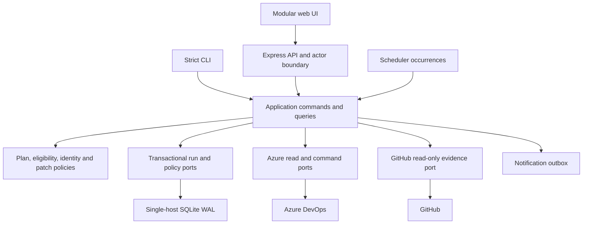

# Project Master Plan

**Product:** 3in1 Task Studio  
**Plan version:** 1.1  
**Decision date:** 2026-10-28  
**Status:** Approved implementation direction under the project owner's delegated authority; not deployment certification.

**Rebuild execution:** Requested 2026-10-28. Implementation is now in progress, not complete. Preserve private configuration and concurrent edits. Begin with reproducible read-path measurements and duplicate-request elimination, then integrate redesigned screens against real API contracts. No live tenant mutation is authorized by the rebuild request. Production acceptance still requires the external gates in section 20.

| Rebuild slice | State | Verification required |
|---|---|---|
| Shared frontend read coordinator | Implemented, focused tests passed | Concurrent identical reads share transport within cancellation scope; 50-entry LRU; stale generations/latest-request ownership; forced refresh isolation; mutation invalidation |
| Read-path measurement | Synthetic baseline/after measured | 20 concurrent consumers: 20 -> 1 upstream calls; 50.71ms -> 51.21ms under a parallel 50ms fixture. This is call reduction, not latency improvement; live measurement pending |
| Complete page/journey rebuild | In progress, incomplete | Shared neutral visual tokens and content migration across ten legacy pages; new member-scoped Lifecycle page; complete replacement architecture and other new pages remain unfinished |
| Durable storage and run protocol | Planned | Migration, crash tests and remote reconciliation; no implicit replacement of private state |
| Production acceptance | Blocked | Tenant, credential, proxy, accessibility and operator evidence |

Verified implementation checkpoint (working-tree tests, not release signoff): shared read coordinator, dashboard removal of automatic all-member plan, read-only preview server option, independent activation opt-in default, awaited journal commits/error propagation, bounded 30s/1,000-item observations, explicit cache-bypassing verification, no automatic relation-batch write replay, activation exact identity matching/preserved descriptions, closure preservation of completed hours/actual dates and removal of synthetic rule-recovery writes. Test fixture types were repaired and test typechecking passed before subsequent changes. Original private roster and concurrent source changes are preserved. Legacy closure tests that asserted fabricated dates/hours now assert one failed transition attempt with preserved fields.

Browser checkpoint: ten existing routes navigated at 1440/768/375px against an isolated empty-roster/no-token preview; no page-wide overflow. This does not prove real-data layout, new Lifecycle page, screen-reader conformance or all interactions. A subsequent complete browser run is required. Preview URL is loopback-only; do not expose this unauthenticated preview outside the local machine. The explicit read-only server option now denies mutation/configuration requests and reports a viewer session.

## 1. Authority and Evidence

This document is the single source of truth for target product behavior, scope, architecture, interaction contracts, implementation order, and acceptance criteria. The current codebase is a migration input, not a normative specification. Historical completion reports, performance multipliers, and accessibility claims do not establish acceptance.

[RELEASE_VERIFICATION.md](RELEASE_VERIFICATION.md) remains the evidence register for release gates, not a competing product specification. Setup and command references remain in [../README.md](../README.md). If a supporting document conflicts with this plan, change it or record an explicit versioned exception here before implementation. Never turn a plan requirement into an implemented claim without evidence.

Evidence labels used throughout:

| Label | Meaning |
|---|---|
| Observed | Behavior or structure inspected in the checked-out source |
| Locally tested | Reproducible offline command passed during this assessment |
| Target | Required future behavior, not a claim about present capability |
| External gate | Requires authorized tenant, deployment, human, or operational evidence |

Assessment is offline. Do not read private credentials or employee records, start persisted automation, or mutate Azure DevOps/GitHub to complete this plan. No production-readiness claim follows from documentation, static checks, or fixtures alone.

### 1.1 Reading and Implementation Order

Everything required for the target experience is specified in this file. No separate journey or page-content document is required to understand the intended product. Sections 3-5 define purpose and invariant rules; sections 6-8 define the shared experience; sections 9-17 define technical guarantees; sections 18-21 define delivery and evidence. The detailed implementation specifications are:

- Section 22: complete journey steps, decisions, recovery, and handoffs for J01-J14.
- Section 23: information architecture, exact page content, controls, layouts, dialogs, roles, and backend responsibilities for S01-S13.
- Section 24: shared content, interaction, accessibility, and state vocabulary.
- Section 25: fast initial load, shared fetches, bounded caching, progressive results, refresh, provider limits, and performance tests.
- Section 26: frontend/backend delivery mapping, acceptance scenarios, and release slicing.

Sections 22-26 elaborate the earlier requirements; they do not bypass their safety, permission, scope, or release gates. Target endpoints, new screens, optimizations, and content are requirements to implement, not features claimed to exist today. Existing operational references remain useful for running the current version, not for deciding target UX.

## 2. Foundational Decisions

1. Preserve Node.js 22+, TypeScript, Express 5, ports/adapters, and pure domain rules. Refactor incrementally instead of rewriting the backend wholesale.
2. Preserve explicit scope, independent remote read-back, conservative date/identity matching, safe relation copying, and non-replay of ambiguous remote writes.
3. Replace independent preview/execution behavior with a server-owned, versioned plan and durable execution/reconciliation workflow.
4. Make automatic creation, activation, and closure separate, disabled-by-default policies. Missing, invalid, or unavailable policy never grants permission.
5. Preserve the existing UI as a migration shell; modularize it around explicit screen states and a shared accessible component contract before considering a framework migration.
6. Deliver a dependable single-host product first. Shared storage and distributed coordination are prerequisites, not assumptions, for multi-host operation.
7. Prefer honest unknown/partial/stale results over fabricated zeroes, productivity scores, or inferred working hours.

## 3. Product Vision and Boundaries

### 3.1 Purpose

Give engineering teams a trustworthy answer to three questions: which daily tasks should exist, what changes are safe to make, and what actually happened? The product is an inspectable work-operations console, not an attendance tracker or an autonomous judge of employee output.

Primary users are an authorized operations lead managing task coverage, an engineer inspecting their assignments, and an auditor investigating changes. A deployment administrator configures credentials, tenant mappings, and recovery. Organizational job roles such as Developer are task metadata, never application authorization roles.

### 3.2 Outcomes and Measurement

| Outcome | Definition and target |
|---|---|
| Correct coverage | Eligible member/series/workday combinations with exactly one matching task divided by all eligible combinations; display denominator, exclusions, unknowns, and snapshot time |
| Unintended changes | Zero changes outside the authorized immutable operation scope; any incident stops unattended execution |
| Duplicate prevention | Zero duplicates caused by retrying the same operation; unresolved remote ambiguity is investigated, never replayed |
| Traceability | Every attempted mutation has a durable intent and attributable outcome, even after a crash |
| Routine efficiency | Target median under two minutes from scope selection to reviewed submission for a 20-member week; validate through usability sessions |
| Recovery | Unknown outcomes visible immediately; operator can identify next safe action without reconstructing raw logs |

Coverage is not completion. Completed tasks are not verified hours worked. PR/commit activity is evidence of repository events, not a productivity score. Targets are release criteria, not measured current achievements.

### 3.3 Supported Scope

- First release: one organization/project per installation, one active application writer on one host, up to 100 enabled members; normal interactive scope 20 members by 31 days. Split larger scopes explicitly and preserve completeness metadata.
- Preserve daily series copying, planned work dates, per-person sources, selected relation copying, ad-hoc tasks, lifecycle transitions, GitHub evidence, optional automation, audit, exports, CLI, and read-only preflights.
- Add calendar exceptions, per-member planned hours, tenant capability mapping, immutable plans, durable recovery, policy management, and scoped notifications.
- Multi-project support, enterprise identity, and multi-host operation have explicit later gates. No native mobile app, ML forecasting, bidirectional GitHub/Jira sync, binary attachment copying, child-item cloning, or unattended deletion in this plan's initial release.
- Responsive web is the mobile product. Do not retain desktop-only critical workflows.

## 4. Current-State Assessment

### 4.1 Method and Limits

Assessment inspected composition/startup, HTTP routes/security, domain entities, planning/exploration/creation/lifecycle use cases, Azure adapters, scheduler, journal, UI structure/controller, test and CI configuration, and supporting documentation. This is system-level coverage, not an assertion that every line or every branch was independently reviewed. Private configuration, credentials, personal journals, live tenant behavior, and visual browser rendering were deliberately not inspected. Referenced paths are repository evidence, not proof of deployed behavior.

Source findings and command results describe the assessment-time working tree, not a frozen release SHA. Application files changed concurrently after the initial reads. Those changes were not made or reverted by this documentation task; revalidate A01-A18 and rerun baseline checks against the implementation-start SHA before treating any defect as still open. Keep the target safety requirements even when an intervening fix resolves the observed symptom.

### 4.2 Reproducible Baseline on 2026-10-28

| Check | Result | Interpretation |
|---|---|---|
| `npm run typecheck` | Passed | Source compilation only |
| `npm run typecheck:tests` | Failed: 10 errors in four files | Obsolete `bypassRules` input, private fixture access, implicit callback types, missing journal `personKey` fixtures |
| `npm run lint` | Exit 0; 23 warnings | Not acceptable to Linux CI's `--max-warnings=0` gate |
| `npm test -- --reporter=dot` | 719 tests passed in 48 suites | Fixture behavior, including some undesirable legacy expectations, not product acceptance |
| Browser, coverage, dependency audit, build | Not rerun in initial assessment | Do not reuse historical results as fresh evidence |
| Tenant, HTTPS, credential rotation, restore rehearsal | Not performed | External release gates remain open |

Tests asserting invented fallback dates/hours must change with the product contract; preserve valid regression intent, not incorrect expected values.

### 4.3 Preserve / Improve / Replace / Rebuild Register

| ID | Surface and observed implementation | Decision and reason | Priority |
|---|---|---|---|
| A01 | Express/TypeScript ports/adapters; [../src/container.ts](../src/container.ts) | Preserve layered backend; remove infrastructure coupling from use cases through typed ports | P1 |
| A02 | Planner and creator build plans separately; [../src/application/use-cases/plan-tasks.ts](../src/application/use-cases/plan-tasks.ts), [../src/application/use-cases/create-tasks.ts](../src/application/use-cases/create-tasks.ts) | Replace duplicate decision paths with one plan engine; current execution replans rather than consuming server-bound reviewed intent | P0 |
| A03 | Date/title reconciliation and exact identity helpers in [../src/domain/entities/task.ts](../src/domain/entities/task.ts), [../src/domain/entities/person.ts](../src/domain/entities/person.ts) | Preserve conservative rules; eliminate weaker local matchers and block ambiguous legacy records | P0 |
| A04 | Closure writes completed work from estimate/default 8 and synthesizes dates on rule failure; [../src/application/use-cases/close-daily-tasks.ts](../src/application/use-cases/close-daily-tasks.ts) | Replace patch builder/fallback; never invent actual effort, attendance, or completion evidence | P0 |
| A05 | Activation has substring identity matcher, description replacement, and shares `autoCloseEnabled`; [../src/application/use-cases/activate-daily-tasks.ts](../src/application/use-cases/activate-daily-tasks.ts) | Rebuild lifecycle policy around exact identities, separate opt-ins, revision checks, and preservation of user-authored fields | P0 |
| A06 | Activation route exists, but serve composition omits its dependency; [../src/index.ts](../src/index.ts), [../src/presentation/api/routes.ts](../src/presentation/api/routes.ts) | Fix wiring only behind lifecycle safety gate; test real composition, not router mocks alone | P0 |
| A07 | Auto-closure service/router/repos exist; router unmounted and active closure ignores injected rule repos; [../src/presentation/api/auto-closure-routes.ts](../src/presentation/api/auto-closure-routes.ts) | Treat as partial; replace disconnected implementations with enforced policy and authenticated actor contract | P0 |
| A08 | `record()` returns before timed flush, clears batch before disk success; [../src/infrastructure/journal/file-journal-repo.ts](../src/infrastructure/journal/file-journal-repo.ts) | Replace acknowledgment semantics; immediate durability fix followed by transactional local run store | P0 |
| A09 | Unbounded `workItemCache`; independent read-back calls same cache; [../src/infrastructure/azure/work-item-service.ts](../src/infrastructure/azure/work-item-service.ts) | Replace with bounded, revision-aware read cache; verification bypasses cache | P0 |
| A10 | Relation batching falls back to individual PATCH after any batch exception | Preserve batching; replace ambiguous failure replay with fresh reconciliation and approved repair | P0 |
| A11 | Azure transport avoids write replay; query retries bounded; [../src/infrastructure/azure/client.ts](../src/infrastructure/azure/client.ts) | Preserve transport policy and extend it through service-level fallback paths | P0 |
| A12 | Scheduler checkpoints/locks exist; activation defaults enabled when absent; [../src/infrastructure/scheduler/node-scheduler-repo.ts](../src/infrastructure/scheduler/node-scheduler-repo.ts) | Preserve checkpoint intent; rebuild explicit per-job permissions, deterministic scheduling, missed-window handling | P0 |
| A13 | Basic operator/viewer, TLS/origin, loopback and headers; [../src/presentation/api/server.ts](../src/presentation/api/server.ts) | Preserve controls; add consistent actor/capability boundary and deployment verification | P0 |
| A14 | Auth limiter selects auth/session/login paths, bulk limiter selects names containing bulk/batch; [../src/presentation/api/rate-limiter.ts](../src/presentation/api/rate-limiter.ts) | Replace path-name inference with auth-failure and operation-class limits; real task routes and protected GET failures need coverage | P0 |
| A15 | Ten hash-routed screens, seven dialogs and console drawer; [../src/presentation/web/public/index.html](../src/presentation/web/public/index.html), [../src/presentation/web/public/app.js](../src/presentation/web/public/app.js) | Preserve navigation continuity; replace monolithic state/rendering incrementally, operational layout instead of oversized briefing sections | P1 |
| A16 | GitHub PR/commit fetching and identity resolution; [../src/infrastructure/github/github-client.ts](../src/infrastructure/github/github-client.ts) | Preserve read-only evidence; explicit identity verification, bounded paging, separate degraded state | P1 |
| A17 | Restore/preflight scripts and cross-platform CI; [../scripts/state-backup.mjs](../scripts/state-backup.mjs), [../../.github/workflows/ci.yml](../../.github/workflows/ci.yml) | Preserve tools; expand backup coverage for new policy/store, include test typechecking and real composition tests | P0 |
| A18 | Parallel closure source and source backups exist; [../src/application/use-cases/close-daily-tasks-updated.ts](../src/application/use-cases/close-daily-tasks-updated.ts) | Remove only after reachability/fixture comparison; retain history in version control, not competing live source files | P1 |

### 4.4 Complete Capability Inventory and Target Disposition

| Capability | Current evidence | Target |
|---|---|---|
| Connection/readiness, schema/identity/work-item preflight | Routes/scripts observed | Separate liveness, connectivity, schema compatibility, identity and write permission gates |
| Dashboard/insights/status/PR tracking | UI and fetch functions observed | Actionable exception queue with source, freshness and completeness; no fabricated KPI |
| My Work | Member-specific UI observed | Remember non-sensitive member selection; honest empty/degraded states; scoped task details |
| Explorer matrix/list, presets, search, person/date inspection | UI/use case observed | Shared eligibility, date filters in URL, duplicate/unknown/calendar reasons; table and mobile list parity |
| Burndown/recorded hours/status charts | UI/use case observed | Rename to Effort & Coverage until historical snapshots prove a true burndown; retain raw recorded values |
| Planning/date windows/series/source selection/gap detection | Domain and use cases observed | One immutable plan engine for every entry point; source revisions and conflict reasons |
| Bulk, row/cell, ad-hoc creation and verification | Routes/use cases observed | Same plan/confirm/run protocol; exact dates cannot silently expand to planner window |
| Task activation and EOD | Use cases/UI/routes observed; activation serve wiring incomplete | Tenant-mapped explicit transitions, truthful fields, separate consent and verification |
| Relation recovery | Use case/journal observed | Plan only missing allowed links; operation-scoped repair, never recreate an accepted item |
| Team/roster/source/series/GitHub scope | Model/UI/config observed | Unique verified identity, independent activation/closure flags, work schedule and effective dates |
| Scheduler creation/activation/closure/run now | Timers/status/routes observed | Independent policies, explicit member scope/limits, durable occurrence records and pause controls |
| Auto-closure rule config/audit/export | Standalone implementation observed, not end-to-end | Deliver policy editor/simulator plus actual use-case enforcement before exposing enabled status |
| Audit journal/archive/export, live/recent logs and console | Implementation observed | Durable structured operations, cursor paging, redacted streaming, append-only repair events |
| Credentials/tenant settings/theme/mobile navigation | Implementation observed | Secure connection setup, capability mapping, session status, no browser token persistence |
| CLI serve/plan/run/daemon/repair/close-today/help | Parser observed | Strict argument errors, same policies and outcomes as API; activation CLI added only with safe lifecycle support |
| Holiday/leave/per-member hours | Not represented in inspected person model | Add shared eligibility service and planned capacity; no inferred actual effort |
| Sprint assignment, CSV roster import, snapshots, notifications | Not established as end-to-end capabilities | Add in later work packages with previews, validation, versioning and delivery evidence |
| SSO/RBAC, multiple projects, distributed jobs | Not established | Separate gated scale increment; never advertise them based on shared Basic credentials |

## 5. Non-Negotiable Domain Contract

### 5.1 Identity, Series and Workday

- Mutation identity is an active, uniquely resolved Azure ID/descriptor and exact canonical account, scoped to the configured project. Display names, email substrings and guessed GitHub suffixes cannot authorize a change.
- Canonical daily key: `(connectionId, projectId, memberIdentityId, seriesId, workDate)`. Duplicate means more than one eligible non-removed remote record with that key. Do not auto-delete duplicates.
- `workDate` is a validated Gregorian `YYYY-MM-DD` in one connection's IANA work timezone. Store event timestamps in UTC and display timezone explicitly. Never infer workday by slicing UTC strings.
- Use explicit mapped work-date metadata where supported; otherwise use reconciled full-year title plus configured scheduling fields. Contradictions or yearless ambiguity are `NEEDS_REVIEW`, not a guessed mutation target. Human resolution records evidence, actor and revision without rewriting remote history automatically.
- A source must match project/type/verified owner/series, be visible in a complete read, and carry a revision. Disabled members, absent sources, unsupported tenant fields, and permission failures block affected planned changes.
- Preserve existing Thursday CURRENT/FOLLOWING/stop-day settings through a versioned planning-window policy; show exact inclusive start/end dates. New UI says Planning Window rather than hardcoding Thursday everywhere. Live creation cannot target past workdays; historical inspection is read-only.

### 5.2 Calendar and Capacity

Eligibility order is: disabled/outside employment dates; non-working weekday; company or regional holiday; approved full-day leave; member availability override. Safety exclusions win; an administrator may explicitly add a working-day exception, but cannot override disabled identity or unresolved ownership. Every exclusion returns a reason code and effective policy version.

- Connection timezone is authoritative for v1; regional calendars are attached explicitly. Per-member timezones are deferred until cross-zone workday ownership is designed.
- Leave uses inclusive local dates; overlapping entries coalesce for calculation but retain audit history. Partial-day leave reduces planned capacity; full-day leave produces no expected task. Existing remote tasks on leave are shown as exceptions and never silently deleted or closed.
- Planned hours are decimal 0-24 per date, with at most two decimal places. Precedence: dated member override, weekly member schedule, project default. Full leave yields 0; partial leave cannot exceed scheduled hours. Unknown schedule blocks capacity-derived estimates, not read-only inspection.
- Original Estimate/Remaining Work may be populated only from the reviewed planned-hours policy or explicitly approved source-copy policy. Completed Work and actual dates are never derived from planned capacity, PR counts or clock time.
- Calendar/config changes invalidate unexecuted plans and future occurrences; completed runs retain the original versions.

### 5.3 Lifecycle and Field Truth

Tenant metadata defines allowed states, required fields and transitions; do not assume New/Active/Closed names exist universally. All mutation builders live in the domain and are used unchanged by HTTP, CLI and scheduler.

- Activate changes only the reviewed transition and explicit approved fields. Preserve description and recorded actual data. No implicit GitHub description replacement or fabricated 17:30 history if the action occurred at another time.
- Close changes state through tenant rules. Remaining Work=0 requires explicit reviewed policy; preserve recorded Completed Work. If tenant demands missing actual dates, description or hours, return `REQUIRED_EVIDENCE_MISSING` with fields the authorized operator must supply and repreview. Never manufacture compliance data.
- GitHub evidence is optional linked context. An unavailable GitHub integration must not be reported as zero activity, and cannot prove completion. Publishing a generated evidence section is a separate previewed opt-in preserving user text.
- A task in an unexpected or terminal state is skipped/blocked according to tenant transition metadata. Date, assignee, series or revision changes between preview and execution require a fresh plan.
- Automatic policy disabled, missing, corrupt, expired, or not resolvable means no unattended write. Per-member auto-activation and auto-closure flags are distinct and default false.

## 6. End-to-End Journeys

| ID | Journey and ordered flow | Success and recovery contract |
|---|---|---|
| J01 | Open app -> authenticate -> capability check -> connections -> read-only schema/identity checks -> roster/source review -> Explorer | Setup complete only when mandatory read gates pass; optional GitHub can be skipped; no scheduler starts during setup |
| J02 | Overview exception -> Explorer member/date filters -> inspect task/source/date evidence -> choose exact gaps -> preview | Unknown data cannot render as missing; zero selection is a deliberate empty selection |
| J03 | Planner scope/window -> fetch complete source/duplicates -> immutable plan -> field/link review -> confirm -> run -> results | Execute exactly approved ready actions; no silent expansion; partial/uncertain rows link to recovery |
| J04 | Explorer empty cell -> ad-hoc source/title/estimate review -> single-action plan -> confirm -> read-back | Exactly one person/date; existing duplicate or source change blocks; failed submission preserves edits |
| J05 | Lifecycle destination -> activate/close mode -> member/date selection -> read-only preview -> required fields -> repreview -> confirm | Live date is current configured workday; no missing work evidence synthesized; viewer can preview only |
| J06 | Team add/edit -> identity validation -> source/series verification -> calendar/capacity assignment -> versioned save | Conflict shows current vs edited values; disabling affects future actions, never deletes remote records |
| J07 | Calendar month/list -> holiday/leave draft -> impact preview -> save effective version -> regenerate affected plans | Existing tasks flagged for review; planned exclusions propagate consistently to coverage and automation |
| J08 | Automation policy -> job/member scope/limits -> policy simulation -> next-occurrence preview -> explicit enable -> observe occurrence | Fresh install off; restart cannot replay unknown writes; pause prevents new attempts, not undo in-flight requests |
| J09 | Run partial/unknown -> fresh remote reconciliation -> verified outcome or unresolved evidence -> selected repair plan -> confirm | Never re-create a remotely accepted task to fix links/audit; preserve original intent and add follow-up events |
| J10 | Activity filters -> run detail -> event timeline -> permissioned export | Filtered export matches reviewed scope; secrets excluded; formula-safe CSV; retention cannot silently erase evidence |
| J11 | Settings connection/schema change -> sanitized validation -> impact summary -> versioned save -> recheck | Scope changes invalidate plans and pause automation until revalidated; credentials remain server-side |
| J12 | Notification channel configure -> synthetic test -> consent/scope -> run outcome -> queued send -> delivery status | No employee evidence sent by default; delivery failure never reruns an Azure operation |
| J13 | CLI plan -> inspect JSON/text plan -> explicit scope/confirm -> execute existing plan -> machine-readable outcome | Same identity/policy/date enforcement as browser; unknown flags fail; interrupted session can inspect run by ID |
| J14 | Maintenance pause -> drain runs -> verified encrypted backup -> restore to empty staging -> integrity/reconciliation -> explicit resume | No secret restoration from exported config; restored uncertain runs cannot replay automatically |

## 7. Information Architecture and Screen Specifications

### 7.1 Navigation and Shared Shell

Keep current hash routes as redirects while introducing canonical destinations: Overview, My Work, Explorer, Planner, Lifecycle, Calendar, Automation, Team, Activity, Logs, Settings, and Setup when required. Rename Daily Burndown to Effort & Coverage; Audit Log becomes Activity with Runs and Events tabs. Preserve deep links and browser back/forward. Console is optional secondary telemetry, not the only result surface.

Header shows product name, connection/project, work timezone, freshness, actor role and contextual refresh. Global mutation shortcuts route to scoped Lifecycle/Planner, never execute. Sidebar groups Observe, Change, Automate, Administer, Investigate. On narrow screens it is a modal navigation drawer with backdrop, Escape and focus return.

### 7.2 Screen Contracts

| ID | Screen | Required content and controls | Specific states and acceptance |
|---|---|---|---|
| S01 | Setup/connection health | Azure connection metadata, secret reference status, schema map, read-only identity/source checks; optional GitHub | Unconfigured, checking, incompatible, denied, ready, GitHub degraded; retry failed step without restarting validated steps |
| S02 | Overview (`dashboard`) | Compact health strip; exceptions sorted by blocked/unknown/duplicate/missing; reviewed next action; recent runs; secondary activity totals | Each metric has date/scope/source and completeness; clicking an exception preserves filters; no hero illustration or unsupported insight |
| S03 | My Work (`mywork`) | Member selector, workday/range, task state/links, date evidence, recorded hours, PR context | No selection, disabled member, empty, stale, upstream failure; never imply selected member is signed-in user without verified mapping |
| S04 | Explorer (`explorer`) | Presets/custom dates, searchable member selection, matrix/list mode, status/series filters, freshness, selected-gap count | Complete/partial/unknown cells, duplicate expansion, holiday/leave indicators; keyboard-operable task details; review gaps carries exact cells |
| S05 | Effort & Coverage (`burndown` redirect) | Month/member filters, recorded estimate/remaining/completed table, chart alternative, completeness counts | Missing hours are null; no invented daily history from current snapshots; a true burndown requires stored historical observations |
| S06 | Planner (`planner`) | Scope -> plan -> review -> result steps; source/revision, dates, fields, links, blocked reasons, totals; ad-hoc entry | Draft/loading/ready/empty/blocked/expired/submitting/running/partial/unknown; selections change invalidates confirmation; reload can reopen run |
| S07 | Lifecycle (new; existing EOD/active dialogs redirect) | Activate/close segmented mode; current workday; scoped tasks; before/after fields; required evidence inputs | Already-state, incompatible, policy denied, revision conflict; live transition requires explicit reviewed rows and reason; dry-run has no remote mutation |
| S08 | Team (`people`) | Search/list, enabled state, verified Azure identity, series/source, pod/role, GitHub scope, calendar/hours, separate opt-ins | Add/edit/disable, invalid/duplicate identity, unresolved source, dirty/version conflict; no hard delete if historical runs refer to member |
| S09 | Calendar (new) | Month/list tabs; project/regional holidays, member leave, availability, capacity and effective dates; impact preview | Overlap, partial leave, invalid range, zero-capacity day, existing-task exception; identical eligibility reasons in all dependent screens |
| S10 | Automation (`scheduler` redirect) | Global pause; separate create/activate/close policies; member scope, calendar, schedule/timezone, max actions, next occurrences, attempt history | Disabled/unvalidated/enabled/paused/running/missed/failed/unknown; separate save and enable; run-now requires fresh manual plan |
| S11 | Activity (`journal` redirect) | Runs/events tabs, actor/type/member/date/outcome filters, cursor pagination, export; run detail timeline and recovery actions | Empty/corrupt/unavailable/redacted/partial/unknown; original and repair evidence visible together; remote outcome and audit status separate |
| S12 | Logs (`logs`) and console | Level/search/run filters, pause/resume, connection state, bounded history, auto-follow toggle, download sanitized scope | Reconnecting/expired session/truncated stream; scroll position retained when paused; new-event count; logs not used as audit authority |
| S13 | Settings (`settings`) | Connections/schema, planning defaults, secret references, security/session, notifications, retention/backups, display preferences | Validation, unsaved, saving, conflict, failed validation; connection changes pause affected automation; secret values never returned |

### 7.3 Overlay and Detail Mapping

Current `dateInspectModal` becomes cell/date detail with task links, duplicates, recorded date provenance and eligibility reasons. `userInspectModal` becomes member coverage detail. `confirmModal` becomes shared immutable-plan confirmation. `personModal` remains team editing, upgraded to full-height sheet on mobile. `adHocModal` remains a compact single-task editor. `eodModal` and `activeModal` become Lifecycle preview/detail, not independent engines. `executionDrawer` remains a log panel linked to a persistent run-detail page.

Add only genuinely needed dialogs: unsaved-changes decision, calendar exception editor, automation enable confirmation, configuration conflict, and retention deletion confirmation. Avoid nested dialogs. An overlay has a title, initial focus, close control, Escape handling, focus containment, inert background, and return target. Long tables use a detail page/sheet instead of compressing an entire workflow into a small modal.

### 7.4 Universal Screen State Machine

Every data region implements `idle -> loading -> ready | empty | partial | error`; ready data may also be stale. Mutating regions add `validating -> confirming -> submitting -> running -> terminal`. Terminal outcomes are verified, accepted-unverified, uncertain, blocked, failed-before-write, cancelled-before-write, or partial aggregate.

- Initial loading: dimension-stable skeleton and `aria-busy`; never a misleading 0 count.
- Refresh: keep existing data labeled stale with last-successful timestamp; sequence/cancel requests so old filters cannot overwrite new results. Cached fallback must retain the error and cannot enable writes.
- Empty: distinguish no roster, no selection, no eligible dates, no matching tasks, no missing tasks, and no activity.
- Partial: identify affected members/dates and failed source; disable any action depending on incomplete discovery, while allowing unrelated read-only inspection.
- Error: plain-language cause, safe retry action, correlation ID and preserved inputs. Session expiry suspends new writes and shows reauthentication; it does not mark a submitted operation failed.
- During write: disable repeated submission, show stable row progress and run ID. Closing the overlay or navigating away does not cancel an in-flight remote call.
- Cancellation: cancel not-yet-started actions only. Explain remaining in-flight/unknown outcomes. No generic Undo for remote creation or state transitions.
- Results: count verified/accepted-unverified/unknown/blocked/skipped separately; “completed” never means every remote mutation verified.

## 8. Design System and Interaction Contract

### 8.1 Visual Direction

Use a quiet operations workspace with white/neutral surfaces, charcoal typography, emerald actions, blue informational states and amber/red exceptions. Preserve dark preference but use neutral charcoal rather than navy panels. Remove orbital motifs, editorial headings, nested cards and explanatory marketing text. Use unframed page sections, dividers and dense semantic tables. Cards are for repeated entities and true framed tools, not every page region.

| Token | Light | Dark | Contract |
|---|---|---|---|
| Canvas | `#f6f7f8` | `#151719` | Low-contrast neutral background |
| Surface | `#ffffff` | `#202326` | Primary readable surface |
| Text | `#202529` | `#f3f5f6` | Body text |
| Muted text | `#536068` | `#b5bfc5` | Still meets 4.5:1 on its actual background |
| Action | `#006644` | `#8ce9c0` | Light on-action white; dark on-action `#10372b` |
| Information | `#175da8` | `#9ac8ff` | Not interchangeable with primary action |
| Warning | `#795200` | `#f2cd72` | Icon + label, never color alone |
| Danger | `#b42318` | `#ffb4a9` | Verify foreground/background pairs |
| Border | `#c6cdd2` | `#657078` | Test interactive boundaries at 3:1 |

Tokens are target seeds; automated contrast checks on each actual text/control pair are release gates. Do not claim compliance from hex substitution alone.

- Fonts: self-host Public Sans for UI and IBM Plex Mono for identifiers/numeric logs, with safe local fallbacks. Body 14px/20px, labels 13px/18px, page heading 24px/32px, section heading 18px/24px; 16px form inputs on mobile. Letter spacing 0; no viewport-scaled fonts.
- Spacing scale 4/8/12/16/24/32px; 4px control and 8px maximum card/dialog corner radius. Fixed icon boxes, reserved loading space, stable table tracks and chart aspect ratios prevent layout shift.
- Controls: labeled inputs/selects, segmented controls for matrix/list or lifecycle mode, toggles for binary policy, checkboxes for selection, numeric inputs for hours, menus for row actions. Use installed/self-hosted Lucide icons with accessible names and tooltips; do not hand-draw a parallel icon family.
- One clear primary action per context. Use explicit command labels such as Review 12 Changes and Confirm Creation; never ambiguous Run on a destructive transition.

### 8.2 Micro-Interactions

| Interaction | Required behavior |
|---|---|
| Filter editing | Apply for server-heavy scopes; local text search debounced 200ms; visible loading and result count; selection retained |
| Selection | Checkbox state and selected count update immediately; deselect-all never means all; batch scope enumerated at confirmation |
| Validation | Validate on submit and after touched-field blur; summary links to field, error text linked with `aria-describedby`; preserve values |
| Confirmation | Show connection, exact members/dates/IDs, before/after patch, skipped/blocked counts, plan expiration and irreversible nature |
| Submission | Immediate pressed/busy feedback, stable button width, duplicate click suppressed; server idempotency remains authoritative |
| Save | Dirty indicator; spinner only within action; persistent success/version and inline failure; no optimistic policy-enable state |
| Row details | Restore focus to originating row; action menu Escape closes menu first; no hover-only critical actions |
| Toast | Success 5s, informational 8s, failure persistent until dismissed; pause on hover/focus; durable result also remains on screen |
| Progress | Announce start and meaningful completion summaries, not every log line; rows remain inspectable |
| Motion | 120ms opacity and 160ms panel transition; no decorative loading animation; reduced-motion disables movement |
| Live stream | Auto-follow only when already at end; pause keeps position and provides count of new events; bounded reconnect backoff |
| Theme | Respect system initially, persist explicit preference locally; repaint charts from existing data without refetch or layout shift |

### 8.3 Responsive and Accessibility Acceptance

Target WCAG 2.2 AA. At 375, 768, 1024 and 1440px, all screens, dialogs and failure states must be operable. Below 768px filters collapse into a sheet and primary tables offer a structured list; true matrices scroll in a named region with sticky row/date headers and a list alternative. No page-wide horizontal scroll or sticky control obscuring focused content.

- Semantic landmarks, one h1 per screen, real links for navigation, buttons for commands, active `aria-current`, visible skip link and heading focus on route change.
- All controls keyboard reachable in logical order; no clickable nonsemantic cells; select native table semantics unless a full keyboard grid is implemented and tested.
- Focus indicator minimum 2px with sufficient contrast; target size 44px for touch controls, never below WCAG minimum without applicable exception; 200% zoom and 320 CSS-pixel reflow pass.
- Text contrast >=4.5:1; large text and non-text controls >=3:1; statuses also have text/icon. Accessible charts have equivalent data table and units; missing data is not connected as a zero point.
- Dialog focus trap/restoration, Escape, inert background; navigation drawer and console exclude hidden controls from focus.
- Screen reader tests with VoiceOver/Safari and NVDA/Firefox or Chrome; keyboard-only, reduced motion, forced colors and genuine errors. Automated axe checks supplement rather than replace these sessions.

## 9. Target Architecture

### 9.1 Deployment and Module Boundaries



Remain a modular monolith. Domain has no filesystem, HTTP, UI or concrete GitHub client imports. Application coordinates typed ports with injected clock, ID generator and authorization context. Infrastructure handles transport/storage. Presentation validates transport shape and maps typed errors; it does not decide different safety rules. Build/container tests must prove every exposed feature is actually reachable.

Target modules: connections/capabilities, roster/identity, calendar/capacity, planning, execution/reconciliation, lifecycle, automation, audit, evidence, notifications and administration. Keep use cases small by responsibility, not arbitrary line counts. Replace duplicate source files only after reachability tests. No microservices or framework migration in foundation work.

### 9.2 Storage Decision

Introduce SQLite WAL with a maintained Node 22-compatible driver, prepared statements, schema migrations, foreign keys, transactional commits and busy timeout. Select/pin the supported driver in the storage work package after macOS/Windows/Linux install tests. Do not use experimental runtime SQLite APIs silently. One writer service on local disk only; no NFS/shared-volume SQLite and no second scheduler process.

Reason: durable intents, idempotency, indexed runs, versioned policy and outbox need transactions that independently rewritten JSON arrays cannot provide. This replaces the earlier no-database direction deliberately. Before migration, fix JSON durability so the old adapter is safe enough to drain/export. Preserve JSON config import/export compatibility; never run dual independent writers.

### 9.3 Data Contracts

| Model | Required fields and invariants |
|---|---|
| Connection | ID, organization/project IDs, HTTPS endpoint allowlist, timezone, capability revision, secret references, health timestamps; no plaintext tokens |
| Member | Stable key, verified Azure identity ID/account, display name, enabled/effective dates, organizational pod/role, series mapping, independent automation consent, GitHub identity verification state |
| TaskSeries | ID, connection/type, source selection/override, full-year naming policy, date field mapping, allowed copied fields/relations, revision |
| Calendar/Availability | ID/version, region, work weekdays, holiday dates, member leave/partial capacity, effective interval, actor/change reason |
| Plan | UUID, actor/access scope, action kind, explicit member/date/task IDs, connection/config/calendar/policy versions, fetched revisions, complete-read proof, actions/diffs/reasons, createdAt, expiresAt, content hash |
| PlanAction | Stable action ID, canonical daily key, source/task revision, safe patch/link diff, eligibility result; ready/blocked/skipped and reason code |
| Run/RunAction | Run ID, plan ID/hash, actor, trigger, idempotency key, occurrence ID, before snapshot, intent timestamp, remote ID/request ID, outcome, verification/audit statuses, error class |
| AuditEvent | Immutable UUID/sequence, run/action/config reference, actor, UTC timestamp, type, sanitized payload, previous event reference; corrections append rather than overwrite |
| AutomationPolicy | Version, job kind, exact member scope, timezone/schedule, effective dates, max actions, allow/deny rules, approvals, enabled/paused status, next occurrence |
| Occurrence | Unique policy/version/local-workday/job key, scheduled UTC time, checkpoint, attempt/result; unresolved occurrence cannot dispatch again |
| NotificationDelivery | Event/run ID, channel reference, minimized payload hash, attempt count, delivery status and retryAt; separate from Azure success |

Typed enums distinguish `remoteOutcome`, `verificationStatus` and `auditStatus`; avoid encoding closure as a creation record or one misleading success boolean. Database uniqueness prevents concurrent local submissions of the same canonical action, but is not a guarantee of remote exactly-once behavior.

## 10. Plan, Execute and Recover Protocol

### 10.1 Immutable Plan

1. Authenticate actor/capabilities and explicit scope. Query APIs permit broad read scope, but writes never expand omitted/empty lists to all.
2. Resolve identity, tenant capability, eligibility and source/date evidence. Fetch all expected IDs; truncation or missing read-back coverage blocks the affected plan.
3. Generate one deterministic action list for UI, CLI and scheduler. Plans expire after five minutes by default, sooner on configuration/policy changes or workday rollover.
4. Persist the plan and hash server-side. Confirmation sends plan ID/hash, explicit selected ready action IDs, and idempotency key, not client-reconstructed patch bodies.
5. Under execution ownership, recheck authorization, versions, current local workday, duplicate key and fresh remote revisions. Any changed precondition yields 409 and a new preview; never silently execute a revised plan.

### 10.2 Durable Execution

Persist run/action intent before each remote mutation. If intent cannot commit, no remote call. Dispatch a write once; read-back bypasses cache and verifies identity, project/type, date/title, requested fields and allowed links. Persist outcome and verification separately before reporting completion.

```text
ready -> intent_committed -> dispatching -> accepted -> verified
																			-> accepted_unverified
																			-> uncertain -> reconciliation_required
												 -> rejected_before_commit
ready -> blocked | skipped | cancelled_before_dispatch
```

A crash after `dispatching` is uncertain until reconciled. A committed request followed by audit failure is not safe to resubmit. Do not claim an atomic transaction spans SQLite and Azure. Return the run ID as soon as durably created; subsequent polling/SSE exposes progress. A run can be partial without losing successful rows.

### 10.3 Retry and Reconciliation

- Retry only replay-safe GET and read-only WIQL SELECT with bounded exponential jitter, provider Retry-After and overall deadline. Classify requests by semantics, not HTTP method alone.
- Never auto-replay create/PATCH after timeout, connection loss, 429 or ambiguous 5xx, including service-level relation fallbacks and lifecycle recovery. A definite rule rejection allows correction only through a new reviewed plan.
- Reconcile against fresh exact key/ID, owner/date/revision and planned fields. One proven remote result may resolve the action; zero results after an ambiguous create does not prove the request cannot commit later. Keep uncertain until operator-approved resolution.
- Relation repair computes missing allowed links from a fresh target and never blindly appends every source link. Do not copy child hierarchy, binary attachments or computed attributes. Verify target after repair.
- Cancellation stops undispatched work; unexpected ownership loss stops new writes. No automatic rollback/delete/reopen. Compensating actions require a separately authorized plan.

## 11. API and CLI Contracts

Introduce `/api/v2` behind a feature flag. Existing routes remain adapters only until migrated; they must not retain an alternate unsafe write path. Once v2 write support is enabled, legacy writes are disabled or translated to the same stored-plan protocol, never independently executed.

| Endpoint | Contract |
|---|---|
| `GET /api/health`, `/api/ready` | Preserve minimal unauthenticated liveness and authenticated read-only readiness; do not require optional GitHub for Azure readiness |
| `GET /api/v2/session` | Authenticated actor, capabilities, connection scope, session expiry; never credentials |
| `GET /api/v2/connections/:id/capabilities` | Read-only tenant mapping/validation and reasoned incompatible states |
| `GET /api/v2/coverage` | Connection/member/date/series scope; rows and cursor; snapshot/freshness/completeness metadata |
| `POST /api/v2/plans` | Read-only preview for create/ad-hoc/activate/close/repair; returns persisted plan, blockers, hash and expiry |
| `POST /api/v2/runs` | Plan ID/hash/action IDs plus explicit confirmation; `Idempotency-Key` required; 202 run resource |
| `GET /api/v2/runs/:id`, `/events` | Durable outcome and authorized SSE progress; reconnect by event sequence |
| `POST /api/v2/runs/:id/reconcile` | Authorized read-only remote reconciliation; no replay of mutations |
| `POST /api/v2/runs/:id/cancel` | Cancel only undispatched actions; result enumerates in-flight actions |
| `GET/PUT /api/v2/members`, `/calendars`, `/policies`, `/settings` | Versioned resources; PUT requires If-Match, validates references and records actor |
| `POST /api/v2/policies/:id/simulate` | Read-only occurrence/scope/deny-reason preview |
| `POST /api/v2/policies/:id/enable`, `/pause` | Explicit policy version, confirmation and administrator capability |
| `GET /api/v2/activity`, `/activity/export` | Filtered cursor results; export permission, format and scope validated; large exports bounded/queued |
| `GET /api/v2/evidence` | Explicit verified identity/repository/date scope, complete/partial/unavailable states |
| `POST /api/v2/connections/:id/check` | Read-only tenant diagnostics, origin/auth protected despite being nonmutating |

Success response: `data`, `meta.requestId`, snapshot time, completeness and next cursor where applicable. Error response: stable `code`, safe `message`, field errors, `requestId`, retry guidance and run ID if dispatched. 400 malformed, 401 unauthenticated, 403 forbidden, 404 unknown, 409 stale/conflict, 422 domain/capability block, 429 throttled with Retry-After, 502 upstream read failure, 503 unavailable/durability failure. Redact provider internals; keep sanitized detail in protected logs.

Input limits: JSON <=1MiB; member lists <=100, interactive actions <=200 per run, default date range <=31 days and hard limit 92; titles <=255 characters subject to lower tenant limit; description <=64KiB sanitized/validated; list page 50 default/200 maximum; server-defined cursor, not arbitrary offsets. Reject duplicate keys, invalid dates/timezones, nonfinite/negative numeric data, unknown writable fields and unsupported export formats. Validate upstream responses too.

CLI target: `plan --kind ... --person ... --from ... --to ... --json`; `execute --plan <id> --hash <hash> --yes`; `run-status`, `reconcile`, `policy simulate`, `policy enable`, existing read-only verification commands. No implicit all for writes; `--all` enumerates/snapshots scope. Unknown commands/options fail. Exit 0 verified/no-op, 1 blocked/input, 2 partial/uncertain, 3 dependency/durability failure; document compatibility changes. Never auto-start automation for plan/help/verification or module import.

## 12. Automation and Policy Semantics

- Separate create/activate/close policy records, per-member consent and schedule. Authorization requires enabled policy AND enabled member AND action consent AND calendar eligibility AND validated capability AND bounded action count.
- Deny rules override allow rules. No rules means denied. Reference IDs are authoritative; unresolved team/role membership blocks policy enabling. Organizational `pod` is not proof of Azure team membership. Rule simulator shows matched IDs and effective reasons per member.
- Manual lifecycle is separately authorized and not silently blocked by an unattended opt-out, but must display that opt-out and require explicit selected tasks. Mandatory organizational deny rules still apply. No implicit override through all-members mode.
- Deterministic local schedule converted to UTC with an injected clock. For DST, skip a nonexistent local occurrence and record it; use the first occurrence of an ambiguous time once. Preview next seven occurrences with timezone offsets.
- Persist occurrence before dispatch. One attempt per occurrence; failure/empty result does not cause heartbeat repeats. Manual run-now creates a separately approved run, not a hidden reset of checkpoint.
- Missed windows are logged and skipped, not caught up automatically. Resume starts at the next future occurrence after validation. Pause persisted policy before timers stop; failed persistence must surface actual state. Global emergency pause blocks new dispatch immediately even if policy persistence subsequently fails.
- Replace randomized closure timing with deterministic configured windows; load spreading, if needed, uses a persisted occurrence time bounded by the approved window.
- Config/source/calendar/identity changes pause affected automation; revalidation and administrator reenable required. Fresh installs and migrated ambiguous settings start paused. Migration never silently enables a job because a boolean was absent.

## 13. Security, Privacy and Governance

### 13.1 Authorization Matrix

| Action | Viewer | Operator | Administrator | Scheduler principal |
|---|---|---|---|---|
| Inspect permitted data and preview | Yes | Yes | Yes | Only own policy scope |
| Confirm create/activate/close/repair | No | Scoped | Scoped | Valid enabled policy only |
| View restricted exports | Separate export capability | Separate export capability | Yes with audit | No |
| Change roster/calendar/source | No | No by default | Yes | No |
| Manage credentials/connection/policies | No | No | Yes | No |
| Purge retained audit data | No | No | Retention/legal-hold checks | No |

Single-operator Basic deployments may use one administrator identity explicitly recorded as shared, never pretending to attribute individual people. More than one human writer requires SSO/per-user accountability before shared production use. Target enterprise auth is Entra ID OIDC with server sessions and scoped role mapping; employee job role remains unrelated. Never trust browser-supplied actor/admin headers. Reverse-proxy identity is accepted only from a documented private trusted ingress with direct backend access blocked.

### 13.2 Required Controls

- Production startup requires authentication; TLS termination with trusted corporate/public CA, exact public origin, loopback/private backend and explicit trusted proxy policy. Do not disable certificate checks or trust arbitrary forwarded headers.
- CSRF protection for cookie/Basic browser mutations, exact Origin and Sec-Fetch-Site enforcement, SameSite/HttpOnly/Secure session cookies for OIDC; no wildcard authenticated CORS. Test sibling subdomain and originless browser requests.
- Secret references from approved environment/vault only in production; UI stores references/status, not secret values. Never log/export tokens, include them in URLs or localStorage, or copy them into plan/audit payloads. Rotation/revocation is an operator gate; code cannot certify it happened.
- Schema-validate config, API and provider JSON with a maintained runtime validator; sanitize rendered HTML and restrict link schemes. Prefer text DOM APIs. Localize tenant field allowlists and encode WIQL values safely.
- Restrict configurable API/webhook endpoints to HTTPS allowlists; reject loopback/private/link-local/metadata destinations and cross-host redirects unless explicit security-approved enterprise endpoints. Protect against DNS rebinding and SSRF in diagnostics/notifications.
- Authentication failure limits apply to all protected requests, count failures rather than session reads, and include account/IP quotas without denying normal authenticated navigation. Explicit operation categories govern read/preview/write/bulk limits; headers communicate reset/retry. Validate proxy/NAT behavior and IPv6 keys.
- Cap request bodies, connection concurrency, log subscriptions, cache sizes and violations tracking. Close timers/listeners on shutdown and SSE disconnect. Dependency locks, automated secret scanning, dependency audit, SBOM and pinning are release gates.
- Self-host scripts/fonts/icons/chart assets; remove CDN dependency and tighten CSP to eliminate unsafe inline styles/scripts as UI migration proceeds.
- Audit actor, action, scope, approvals, configuration version and outcomes; operational logs are separately retained. Append-only in application does not mean tamper-proof against host administrators. External immutable encrypted audit copies are needed where compliance requires tamper resistance.
- Default operational logs 14 days; run/audit retention 365 days pending organizational policy, with legal hold overriding deletion; employee leave reason text is not collected. Purge requires admin preview, cutoff/count, backup/legal-hold checks, audit event and explicit confirmation. No silent archive pruning.

## 14. Performance and Scalability

### 14.1 Target Budgets

Reference load: 100 configured members, interactive scope 20 x 31 days, 10,000 indexed work-item observations, 100,000 audit events, one concurrent writer and 10 readers, 2 vCPU/4GiB RAM. Benchmark synthetic provider latency (100ms median) and separately record real tenant/proxy results.

| Metric | Target and measurement |
|---|---|
| UI response to local interaction | p95 <100ms; no normal render task >50ms without yielding/virtualization |
| First usable shell | <=2s on defined mid-tier mobile test; compressed initial JS+CSS <=250KiB excluding deferred charts |
| Warm read API | p95 <300ms excluding explicitly reported upstream work |
| Cold scope/plan | p95 <=5s for reference scope/provider fixture; show progress after 1s; job resource after 10s rather than an indefinitely hanging screen |
| Durable run submission | <=500ms local acknowledgment; never weaken disk durability to meet latency |
| Verification | Begin fresh read immediately after accepted write; unresolved after 30s marked accepted-unverified, with bounded reconciliation task |
| Memory | RSS <512MiB at reference load, stable after 60-minute soak; no unbounded cache/listener growth |
| Availability | Initial target 99.5% service availability, measured externally; upstream outage reported separately |

### 14.2 Implementation Rules

- Batch reads by provider limit and deduplicate requests; validate exact expected ID coverage. Bounded read concurrency default 4, writes serialized for v1, configurable lower under tenant throttling. Stop dispatch on provider throttling, do not fan out retries.
- Source discovery uses explicit work-date fields/indexed observations where trustworthy. Retain the current 5,000-candidate fail-closed guard until safe query partitioning proves exhaustive results. Do not solve performance by silently truncating.
- Server read cache maximum 1,000 items with 30s TTL initially, keyed by connection/project/type/identity/revision; coalesce in-flight reads. Mutation invalidates affected keys. Verification, duplicate recheck and reconciliation always request fresh data.
- UI cache maximum 50 scope entries, 30s TTL, connection/version keys, clear on session/scope changes; never store secrets. Cached provider error fallback must show stale/degraded state.
- SQL indexes on connection/member/workdate/series, run timestamps/outcomes, occurrence uniqueness and audit sequence. Cursor-page activity and exports, do not read all archives for every request.
- Lazy-load chart assets, reuse chart instances, render visible table windows with accessible pagination fallback, cancel obsolete requests and release view resources on navigation.
- Measure real latency/call counts/event-loop lag; historical 10x/1000x claims are not baselines. Buffered memory enqueue latency is not durable write latency.

### 14.3 Scale Gates

Scale beyond one host only after PostgreSQL replaces local state, transactional job claiming/fencing prevents stale-worker writes, scheduler leader election is tested, shared rate limits exist, and requests/sessions are stateless or shared. Do not simply add replicas. Multi-project support adds connection-scoped identity, cache, permissions and unique keys first. Shard provider queries by project/member/date with completeness tracking. No initial Kubernetes/microservice dependency.

## 15. Reliability, Deployment and Operations

- Health separates process alive, local storage ready, Azure ready and optional GitHub/channel degraded. Cache readiness briefly and do not expose credentials or internals in public probes.
- Structured logs include request/run/action/occurrence IDs, action kind, latency, provider request ID and sanitized outcome. Metrics track unknown writes, blocked policies, audit commit failures, queue age, rate limits, completeness failures and reconciliation age.
- Page operator immediately on audit durability failure or unknown write; pause relevant automation. Alert on repeated auth failures, schema drift, missed occurrence, backup overdue and unhealthy readiness. Dashboard links to the affected run, not only raw logs.
- Graceful shutdown: reject new writes -> persist pause/drain state -> stop new schedule dispatch -> finish/mark in-flight actions -> commit audit/outbox -> close SSE/timers/storage. SIGKILL and power-loss tests prove restart reconciliation, not merely `close()` behavior.
- Release artifacts include built assets, exact SHA, schema version, dependency lock/SBOM, migration command, environment example and rollback instructions. Never bundle private config, certificates containing private keys, live journals or `.env`.
- Before migration, stop writers and scheduler; use SQLite online backup API after migration, not a raw copy of only the main file while WAL is active. Encrypted off-host daily backups plus before-release backup, checksummed manifest, retention and restore tests. Target local committed-run RPO 0 for process crash; disaster RPO <=24h and RTO <=4h pending operational approval.
- Restore into empty isolated state, validate checksums/schema/event counts, provision secrets separately, reconcile unfinished remote actions and leave all automation paused. A restore never erases Azure changes or proves duplicate absence.
- Rollback code only when schema compatible; otherwise restore to new state directory and reconcile all writes since backup before resuming. No destructive directory deletion or git checkout rollback recipe as the operational standard.
- Configuration migrations are explicit, versioned and reversible through preserved export; policy rollback creates a new revision and fresh preview, not historical time travel.

## 16. Edge-Case and Failure Matrix

| ID | Scenario | Required behavior and test |
|---|---|---|
| E01 | Empty/unknown/disabled member scope | No scope expansion; block write, explicit empty read state |
| E02 | Same display name/different UPN, substring overlap, inactive identity | No mutation; exact verified identity regression cases across create/activate/close/repair |
| E03 | Yearless December/January title, leap day, conflicting recorded date | Needs review with evidence; no guessed creation/transition |
| E04 | DST gap/fold, UTC midnight, timezone config change | One documented local date/occurrence; invalidate old plan |
| E05 | Weekend/holiday/leave, overlapping/partial leave, existing task on leave | Consistent exclusion/capacity, no auto-delete or fabricated missing task |
| E06 | No source, wrong owner/project/type, source changed/deleted | Block affected actions; never substitute another member's task |
| E07 | Zero/one/many duplicates, removed item, repeated title in another series | Canonical scoped key; flag duplicates, don't create additional task |
| E08 | WIQL bound, missing batch item, malformed upstream JSON, page cap | Incomplete state, no false empty/coverage and no dependent write |
| E09 | Double click, two tabs, CLI vs scheduler race | Same idempotency key gives same run; local ownership/unique key prevents concurrent dispatch |
| E10 | Plan expired, config/calendar/policy/revision changed, workday rolled | 409 with repreview; no silent new patch/scope |
| E11 | Create/PATCH committed but response lost | Uncertain; fresh reconcile, never blind retry or fallback |
| E12 | Relation batch timeout or partial verification | No individual replay until proven safe new repair plan; no new work item |
| E13 | Disk full/permission failure before intent | No remote dispatch; health fails and automation pauses |
| E14 | Disk/audit failure after Azure accepted | Preserve remote outcome, accepted-unverified/audit warning, emergency reconciliation; no retry-as-create |
| E15 | Timer flush failure, corrupt file/archive, shutdown mid-write | No silent dropped acknowledged entries; preserve evidence and surface failure |
| E16 | Azure requires missing actual dates/hours/description | Block for approved evidence; no synthetic tenant-rule recovery |
| E17 | GitHub not configured, guessed username, 403/429/search truncation | Separate unavailable/unverified/partial state; no fabricated empty work evidence |
| E18 | External edit during transition or repair | Revision test fails safely; new preview, preserve operator-authored fields |
| E19 | Browser reload/network disconnect/session expiry during run | Reopen run by ID; remote state not inferred from UI connectivity |
| E20 | Scheduler restart, missed window, failed checkpoint, empty run | No surprise catch-up or repeated attempt; one durable occurrence |
| E21 | Viewer calls mutation or forged admin/trigger header | 403; actor derived from trusted server context; policy not bypassed |
| E22 | Hostile/sibling origin, proxy spoof, SSRF endpoint, XSS in task title | Reject at boundary; encode/sanitize; test real proxy separately |
| E23 | Formula CSV cell, export too large, unauthorized export | Neutralize spreadsheet controls, bounded export, deny before reading sensitive scope |
| E24 | Multiple pods/roles, rule conflict, missing reference, disabled policy | Deny wins; missing references block enable; simulator and execution agree |
| E25 | Restore old state after remote writes, migrated missing opt-ins | Paused and reconcile; never replay historical jobs or enable missing flags |
| E26 | Late UI fetch from old member/theme/navigation, stale cache | Latest request wins; no cross-screen plan overwrite; error freshness remains visible |
| E27 | No eligible days or missing metric denominator | Display not applicable, not 100% success or 0 hours |
| E28 | Notification timeout/duplicate delivery/channel revoked | Outbox retry independent of task action; delivery ID dedupe where supported; disclose at-least-once delivery |
| E29 | Duplicate import rows, partial validation, unknown columns | Entire config import staged; no partial apply without explicit reviewed accepted subset |
| E30 | Legal hold/retention purge/concurrent export | Hold wins; audited authorized purge and stable export snapshot |

## 17. Testing and Verification Strategy

### 17.1 Layers

1. Pure domain tests: identity/date/calendar/capacity/rule precedence, deterministic plans, field/link allowlists, transition invariants and reason codes. Property-based tests cover date ranges/unique keys and no out-of-scope actions.
2. Adapter contracts: response schema, exact batch/pagination coverage, cancellation/timeouts, retry classification, cache bypass, error mapping, schema capabilities and prepared storage operations.
3. Use-case integration: fresh plan/confirm/run, stale revisions, duplicate submission, journal failure before/after remote acceptance, crash boundary injection, policy enforcement from every entry point.
4. Composition tests: instantiate real application wiring with injected fake providers/temp state; assert activation and policy APIs are reachable and guarded. No dependency placeholder allowed to masquerade as enabled feature.
5. HTTP security: unauth/viewer/operator/admin matrix, CSRF/origin, body/schema bounds, rate limits on real routes and failed protected GET, unknown route JSON, safe errors/exports and SSE cleanup.
6. Browser: all screens/states, navigation/back/deep links, stale-response races, scope selection/confirmation, partial/uncertain results, dirty-state conflicts, mobile/keyboard/dialog focus, accessible charts and session expiry.
7. Process tests: child-process crash at each durable boundary, concurrent CLI/server, stale lock, scheduler DST/restart/missed window, database rollback and restore. Use isolated temp directories and injected clocks.
8. Performance/soak: reference dataset, provider delays/throttles, bounded memory/caches, event-loop lag, pagination and frontend layout. Retain raw measurements with environment/SHA.
9. Authorized staging: read-only schema/identity/date comparison first; then separately approved one-member/one-date create/transition/repair, independent read-back and retry/reconciliation checks. No CI production secrets.

### 17.2 CI Gate

```bash
cd new-app
npm run typecheck
npm run typecheck:tests
npm run lint -- --max-warnings=0
npm test
npm run test:coverage
npm run test:schema
npm run test:identities
npm run test:workitems
npm run build
node --check src/presentation/web/public/app.js
```

Run the browser suite only after isolating its server config/state and guaranteeing automation off; its current harness inherits environment and does not by itself prove startup cannot activate persisted jobs. Pin browser tooling in dev dependencies, add repeatable browser/a11y scripts, and run Chromium/Firefox/WebKit where supported. Current browser file is a starting point, not comprehensive visual certification.

Target changed safety modules >=90% branch coverage and all P0 invariants explicitly covered; overall >=85% statements and >=80% branches after realistic exclusions are reviewed. Composition/startup must not disappear from coverage without integration substitutes. Coverage never substitutes for failure tests. Tests must not contact external APIs by default; deny external network in CI except controlled dependency/audit installation steps.

### 17.3 Definition of Done

Every work package requires linked requirement/edge IDs, implementation and migration, positive/negative/error tests, accessible UI states if applicable, updated documentation, passing exact-SHA gates, and no accidental secrets/state changes. Release additionally requires environment evidence and operator approval. Do not close tickets on source presence alone.

Before W02, create a machine-readable acceptance register with fields `requirementId`, `workPackage`, `testFile`, `testName`, `artifact`, `sha`, `status`, and `owner`; CI rejects missing P0 mappings. Put lifecycle truth tests in dedicated create/activate/close domain and integration suites, asserting exact outbound patch fields as well as preserved original values. Register test results and changed-module branch coverage against each E-ID; names alone are not proof.

W03 crash protocol: run the real temporary-file adapter in a child process; instrument commit boundaries; acknowledge to the parent only after write, file fsync, atomic rename, and supported directory durability steps complete. Parent sends SIGKILL after acknowledgment, restarts an independent reader, and asserts the exact entry count/content. Inject write/fsync/rename failures before acknowledgment and verify caller rejection, retained recoverable batch, no remote dispatch and no unhandled timer rejection. Repeat at least 100 seeded boundary schedules on Linux/macOS, with equivalent supported termination and filesystem tests on Windows. Document platform guarantees and distinguish process-crash proof from a real power-loss/storage durability claim. The 500ms submission budget is a target, never a durability timeout that permits premature acknowledgment.

## 18. Delivery Roadmap and Work Packages

Priorities: P0 prevents unsafe changes/data loss or unreliable release; P1 completes core usable product; P2 adds operational leverage; P3 is gated scale. Effort estimates are engineering days, not promises, exclude external approvals, and require recalibration after phase 0. Suggested ownership is responsibility, not invented staffing.

### Phase 0: Establish Trustworthy Baseline

| WP | Owner / effort | Ordered implementation and dependency | Acceptance |
|---|---|---|---|
| W00 / P0 | Tech lead + QA / 2-3d | Adopt plan, record source SHA and baseline; inventory reachable routes/CLI; fix baseline test types/lint; create acceptance register; isolate browser server in temp config/state with sanitized environment and automation disabled | Source/test typechecks and zero-warning lint pass; all original failures accounted for without suppressions; harness cannot load real config/secrets or dispatch provider writes; no live data changes |
| W01 / P0 | Backend + security / 3-5d | Add global write pause and explicit boot-mode contract before exposing missing lifecycle/policy wiring; keep disconnected auto-closure API unavailable and deny unattended closure until W15 enforcement; review defaults without editing private state | Serve/read-only tests cannot start mutations; absent create/activate/close consent denies dispatch; A07 containment tested; J01/E20/E25 covered |
| W02 / P0 | Backend + QA / 4-6d | Replace closure fabricated evidence and activation weak matcher/description overwrite; central transition builder; depends W01 | E02/E03/E16/E18 fail safely across HTTP/CLI/scheduler; existing true data preserved; old fabrication tests replaced |

Exit: a deployable safety patch with automation paused by default and truthful lifecycle behavior. Do not enable a newly wired route merely to satisfy reachability while its safety contract is incomplete.

### Phase 1: Durable and Reviewable Execution

| WP | Owner / effort | Ordered implementation and dependency | Acceptance |
|---|---|---|---|
| W03 / P0 | Backend / 3-5d | Fix journal promise durability, serialized writes, failure retention, timer rejection and graceful close before migration | Awaited record survives process crash after acknowledgment; disk errors reject caller; no dropped batch; E13-E15 |
| W04 / P0 | Backend / 3-4d | Fresh verification reads, bounded/invalidation cache, remove ambiguous relation replay; depends W02 | E11/E12/E18; verification hits provider, no replay after unknown batch result |
| W05 / P0 | Storage + QA / 5-8d | Add SQLite ports/schema/migrations/import dry-run/manifests; migrate config/policy/runs/events atomically; depends W03 | Windows/macOS/Linux; corrupt import refuses; count/hash reconciliation; legacy untouched backup; restore round-trip |
| W06 / P0 | Domain/backend / 6-9d | Merge plan logic; persist version/hash/revisions/expiry; exact action scope; depends W02/W04/W05 | J02-J05; API/CLI/scheduler plans identical given same inputs; E01/E06-E10 |
| W07 / P0 | Backend + QA / 6-9d | Durable run engine, idempotency, fresh read-back, uncertain state, reconciliation/cancel APIs; depends W06 | Crash at every boundary; repeated key same run; no auto replay; J09/E11-E15/E19 |
| W08 / P0 | API/security / 4-6d | Typed DTO/schema errors, actor capabilities, real-route rate limits, v2 adapter and composition tests; depends W01/W07 | Auth matrix, status codes, reachable activation/policy only when ready; E21-E23 |

Exit: safe manual create/ad-hoc/activate/close/repair loop and durable recovery, even before UI polish. First production candidate remains blocked on external acceptance.

### Phase 2: Complete Daily Operations Experience

| WP | Owner / effort | Ordered implementation and dependency | Acceptance |
|---|---|---|---|
| W09 / P1 | Frontend + design / 5-8d | Modular API/store/router/view files, shared state/error/dialog/table/form primitives and tokens; preserve old route redirects | S01-S13 shell, two themes, responsive/focus tests; no stale request overwrites; no framework rewrite |
| W10 / P1 | Frontend/backend / 6-9d | Planner/Lifecycle/ad-hoc exact scope review + durable run-detail/recovery; depends W07/W08/W09 | J03-J05/J09; every terminal outcome visible after reload; confirmation never expands scope |
| W11 / P1 | Domain/backend / 5-7d | Eligibility/calendar/capacity models, effective versions and APIs; depends W05/W06 | E04/E05/E27; same expected cells/hours across Explorer/Planner/Lifecycle |
| W12 / P1 | Frontend + QA / 5-8d | Team/Calendar editors, identity/source validation and import preview; depends W08/W09/W11 | J06/J07; overlaps/disabled identities handled; save conflict and dirty state tested |
| W13 / P1 | Frontend/backend / 5-7d | Explorer/My Work/Overview/Effort & Coverage, metadata and list alternatives; depends W09/W11 | S02-S05, unknown vs missing, correct eligible denominator, no invented burndown |
| W14 / P1 | Frontend/backend / 3-5d | Activity cursor/filter/export, logs/console subscriptions and recovery linkage; depends W07/W09 | S11/S12; bounded memory, accessible stream, filtered export consistency |

Exit: full manual product usable on desktop/mobile and keyboard; documented field/capability/data states; no orphan controls.

### Phase 3: Controlled Automation and Useful Extensions

| WP | Owner / effort | Ordered implementation and dependency | Acceptance |
|---|---|---|---|
| W15 / P1 | Backend/security / 5-8d | Complete A07 replacement with enforced policy/rule simulator, independent consents, deterministic occurrences, durable attempt, pause/resume; depends W05 policy schema/import plus W07/W08/W11 | J08/E20/E24/E25; API policy changes affect real decision path; missing policy denies; old standalone router/service retired or delegated to this same engine, not mounted as a second authority |
| W16 / P1 | Frontend/QA / 3-5d | Automation screen including next occurrences, max actions and deny reasons; depends W09/W15 | S10; save vs enable separated; run-now goes through reviewed plan |
| W17 / P2 | Integrations / 3-5d | Verified GitHub identity/evidence panel, optional preserved-text publication and scoped outbox Slack/Teams webhooks; depends W07/W08 | J12/E17/E28; no secret/PII leak, no Azure retry on channel failure; recipient test approved |
| W18 / P2 | Backend/frontend / 3-5d | Active sprint mapping and configuration snapshots; depends W06/W11 | Map by workday/project/team dates; zero/multiple matching sprint blocks assignment unless reviewed fallback; config rollback new version |
| W19 / P2 | Backend/frontend / 3-5d | Bounded CSV roster/calendar import, schema/template, preview/diffs/duplicate validation; depends W12 | E29; atomic validated apply, formula-safe export, no spreadsheet upload triggers task writes |

Exit: manual-loop acceptance completed before enabling any unattended policy; calendar and consent enforced identically by scheduled work.

### Phase 4: Production Acceptance

| WP | Owner / effort | Ordered implementation and dependency | Acceptance |
|---|---|---|---|
| W20 / P0 release gate | Security/ops/QA / 5-8d + approvals | Threat model, secret rotation/vault, HTTPS/origin deployment, backup/restore, observability and dependency review; depends all release-selected packages | External evidence in ledger; no unresolved unsafe mutation/audit issue |
| W21 / P0 release gate | QA + authorized operator / 4-7d + tenant access | Cross-platform/browser/a11y/performance/chaos; read-only preflights then separately authorized bounded staging writes | Exact SHA, all applicable J/S/E requirements linked to artifacts; no fixture-as-tenant proof |
| W22 / P1 | Ops + product / 2-3d | Signed release/canary/read-only-first rollout, one opt-in policy, monitor, support runbooks | Tested rollback/reconciliation, emergency pause, owner/on-call and successful restore proof |

### Phase 5: Enterprise/Scale, Separate Approval

W23 / P3: Entra OIDC, individual scoped RBAC and audit attribution is a prerequisite for multiple human production writers, not optional polish. W24 / P3: multiple connections/projects with strict scope isolation. W25 / P3: PostgreSQL, job claims/fencing, leader election and shared rate limits before any multi-host rollout. Each requires a separate threat model, migration rehearsal, isolation tests and load acceptance; do not bundle them into the first single-operator release.

### 18.1 Dependency and Sequencing Rules

Critical path: W00 -> W01 -> W02 -> W03/W04 -> W05 -> W06 -> W07 -> W08 -> W10 -> W15/W16 -> W20/W21 -> W22. W09 can proceed against typed fixtures after API contracts stabilize; W11 and W12 must complete before enabling calendar-dependent automation. Read-only UI work and design assets can run in parallel with storage work. Never parallelize two independent rewrites of the same lifecycle or plan engine.

A practical first backlog is W00, W01, W02, W03 and W04. Do not start new analytics, integrations or visual overhaul while uncertain-write replay or evidence fabrication remains open. Estimates are planning ranges; no claim that all work fits a one-week sprint or an eleven-minute agent run.

## 19. Migration and Compatibility Plan

1. Tag baseline and export supported configuration with credentials excluded; retain original private files untouched. Audit imports offline, not through runtime startup.
2. Ship safety patch with explicit migration notice: automation paused until policy approval; describe changes to activation/closure behavior and missing-evidence blocks.
3. Fix JSON durability and drain old runs; verify backups before replacing adapter. Inventory active/archived task journal plus standalone auto-closure config/audit files; current backup tool does not establish coverage of future state.
4. Import into versioned SQLite staging database: preserve original entries with source-file hash/ordinal, assign `legacy-shared` actor when unknown, never invent historical operation kind or verification. Import existing schedules as disabled draft policies requiring review.
5. Validate counts/checksums and sample remote IDs read-only. Validate duplicates/conflicting policies/ambiguous dates into an exception report; do not silently merge or drop them. Switch one storage adapter atomically during maintenance, no dual write.
6. Roll out v2 queries then safe manual writes; old hash routes redirect and old APIs emit deprecation guidance. Disable alternate legacy write routes when v2 is active. Update scripts and browser tests before removing compatibility adapters.
7. Expand calendar/capacity and target screens, then policy automation. Existing full-day task estimates are not retroactively rewritten when calendars/hours change.
8. Remove reachable dead variants/backups from runtime source only after tests prove parity; archive historical docs as references with clear authority banners. Keep version control history and original audit records.

## 20. Release Acceptance and Traceability

### 20.1 Go/No-Go Checklist

- All P0 work in selected release scope done, source and test types pass, lint has zero warnings, tests/build/coverage/security gates pass on exact release SHA.
- Every migrated legacy write entry point uses new domain/run contract or is disabled; composition tests cover reachable routes, CLI and scheduler.
- No fabricated hours/actual dates, weak mutation identity matching, stale verification, ambiguous write replay or acknowledged-but-undurable audit remains.
- S01-S13 and J01-J14 pass applicable desktop/mobile/keyboard/error-state tests; manual accessibility findings resolved or formally accepted without misclaiming WCAG conformance.
- Rotated least-privilege credentials, approved secret store, HTTPS/private ingress, real origin/auth controls and dependency review have dated evidence.
- Read-only tenant identity/schema/source/date verification complete; bounded staging create/repair/activate/close explicitly authorized and independently verified, with no production writes implied.
- Crash/restart/scheduler missed-window/restore drills pass; recovery owner and emergency pause documented; rollback reconciles post-backup writes.
- Performance budgets measured, optional GitHub/notification degradation honest, metrics and alerts operational; no unsupported 10x claims.
- Shared Basic deployment has at most one human writer. Multiple writers require W23 individual identity/capability acceptance.
- Record operator signoff, SHA, build/artifact hashes, database schema, deployment URL, test/CI links, restore report and exceptions in release ledger. Any unresolved production blocker means no-go.

### 20.2 Requirement-to-Evidence Register

Each implementation ticket and release ledger row uses `requirement ID -> work package -> automated test -> environment evidence -> status/owner`. Minimum mappings:

| Requirement group | IDs | Work packages | Required proof |
|---|---|---|---|
| Scope/identity/date truth | A02-A05, E01-E10, J02-J05 | W02/W06/W11 | Domain + use-case + staging identity/date checks |
| Durable outcomes and recovery | A08-A11, E11-E15/E19/E25 | W03-W07/W14 | Crash injection + restart + restore + bounded remote read-back |
| Secure reachable features | A06/A07/A13/A14, E21-E24 | W01/W08/W15/W20 | Composition + role/origin/rate-limit tests + real ingress evidence |
| Screen/interaction/accessibility | S01-S13, J01-J14, E26/E27 | W09-W16/W21 | Browser state matrix + keyboard/screen-reader + viewport artifacts |
| Calendar/capacity | E04/E05/E27, J06/J07 | W11-W13 | Shared eligibility tests + impact preview + user acceptance |
| Automation and optional features | E17/E20/E24/E28/E29, J08/J12 | W15-W19 | Clock/policy/outbox/import tests + approved channel/tenant checks |
| Operational release | J14, E13-E15/E25/E30 | W20-W22 | Exact-SHA gates + security + restore + operator signoff |

For every S-screen, test initial/loading/ready/empty/partial/error/stale plus role restrictions. For every mutation, test before-dispatch block, accepted verified, accepted-unverified, uncertain, cancellation and reload. A state may be inapplicable only with a documented reason, not because it was omitted from implementation.

## 21. Decisions, Risks and Change Control

| Topic | Decision / outstanding external input | Default until resolved |
|---|---|---|
| Product name | Canonical name 3in1 Task Studio; remove conflicting Mission Control/Workday labels incrementally | Use canonical name in new work |
| Tenant field/state mapping | Actual organization must approve required dates/work-hour semantics | Block incompatible writes; never invent values |
| Historical date ambiguity | Human-reviewed migration evidence required | Read-only unresolved records |
| Attendance/effort | Explicitly out of scope as inferred data | Preserve unknown actual values |
| Secret provider and SSO tenancy | Deployment owner selects approved vault/Entra configuration | External secret references; one shared human writer maximum |
| Regional holidays/leave ownership | Administrator approves calendars/effective dates; no silent public-feed dependency | Explicit local records; unresolved member calendar blocks automation |
| Retention/legal hold | Organization approves 365-day proposed audit policy and employee-data handling | No purge until approved; restricted encrypted storage |
| Notifications | Channel owner approves recipients and minimal payload | Disabled, no employee content sent |
| SQLite driver and restore compatibility | Storage package verifies supported driver/OS builds and licenses | No production migration before proof |
| Business capacity targets | Validate proposed 100-member/one-host envelope against real workload | Fail closed at documented bounds; no hidden truncation |

All material changes update plan version/date, decision reason, affected J/S/E/W IDs, migration and acceptance consequences. Supporting architecture/design/workflow documents are projections of this contract, not independent competing roadmaps. Deferred scope requires explicit promotion and sequencing before development. A completed ticket updates release evidence, never rewrites an unverified target as historical fact.

## 22. Detailed Journey Execution Specifications

These are target journeys. Every handoff carries connection, explicit member keys, work dates, series, snapshot time and return location. A handoff is not an executable plan. The receiving page validates it before displaying actions. Browser URLs must not contain credentials, private evidence text or patch bodies.

| Journey | Entry, steps and decisions | Completion, interruption and role behavior |
|---|---|---|
| J01 Setup | First open resolves session, local configuration and mandatory read gates. Administrator enters connection/project/timezone, checks Azure metadata, resolves roster identities and sources, then opens coverage. Optional GitHub is configured later. | Show each check separately as Not checked, Checking, Passed or Blocked with timestamp. A viewer with missing setup sees Connection not configured and contact-administrator state. Save draft without enabling jobs. Resume at the earliest failed mandatory step. |
| J02 Inspect coverage | Overview exception opens Explorer with exact scope. Apply member/date/series filters, inspect a cell or list row, distinguish missing/duplicate/unknown/excluded, select confirmed gaps, choose Review selected gaps. | Planner receives only selected cells, never a rolling replacement scope. Empty selection stays empty. Partial provider results cannot prove absence. Back returns to the same filters and scroll location. |
| J03 Planned creation | Planner starts with explicit selection and date window. Preview evaluates identity/source/calendar/duplicates. Review ready and blocked rows, open before/after fields and links, then confirm selected ready actions. | Run detail is durable and reloadable. Expired or changed plan returns to review with reasons. Viewer previews but cannot confirm. Partial outcomes preserve verified rows and offer Check remote status rather than generic Retry. |
| J04 One-off creation | Open from one missing cell or Create one task. Member/date are visible and fixed when inherited; select verified source, enter optional title/estimate/description, preview one action, inspect diff, confirm. | Duplicate bypass is unavailable. Invalid input keeps all edits. Source ownership conflict blocks submission. Completion links to the new item and returns to the original cell; no other date is created. |
| J05 Activate/close | Lifecycle mode and exact tasks are chosen, current local workday displayed, read-only preview fetches fresh revisions, required evidence is entered explicitly and a new preview is generated. Confirm shows exact transition and changed fields. | Already-state rows are skipped. Missing actual evidence blocks, never fills defaults. Optional GitHub failure is separate. Manual consent does not enable scheduled consent. A viewer can inspect and preview only. |
| J06 Team | Search roster, add/edit member, resolve canonical identity, validate source/series, choose calendar and hours, independently choose future automation eligibility, preview configuration impact and save. | Stable keys cannot be silently changed. Disable replaces destructive removal when history exists. Version conflict opens current-vs-draft comparison. Save cannot start a job or create a task. |
| J07 Calendar | Select project/member and month/list, add holiday/leave/availability with inclusive work dates, preview affected expected tasks and capacity, save version. | Existing tasks become review exceptions, not deletions. Overlapping full leave coalesces for eligibility. Invalid partial capacity blocks save. Go to affected coverage with the same scope. |
| J08 Automation | Choose job type, exact members, schedule/timezone/window, action cap and allow/deny rules. Simulate next seven occurrences, resolve blockers, save disabled draft, explicitly enable approved version. | Restart honors durable occurrence, not wall-clock guess. Missed windows are visible and skipped. Pause prevents new dispatch; in-flight work remains visible. Run now opens a manual review, never bypasses it. |
| J09 Recovery | Activity attention filter opens run and separates remote, verification and audit outcomes. Check remote status performs reads. Confirm exact match or leave uncertain. A proven incomplete relation set opens a new repair plan. | Never recreate accepted work to repair audit/links. No result from reconciliation does not prove a timed-out create cannot arrive later. Escalate unresolved ambiguity with correlation IDs. |
| J10 Reporting | Choose run/event filters, inspect details, select authorized export format and exact filtered scope, download bounded export or observe export job. | Cursor navigation keeps snapshot/filter context. No-data export requires explicit empty result, not a corrupt-file fallback. Formula controls escaped, credentials excluded. Export permission independent of viewing. |
| J11 Settings | Open a settings section, edit versioned draft, validate syntax and read-only access, preview scope effects, save. Revalidate affected sources and explicitly resume paused policies. | Unsaved changes offer Keep editing or Discard changes. Secret references/status only in production. Provider validation failure does not overwrite the last working config automatically. |
| J12 Notifications | Administrator selects approved destination reference and minimal event types, previews synthetic test payload, sends explicit test, saves channel disabled, then enables consented scope. | Delivery is an outbox event with its own status. Retry delivery does not repeat the Azure action. Never claim exactly-once webhook delivery when the provider lacks idempotency. |
| J13 CLI | Strict parser resolves explicit scope and read-only plan, prints text/JSON plus plan hash/expiry; separate execute confirms ID/hash; status/reconcile work after interruption. | Same domain and actor policy as HTTP. No module import or preview starts scheduler. Exit distinguishes blocked, partial/uncertain and unavailable. Never print secrets or full sensitive config. |
| J14 Maintenance | Administrator pauses new dispatch, drains or records in-flight uncertainty, backs up state with manifest, restores to isolated empty target, validates counts/schema and reconciles remote outcomes, explicitly resumes. | Restore never rolls back Azure. Secrets provisioned separately. Unfinished actions remain paused. Failed manifest or uncertain post-backup changes block resume. |

## 23. Page Content, Layout and Backend Contracts

### 23.1 Shared Layout and Navigation

Canonical product identity is 3in1 Task Studio. A compact left navigation rail contains Observe (Overview, My work, Task explorer, Effort & coverage), Change (Plan & create, Lifecycle), Automate (Automation), Manage (Team, Calendar, Settings), and Investigate (Activity, Logs). Existing hashes redirect without losing context. Until a new backend is implemented, do not add a visible destination that is only a placeholder.

The header contains breadcrumb, one 24px h1, project/connection, timezone, role, last successful refresh and contextual refresh. Primary commands belong inside their page workflow rather than a crowded global toolbar. Console is secondary. No editorial slogans, orbital artwork, tutorial bands, numbered decorative eyebrows, fake KPI cards or blanket explanatory subtitles.

Desktop: 216px navigation, 24px content gutters, full available width for tables, reading/forms max 72ch. Tablet: collapsible navigation and stacked toolbars. Mobile: navigation drawer, 16px gutters, field labels above controls, list alternatives for matrices, dialog sheets with visible titles/close controls and in-flow action bars. Tables scroll only within named regions. Never hide required data solely to make a layout fit.

### 23.2 S01 Setup and Connection Health

- H1: Connect workspace. Content order: Connection, Tenant compatibility, Team identities, Sources, Ready for inspection. Each step has its own check timestamp and concrete blocker.
- Fields: Organization, Project, Work item type, Work timezone, Secret reference; tenant date/state/field mappings as a validated advanced section. Secret value is not returned or stored by the browser.
- Primary: Check connection; then Continue to team; final Open task explorer. Secondary: Save draft and optional Configure GitHub later. Retry repeats only failed/invalidated checks.
- Backend: local config/session first, read-only connection check, schema/identity/source checks with request IDs. Connection valid does not imply write permission or successful workflow transition.
- Empty/error: Connection not configured; Access denied; Work item type incompatible; Identity unresolved. State lists exact failing fields and safe administrator action, never displays provider secrets.
- Acceptance: setup can be completed without GitHub, without any Azure mutation and without activating persisted scheduler settings. Returning users see current readiness, not a reset wizard.

### 23.3 S02 Overview

- H1: Overview. Top: compact connection/roster/timezone strip. Main column: Needs attention, Current-week coverage. Secondary column: Recent activity. Bottom: recorded effort/status charts and optional PR activity, loaded independently.
- Attention rows: severity, member/date, reason, checked time, Inspect link. Order unknown writes/audit failures, identity/schema blocks, duplicates, confirmed missing. Counts link to exact Explorer/Activity scope.
- Coverage shows covered/missing/duplicate member-days and completeness; zero eligible denominator is Not applicable. Primary Review task plan navigates to Planner; Inspect coverage opens Explorer. No automatic all-member plan generation on page load.
- Backend: local workspace/session/config summary, bounded journal, one weekly Explorer read reused for attention/counts/charts. GitHub never blocks Azure content. No hidden per-member fan-out solely for a summary.
- Loading: each section reserves its own dimensions. Failed coverage remains Coverage unavailable, not no tasks; stale values retain timestamp and error. No generic Smart insights text unless backed by deterministic reasoned rules.
- Acceptance: reading the overview causes zero mutation/plan requests; charts missing recorded values stay null; clicking a count preserves exact source scope.

### 23.4 S03 My Work

- H1: My work. Layout: compact member/date scope row followed by task list, selected task detail and optional GitHub evidence. Do not equate selected employee with authenticated viewer absent identity mapping.
- Fields: Team member, Date range, State; Search titles or IDs. Primary Refresh; row actions Open in Azure, Inspect date, Review activation/closure when authorized.
- Columns: Work date, Task, State, Recorded remaining, Recorded completed, Evidence quality. Missing numeric values are Not recorded. Detail includes source/series/date provenance and last checked time.
- Backend: reuse compatible coverage observation for member/date; fetch detail only on selection; fetch evidence only when visible or requested. Abort obsolete member selection and reject late results.
- Empty: Choose a team member; No tasks found for this scope. Error: Tasks unavailable with last successful snapshot. Disabled member stays inspectable for history but not eligible for new actions.
- Acceptance: switching members cannot mix rows, totals or actions; viewer never sees a working mutation command; route back restores selection.

### 23.5 S04 Task Explorer

- H1: Task explorer. Full-width data workspace: filter toolbar -> result summary -> matrix/list selector -> data -> selection action bar. Avoid a tall left form consuming table width at desktop sizes.
- Filters: Date preset, Start date, End date, Members, Series, Coverage status, State. Apply and Reset; local search debounced. Members are searchable checkboxes with selected count and explicit Select all/Clear.
- Matrix columns are workdates, rows members; cell status text is Covered, Missing, Duplicate, Excluded or Unknown. Row/date details are semantic buttons, never mouse-only table cells. List has stable sortable Work date, Member, Task ID/title, State, Coverage and recorded-hour columns.
- Primary Review selected gaps includes exact selected ready cells and count. Single empty cell opens one-off editor with fixed member/date. Duplicates open comparison, never a deletion command.
- Backend: validated bounded coverage query with completeness metadata, snapshot ID and cursor. Same eligibility service as Planner/Calendar. Query failure cannot be translated to missing cells.
- Error: Results incomplete for N members/dates with blocked dependent writes; historical inspection read-only; provider bounds offer narrower filters, not silently truncated success.
- Acceptance: empty selection sends no unfiltered query; sorting/paging cannot change selected action scope; mobile list exposes all essential values; no rolling-window creation from a single cell.

### 23.6 S05 Effort & Coverage

- H1: Effort & coverage. Scope: Month, Members, Series; primary Load month. Layout: recorded-data completeness strip, daily table, optional chart above or beside table on wide screens.
- Values: expected eligible member-days, covered days, recorded estimate/remaining/completed, unknown records. Label totals as recorded totals with known/unknown count. Do not call present-state aggregates a historical burndown.
- Date/member drill-down returns to Explorer with identical scope. Chart has data-table alternative; blank is not zero; no productivity ranking.
- Backend: aggregate compatible observations with provenance; no separate identical query for chart and table. Paginate detail, bound aggregation and report partial provider coverage.
- Empty: No eligible workdays or No recorded effort; error: Monthly records unavailable. Loading one month cannot overwrite a later-selected month.
- Acceptance: all aggregate values reconcile with displayed rows; charts and tables use the same snapshot/version, unit and timezone.

### 23.7 S06 Plan & Create

- H1: Plan & create. A true four-stage sequence: Scope, Preview, Review, Result. Desktop uses compact scope toolbar and expansive result workspace; mobile stacks without losing selected rows.
- Scope fields: Members, Planning start, Planning window end/policy, Series. Create one task is a secondary entry. Dates are explicit; defaults visible, not hidden Thursday assumptions.
- Preview rows: Member, Work date, Source ID/revision, Proposed title, Eligibility, Existing item, Planned fields, Links, Status/reason. Tabs Ready, Blocked and Skipped show counts. Changes to scope invalidate review.
- Primary Preview tasks -> Review N changes -> Confirm creation. Confirmation lists connection, exact members/dates, changed fields/links, blocked/skipped exclusions and expiry. A required confirmation is distinct from merely opening the page.
- Backend: one deterministic plan builder, stored ID/hash/revision/completeness and five-minute expiry; execute accepts exact ready action IDs and idempotency key, not arbitrary client patch data.
- Result shows run ID and per-action remote outcome, verification and audit separately. View activity and Check remote status are available; generic Retry creation is not offered for uncertain writes.
- Acceptance: reload run resumes observation; expired plan requires repreview; selected subset of ready actions is explicit and server-validated; no unreviewed planning side effects.

### 23.8 S07 Lifecycle

- H1: Task lifecycle. Mode: Activate or Close. Header shows current configured workdate; historical dates are Preview only. Scope selects members/tasks, never all implicitly.
- Preview table: selection, Member, ID/title, Workdate, Current state, Proposed state, Changed fields, Required evidence, Result. Detail shows before/after values and tenant requirement reasons.
- Primary Preview transition -> Review N transitions -> Confirm activation/closure. Secondary Cancel review and Open in Azure. Missing evidence form uses exact tenant fields with provenance; no prefilled fabricated actual hours/dates.
- Backend: tenant state/field map, canonical identity/date matcher, revision preconditions, explicit operator authorization or enabled scheduler policy. GitHub evidence is optional and descriptions preserved unless separate approved publication.
- Failure: Already active/closed skipped; Unsupported transition blocked; Missing required evidence blocked; Changed in Azure requires new preview. Never automatic patch-casing guess-and-retry after uncertain response.
- Acceptance: manual preview available to viewers but confirm forbidden server-side; activation and closure eligibility/consent independent; results persist like creation runs.

### 23.9 S08 Team

- H1: Team. Searchable roster table with add/edit sheet; not a wall of simultaneously editable unlabeled fields. Columns Member, Identity status, Series/source, Calendar, Enabled, Automation eligibility, More.
- Editor groups Identity (stable key, name, exact account), Task source (series/prefix/source ID), Availability (effective dates/calendar/weekly planned hours), Evidence (verified GitHub user/repositories/branches), Automation (separate create/activate/close opt-ins).
- Primary Add member or Save changes; secondary Validate identity, Check source, Disable member, Discard draft. Never hard-delete a referenced historical member.
- Backend: runtime schema, unique stable key/account/descriptor, read-only identity/source verification, versioned If-Match save, atomic config write and dependent-plan invalidation/policy pause.
- States: No members -> Add member for admin; viewer sees configuration read-only; duplicate/unresolved identity inline; save conflict compares original/current/draft; failure retains input and dirty state.
- Acceptance: saving roster does not create tasks or enable policies; private data is not printed in test artifacts; disabling updates future eligibility without rewriting history.

### 23.10 S09 Calendar

- H1: Calendar. Month/List segmented mode; project/region/member scope; visible timezone. Month presents eligibility/capacity, list provides accessible equivalent.
- Primary Add exception; editor Type (Holiday, Leave, Working-day override), Members/calendar, Start, End, Full/partial day, Planned available hours, Effective version. Do not collect leave diagnosis or private reason narrative.
- Before Save exception show affected expected tasks, existing tasks needing review, invalidated plans and paused policies. Remove exception creates audited new version, not erasure of history.
- Backend: shared pure eligibility/capacity service, overlap normalization, date validation, effective versioning, impacted-plan lookup. Full leave always yields zero expected tasks; partial hours <= scheduled capacity.
- Error: End date precedes start; Partial leave exceeds scheduled hours; Calendar unresolved. Unknown calendar blocks unattended tasks rather than defaulting to working.
- Acceptance: same dates/hours/reasons in Explorer, Planner, Lifecycle and automation. Existing Azure tasks never automatically deleted or transitioned when leave is entered.

### 23.11 S10 Automation

- H1: Automation. Global pause strip, then distinct create/activate/close policy rows or framed editors, next seven occurrences, recent attempts. Show persisted enabled status separately from timer running status.
- Policy fields: Name, Job, Members, Schedule/timezone/window, Effective dates, Maximum actions, Allow/deny references, Calendar, Consent requirements. Checkboxes/toggles are binary, time inputs numeric; Save draft never enables.
- Commands: Simulate, Save draft, Enable policy, Pause policy, Review run now. Enable confirmation shows approved version/scope and next time. Run now goes through manual plan review.
- Backend: versioned policy engine shared by simulator and dispatcher, durable unique occurrences, pre-dispatch checkpoint, job-specific actor, no missing-policy allow, no missed-window catch-up, deterministic DST rule.
- States: Disabled, Draft invalid, Enabled, Paused, Running, Missed, Empty, Failed, Uncertain. Unknown writes pause new related dispatch. Failed pause persistence does not falsely report durable disabled status.
- Acceptance: restart never duplicates occurrence; changing schedule/roster/calendar requires reapproval; no implied activation because closure is enabled or a flag is absent.

### 23.12 S11 Activity and Run Detail

- H1: Activity. Runs/Events tabs; filters Date range, Action, Actor, Trigger, Member, Outcome; searchable run/item ID. Cursor pages show page size and snapshot, not invented total count.
- Run columns: Started, Action, Scope, Trigger/actor, Verified, Unverified, Unknown, Audit status. Run detail: summary, exact authorized scope, original plan, per-action outcomes, timeline, linked repairs and delivery status.
- Commands: Inspect run, Check remote status (read-only), Review missing-link repair, Export filtered results, Cancel not-started actions. No generic undo/retry unknown creation.
- Backend: indexed durable run/event queries, permission filtering before export, snapshot cursor, append-only corrections, independent provider reconciliation and link patch plan.
- Empty: No activity matches these filters; storage failure: Activity unavailable, preserve evidence and pause writes. Accepted remote change with local audit failure remains a visible distinct critical status.
- Acceptance: original records remain visible after repair; export equals authorized reviewed filter/snapshot; reload can recover a submitted run without relying on console logs.

### 23.13 S12 Logs and Console

- H1: Logs. Filter row Level, Search messages, Run ID; connection status; Follow new events toggle, Pause display, Clear displayed logs, Download filtered logs. Console is the same bounded store in a secondary drawer.
- Rows: UTC/local timestamp toggle, level, correlation/run ID, sanitized message. Monospace is reserved for technical content. No live region announcement for every line.
- Backend: authorized bounded replay and SSE, heartbeat, event IDs, capped subscriptions and backpressure; query filter/limit validation. Reconnect backoff is bounded and session-aware.
- Pausing retains scroll and shows N new events. Clear display never deletes audit. Truncated history says Earlier events not loaded; disconnected says Reconnecting with last event time.
- Acceptance: route exit/disconnect releases listeners/timers; hundreds of events do not freeze typing or grow memory without bound; errors never expose tokens or employee evidence accidentally.

### 23.14 S13 Settings

- H1: Settings. Section navigation: Workspace, Task rules, Credentials, GitHub evidence, Notifications, Security, Retention & backup, Appearance. Group fields by responsibility, not one long unrelated form.
- Workspace: org/project/type/timezone; Task rules: series/date/state mappings, planning window, copied-field/link policy; Credentials: secret reference/status/check time; Evidence: optional org/verified identity scope; Notifications: destination reference/event scope; Appearance: system/light/dark and density.
- Primary Save changes per section; secondary Check connection, Validate mappings, Test notification with synthetic content, Export sanitized configuration. Dangerous retention operations require independent impact preview and permission.
- Backend: section schemas, versioned save, validation, config snapshots and impact diff. Connection/identity changes invalidate plans, cache namespace and policy approvals. Sensitive values never returned or stored in browser preferences.
- Empty optional GitHub: Not configured, no forced setup. Secret external mode disables plaintext submission and shows status. Save conflict preserves draft. Changing appearance never fetches Azure data.
- Acceptance: every settings command has actual backend effect or is not rendered; restore/backups remain supervised until an implemented operational API exists, not fake successful buttons.

## 24. Shared Content and Interaction Specifications

### 24.1 Vocabulary and Feedback

| Internal state | Visible text | Appropriate action |
|---|---|---|
| Initial | Not checked | Check access / Load results |
| Fetching | Loading results | Cancel obsolete read if applicable |
| Complete empty | No tasks match this scope | Change filters |
| Missing selection | Select at least one member | Member selector focus |
| Incomplete read | Results incomplete | Retry read / Narrow scope; no dependent writes |
| Stale | Last checked {time}; refresh failed | Refresh; never infer current absence |
| Verified | Change verified in Azure | Open item / View activity |
| Accepted-unverified | Azure accepted the change; verification pending | Check remote status |
| Uncertain | Remote outcome unknown | Check remote status / Investigate; never Retry creation |
| Blocked | Change blocked: {specific reason} | Resolve named prerequisite / New preview |
| No write attempted | No remote change was attempted | Edit input / Preview again |
| Cancellation | Remaining actions cancelled; {N} still in flight | View run |

Use sentence case and literal commands. No fake smartness, confidence percentages, decorative badges or UI narration. Field help is for necessary domain constraints/security, not a tutorial describing visible styling or shortcuts. Status messages must state whether a remote call was attempted. Count pluralization, timezone and units must be consistent. Screen-reader error summary links to actual invalid fields.

### 24.2 Controls, Dialogs and Persistence

- A command is disabled only with a visible/accessible reason. Role-forbidden actions are hidden where appropriate and denied server-side; do not make a disabled UI the security boundary.
- A preview dialog has title, exact scope, diff, expiry, warning, Cancel and explicit Confirm command. Escape/close cancels review only; it cannot cancel dispatched remote work. No nested dialogs.
- Unsaved changes: Keep editing and Discard changes; save error keeps draft. Prefer in-memory sensitive drafts; localStorage stores only theme/density and non-sensitive view preferences, never credentials/evidence/person lists.
- Local search 200ms debounce; scope changes use Apply and latest-request sequencing. Pagination retains filters; Back restores context; stale filter results cannot restore invalid selections.
- Forms validate on submit plus touched blur; summaries focus first invalid field. Save buttons reserve dimensions; operations have accessible busy states and stable result region.
- All page states meet the responsive and WCAG requirements in section 8; a reusable component does not exempt each page from browser/keyboard verification.

## 25. Measured Fast-Data Architecture

### 25.1 Assessment and Measurements

Source inspection found Dashboard requesting status, config, scheduler, journal, all-member planning, weekly Explorer and daily GitHub data on entry; navigation also requests status. These paths can overlap. Planning and Explorer independently discover sources/candidates, and legacy per-member Explorer reads may repeat upstream work. These are identified mechanisms, not measured live latency attribution.

Offline coordinator regression baseline: ten concurrent identical frontend reads produced ten transport requests; after the first slice they produce one. Five overlapping identical HTTP Explorer requests now call its use case once; a later completed request calls again. These measurements prove request-count changes under synthetic load, not a 10x live speed improvement. Dashboard all-member plan POST was removed and coverage summary uses its existing weekly Explorer response. No database latency baseline exists yet because current production persistence is JSON, not SQL.

### 25.2 Page Load Priority and Request Graph

1. Load same-origin shell/assets and session first; no live provider dependency blocks navigation.
2. Resolve local configuration, role and scheduler status concurrently or through a sanitized local workspace DTO. Never bundle raw configuration secrets. Local summary must not call Azure.
3. Load only the active page's critical scope. Dashboard uses one coverage query and bounded recent activity. Explorer uses one selected scope. Planner discovers only after explicit preview. Team/Settings load local versioned data without task scans.
4. Optional charts/evidence load after critical content or on expansion. GitHub failure cannot block Azure rows. A response region updates independently without blanking other ready regions.
5. Session/connection change invalidates all permission-scoped resources. Reload restores run IDs and non-sensitive filters, not executable client-created patch bodies.

| Page | Critical data | Deferred / reused data | After mutation |
|---|---|---|---|
| Setup/Settings | Session, local config/capability metadata | Explicit read-only provider checks | Invalidate connection namespace, plans and affected approvals |
| Overview | Weekly coverage, six recent events, local workspace status | PR activity and charts from same coverage | Refresh affected scope, not every data source |
| My work | Selected member/date observation | Task detail and optional GitHub | Invalidate member/date coverage and activity |
| Explorer/Effort | One scope snapshot | Matrix/list/chart from that same result | Refresh affected key; remove expired selection |
| Planner/Lifecycle | Local scope defaults, explicit fresh preview | Field/link diff on detail | Observe run; fresh independent verification then scoped read refresh |
| Team/Calendar | Local versioned models | Read-only identity/source checks on demand | Invalidate eligibility/plan namespaces; pause affected policy |
| Automation | Policies/status/next occurrences | Simulation on command, attempt detail on selection | Refetch exact policy and future occurrence preview |
| Activity/Logs | Cursor page or bounded SSE replay | Detail/export on demand | Append new events; no full archive reload for each message |

### 25.3 Sharing and Freshness

- Browser coordinator shares identical in-flight URL within cancellation scope and generation; successful cache is LRU-capped at 50 entries. TTL is resource-specific within section 14 bounds. Errors/aborts never masquerade as fresh successful cached data.
- Invalidation advances a generation before clearing matching cache entries. Older responses cannot repopulate invalidated entries. Completed mutations invalidate affected namespaces, and a connection/session change clears all. Latest screen request/version still guards visible rendering.
- Server in-flight coordinator shares only identical authenticated scope and normalized request within one router/generation; no completed response cache initially. It is not used by create/activate/close/repair. Invalidating mutations/config requests advance generation before and after execution.
- Add actor/scope/connection/config-version dimensions before introducing finer-grained per-user/project authorization. Never share results on role name alone once roles can see different records.
- Provider observations may later use bounded 30s cache with explicit snapshot time, completeness and provenance. Fresh plan preconditions, duplicate checks, read-back and reconciliation bypass all observation caches.
- Canonical request keys sort/deduplicate member keys and query fields, but a missing list never becomes all by key normalization. Deduplication must preserve explicit selection semantics.
- Per-provider read concurrency default 4, explicit timeouts/overall deadline, bounded Retry-After; no Promise.all over an unbounded roster. Provider pagination must be exhaustive or incomplete. Validate required field projection before reducing payload.
- Shared request cancellation is subscriber-aware: removing one consumer cannot abort another consumer's transport; obsolete consumers ignore results. Existing independent abort scopes remain separate until subscriber ownership exists.

### 25.4 Instrumentation and Reproducible Benchmarks

Instrument request ID, operation, provider duration/count, local queue time, serialization time, bytes and cache/coalescing outcome without logging identity/token payload. Expose sanitized Server-Timing for authorized responses. Browser measures route start, first local content, first useful provider region, full optional completion and long tasks. SQL migration adds query timings/EXPLAIN evidence before indexing claims.

Use fixed synthetic workloads: 1/20/100 members, 1/7/31-day scopes, provider 100/500/2000ms latency, duplicates, partial batches and 429. Compare identical workload and environment before/after. Record p50/p95, request count, upstream calls, bytes, memory and event-loop lag. Live benchmarks require approved read-only credentials and separate dated deployment evidence.

Acceptance: ten identical concurrent reads -> one shared transport within a scope; ten repeated navigation reads inside valid TTL -> no extra transport; forced refresh after completion -> new transport; invalidated old generation -> cannot refill cache; different authorization/connection -> never shared; aborted read -> no stale success; dashboard -> zero automatic task-plan POST; optional GitHub delay -> no delay in visible Azure results. Retain the section 14 response budgets as targets, not verified claims.

## 26. Implementation Mapping and Current Evidence

| Area | Backend responsibility | Frontend responsibility | Current rebuild status |
|---|---|---|---|
| Shared read loading | Bounded in-flight status/Explorer coalescing; no write caching | Promise sharing, 50-entry LRU, invalidation generation, explicit preview parity | First slice implemented; focused HTTP/VM/unit tests passed, full regression/browser pending |
| Dashboard loading | Existing Explorer/status/journal contracts | Coverage summary replaces automatic all-member plan | Implemented; focused regression passed; live latency unmeasured |
| S01-S13 visual system | Preserve endpoint safety and compatible data shape | Neutral operations shell, purposeful page layouts, all state/role controls | Planned/in progress; not a completed frontend rebuild |
| J03-J05/J09 execution | Durable stored plans/runs, strict policy and fresh revision checks | Review exact diffs and durable results after reload | Planned; legacy execution is not target compliance |
| J06-J08 models | Calendar/capacity/policies and transactional migrations | Accessible editors, impact preview, explicit enable | Planned; no placeholder controls may be presented as working features |
| Security/production | Auth/CSRF/vault/private ingress, durable audit and restore | Session expiry, role states, safe content | Existing controls retained; target gaps/external gates remain |

Rebuild delivery follows W00-W25 but records page/journey/API granularity. For each page add implementation SHA, tested states/roles/viewports, API contract tests, data-fetch measurement and remaining gaps. Code presence alone is not complete. A page may be visually migrated while still blocked on durable backend; record those separately. A benchmark comparing synthetic requests is not live tenant certification. Do not silently drop preserved capabilities to finish a visual milestone.
